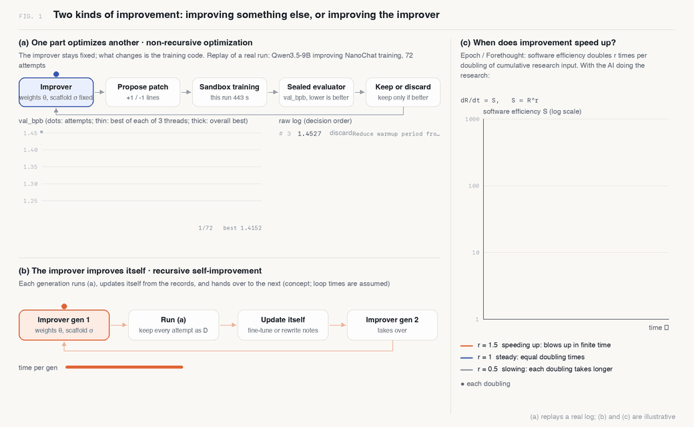

<!-- 此文件由 report/tools/build_content.py 自动生成，请勿直接修改。改 report/draft.md（摘要）或 report/sections/*.md（各节），再运行构建。 -->

# Recursive Self-Improvement in AI: A Survey of Claims, Evidence, and Empirical Tests

孙祺（Qi Sun）

## 中文

### 摘要

*总览图：不同自我更新方案的改进速度与原始模型对比。每一行代表一种自我更新方案；圆点表示该方案相对于原始模型（Qwen3.5-9B）的改进速度差值，横线为 95% 置信区间；灰色阴影带表示同一原始模型独立运行两次时的随机波动范围（±2 个标准差）。圆点落在 0 刻度线左侧即意味着比原始模型更慢。所有数据均测自 8 个未曾见过的小型研究任务 [1,2]。*

AI 已经参与模型、代码和训练流程的研发。但“AI 帮助改进某个对象”与“AI 让自己一代比一代更善于改进”是两个不同的主张。本文将后者称为递归自我改进（recursive self-improvement，RSI）：系统需要能够改变自身的改进机制，并在代际比较中提高改进速度 [3,4,5]。

本文梳理 RSI 的理论定义与相关学术工作，并分析 Recursive、Naive 和 Apex 发布的四份报告。它们展示了 AI 对训练代码、推理系统、模型结构或训练数据的改进，却没有报告后继模型接替改进者后是否变得更快。现有自训练研究通常报告模型性能变化，少有工作直接比较各代的改进速度；本次检索未发现模型权重层面的受控代际测量 [6,7]。

为检验这一步，我让 Qwen3.5-9B 先独立研究 NanoChat，再用研究记录训练后继模型，并在 8 个未见过的小型任务上比较各代的改进速度。固定的原始模型完成了有效的一阶改进：NanoChat 验证损失从 1.4152 降至 1.2308。跨代结果则不同：三代后继模型没有一代超过原始模型；成功记录微调出的模型也没有胜过失败记录安慰剂 [1,2]。

模型写给自己的经验笔记使改进速度下降约三分之一，在 8 个任务上均不如通用建议。让模型自行设计训练配方也没有产生稳定加速。补充实验显示，第一轮配方换随机种子重训后得分仍接近原结果（0.602 对 0.605）；第三轮的 0.392 因而不能归因于普通的种子波动。用 Qwen3.8-27B 设计配方得到 0.513，仍低于原始模型 [1,2]。

单代研究证明模型能够参与研发；后继模型在相同条件下更快地推进研发，才构成改进能力增长的证据。本研究提供了模型权重层面的测量案例，并观察到数据选择与训练强度会影响后继模型表现。

### 1. 什么才算 RSI

1965 年，I. J. Good 提出：如果机器在所有智力活动上都超越人类，它也应能设计更好的机器；继任者再重复这一过程，可能引发“智能爆炸” [8]。这一设想后来被称为递归自我改进（recursive self-improvement, RSI），但研究者至今仍未就其边界达成共识。2026 年专门讨论 RSI 的 ICLR workshop 也没有给出通用的形式化定义 [9]。

RSI 的关键在于改进循环是否回到改进者自身。Yudkowsky 将“系统优化自身”与“一个系统优化另一个对象”区分开来 [10,4]。若一个固定的模型持续改进训练代码或目标模型，它完成的是一阶研发进展；若更新后的系统接替研究者，并改变自己后续改进的能力，循环才具有递归性。即使系统能修改自身，也不保证进展持续。EURISKO 和自优化编译器等早期案例都曾取得改进，随后便停滞 [10]。

RSI 的定义还涉及两个不同问题：改进机制由谁控制，以及改进是否逐代加速。Tang 等人把前者作为形式边界：当数据选择、训练配方或其他改进机制仍位于 agent 外部时，过程属于一般迭代策略改进（GPI）；当系统能够内化并改写这些机制时，才符合他们对 RSI 的定义 [5]。这一界定回答“什么过程算 RSI”，并不预先回答它是否有效。

后一个问题需要测量。Yampolskiy 将自我修改分为自我修改、弱自我改进和递归自我改进三个层次 [4]。最高一层要求系统“越改越会改”，持续提升产生后继者的方法。Chalmers 将相关能力称为 self-amplifying capacity，即产生下一代的能力本身得到放大 [11]。若训练流程仍由人预先固定，自蒸馏或自博弈的任务分数衡量的是一阶表现，不是改进机制的递归增长〔推断〕[12,4,5]。

本文据此把证据分成两层。**一阶改进**是固定的研究者在给定预算内改善目标。Qwen3.5-9B 将 NanoChat 验证损失从 1.4152 降至 1.2308，就是一阶成果 [1]。**跨代改进**则比较继任研究者在相同任务和预算下的改进速度。若后继者的改进速度高于前代，才有直接证据表明改进能力正在增长。Weco 把这一门槛称为 ignition，AIDE² 据此设计了 ignition test [13,6]；HGM 则用后代表现衡量 agent 产生更强后继者的能力，并称其为 metaproductivity [14]。

*图 1 两类改进循环。(a) 固定的改进者持续改进另一个对象，属于非递归的一阶研发 [10]。图中回放 Qwen3.5-9B 改进 NanoChat 训练脚本的真实运行，共 72 次尝试 [1,15]。(b) 后继模型接替成为改进者，继续改进同一研发过程，只有在其改进能力随代际提升时才体现 RSI [4,5]。(c) $r$ 表示研发投入增加与软件效率增长之间的关系；曲线用于解释加速概念，并不代表本报告实验结果 [16,17]。*

宏观研究还用研发回报率 $r$ 描述投入与效率的关系。Epoch 和 Forethought 将 $r$ 定义为研发投入翻倍时软件效率的增长幅度；$r>1$ 对应投入翻倍带来的效率增益逐渐扩大 [16,17]。历史领域的估计跨度很大，现有工作也没有给出 LLM 研发的直接估计 [17]。本文测的是固定预算下的代际改进速度，不能与按累计研发投入定义的 $r$ 直接换算。两者都关注进展是否加速，度量对象则不同。

### 2. 公开报告

2026 年，Recursive、Naive 和 Apex 发布了四份 AI 参与研发的报告。它们分别展示自动搜索、推理系统优化、模型训练和自主设计训练流程，提供了当下 AI4AI 工作的几个具体切面。

*图 2　四份报告公开的信息。实心圆表示公开或具备，半圆表示部分公开，空心圆表示未公开或没有。依据各报告内容整理 [18,19,20,21,22,23]。*

#### Recursive：自动搜索与模型构建

First Steps 将自动搜索用于 NanoChat 训练代码、NanoGPT Speedrun 和 GPU kernel。报告称，NanoChat 验证损失从 0.9372 降至 0.9109，Speedrun 耗时从 79.7 秒降至 77.5 秒，SOL-ExecBench 平均分从 0.699 升至 0.754 [24,25,26,27,28,29,30,31,32]。不同指标体现了自动搜索在训练脚本、程序速度和内核优化上的应用。

Flint 把自动化研发推进到模型构建。Recursive 的 Eureka Machine 辅助训练了一个从零开始的语言模型，报告了模型规模、训练周期与推理效率 [33,34,35,36]。让 Flint 接手 Eureka Machine 的研发工作目前仍是后续方向 [21]。

#### Naive：从研究尝试到系统结果

NaiveRT 的日志保留了 151 次优化尝试，并报告投机解码耗时从 12.3 毫秒降至 3.4 毫秒 [37,38,39,40]。AutoWM 则给出系统级结果：由 N0.5-Flash 参与研发的世界模型在 WorldArena 得分 77.43 [41,42]。一份材料突出优化过程，另一份呈现模型研发后的基准表现。

#### Apex：自我改进的命名与代际证据

Apex 将其 AI4AI 工作称为“递归自我改进” [43,44]。报告中的 Sokoban 案例显示，Apex 设计的训练流程将 Qwen2.5-3B-Instruct 在 512 个关卡上的成功率从 11.7% 提高至 24.4% [45,46,47]。这是一项模型设计并运行强化学习训练的结果。若要判断代际递归，仍需测量后继 Apex 接手研发后能否比前代更快地设计有效训练。

四份报告记录了模型参与训练脚本、内核、推理系统和训练流程研发的成果。本文接下来关注它们尚未直接比较的一项结果：后继研究者的改进速度。

### 3. 跨代测量缺口

现有基准主要测量模型能否完成研究任务。RE-Bench 评估机器学习工程能力，MLE-bench 看模型能否在 Kaggle 竞赛中获奖，PaperBench 测试论文复现能力 [48,49,50]。这些基准回答的是“模型现在能做什么”。它们没有回答更难的问题：模型改进出的下一代，能不能更快地完成同类研发？METR 对 Anthropic 整体研发速度的估计达到约 1.9 倍，但其中包含人类研究员的贡献，不能直接归因于模型代际更替 [51]。

要测量递归改进，必须把后继模型放回同一研发流程，给它相同任务和预算，再与前代比较改进速度。相关研究涵盖了这项测量的不同部分：

| 工作 | 被改进对象 | 模型权重改变 | 比较代际改进速度 | 主要对照 |
|---|---|---|---|---|
| 自我训练（STaR、ReST-EM、SPIN） | 模型权重 | 是 | 否，主要报告每轮任务得分 | SFT 等训练基线 |
| STOP | 改进者代码 | 否 | 追踪改进者效用 | — |
| DGM | agent 代码 | 否 | 比较迭代后的终点得分 | 移除自我改进机制 |
| HGM | agent 代码 | 否 | 由后代表现估计改进能力 | 同预算系统比较 |
| AIDE² | 外层改进者代码 | 否 | 是，进行 ignition test | 多随机种子比较 |
| 本报告 | 模型权重与经验笔记 | 是 | 是，8 个未见任务、每项 5 个种子 | A/A、失败记录安慰剂、等量数据对照 |

（来源：[52,53,54,55,56,57,58,59,14,6,7]）

文献中的两类方法各有侧重。自训练会更新模型权重，但更新规则通常由研究者预先设定；代码自改进系统能改变搜索过程，却往往冻结底层模型。AIDE² 是少数直接测试“改进者能否改进自己”的工作，但改变的是 agent 脚手架，而非语言模型权重 [6]。因此，关于模型权重能否通过自身研发记录获得更强的研发能力，仍缺少直接比较。

这项测量需要多轮内层研发和跨代比较，成本高，噪声也会在两层选择过程中累积。若评测器能被改进者修改，结果还可能反映对指标的利用，而不是能力提升。STOP、DGM 和 METR 都记录过这类评测操纵 [58,56,60]。因此，跨代比较需要固定任务、预算和评测器，并将评测器与改进者隔离。

第 4 节在模型权重层面比较原始模型与后继模型在未见任务上的改进速度，并设置基线重复、失败记录安慰剂和等量数据对照。

### 4. 后继模型的改进速度

实验先测固定研究者在 NanoChat 上的一阶进展，再比较经验笔记、权重微调和自主配方训练出的模型在 8 个未见任务上的改进速度。

#### 任务与测量

初始改进者为 Qwen3.5-9B。第一项任务是 NanoChat：模型修改训练脚本，评估器在固定预算下训练并返回验证损失。第二项是 8 个未见过的小型研究任务，模型通过调整训练配置来降低验证损失。另有 8 个训练任务提供研究轨迹和经验笔记；这些任务不参与最终比较 [1,61,62]。

在未见任务上，每个改进者均进行 12 次尝试，每项任务使用同一组 5 个随机种子。改进速度分衡量 12 次尝试期间，模型逐步缩小初始表现与参考最优值之间差距的平均比例，范围为 0 到 1，越高表示有限尝试内取得的进展越多。比较按任务配对，置信区间通过 bootstrap 计算，$p$ 值来自配对符号翻转检验 [62]。

实验设置了原始模型重跑的 A/A 基线、被否决记录安慰剂、等量原始模型数据对照和随机配方对照。预先设定的判定规则要求差值为正、置信区间排除 0、效应超过 A/A 波动阈值，并优于对应对照 [62,63]。

*图 9　改进速度分的计算示意。阴影表示每次尝试后已缩小的差距；先对 12 次尝试和 5 个种子取平均，再在 8 个任务间配对比较。曲线为示意，不是实验数据 [62]。*

*图 11　各更新方案及其对照在 8 个未见研究任务上的改进速度分。蓝点为更新后的模型，橙点为对应对照，虚线为原始模型（0.588）。鼠标悬停可查看分数和来源 [63]。*

#### 固定改进者：明确的一阶进展

Qwen3.5-9B 运行 176.6 分钟，提出并评测 72 次尝试，NanoChat 验证损失累计下降 0.1844，从 1.4152 到 1.2308 [1]。评估噪声不足以解释这一变化。改进者在这段运行中保持不变，这项结果确立了一阶研发进展，跨代能力变化仍需由后继模型比较来判断。

*图 10　NanoChat 研究运行回放，依据事件日志重绘。上方显示当前最佳验证损失和单次评估结果，中间显示并行评估，下方显示模型的决策与提案。鼠标悬停可查看数值 [15,1]。*

#### 经验笔记：把局部经验写成通用规则会收窄搜索

模型阅读 8 个训练任务的记录后，写出一份 252 词的经验笔记。笔记给出固定的超参数调整顺序，并建议“忽略任何会让损失哪怕略微升高的改动”。把这份笔记附加到提示词后，改进速度从 0.588 降至 0.392，差值为 −0.196（95% CI [−0.383, −0.033]）。等长通用建议得到约 0.631；经验笔记在 8 项任务上全部落后于该对照，平均差值为 −0.239（95% CI [−0.420, −0.075]，$p=0.008$）[63]。

退化最大的任务包括二维分类、序列反转和上下文线性回归。这一模式符合笔记将局部成功概括成固定搜索顺序的解释。模型提炼出的经验没有改善新任务上的判断，让它更早排除了可能有用的探索方向。经验规则须经外部验证，才适合作为跨任务策略。

#### 权重更新：成功记录没有胜过失败记录

第一代模型使用原始模型采纳的研究记录微调；安慰剂使用数量相同的被否决记录，并采用相同训练设置。两者在未见任务上的改进速度几乎一致，第一代相对安慰剂只高 0.004（95% CI [−0.084, 0.080]，$p=0.91$）。这一对照没有显示模型从记录中学到了哪些研究假设有效。

第二、三代测试了更新后的模型是否能产生更有用的后续记录。为了控制数据量，后继模型新增的记录与原始模型对照组的记录数量相同，区别在于由哪一代模型生成。原始模型与三代后继的速度分依次为 0.588、0.537、0.573 和 0.487。第二代回到基线附近，第三代低于第二代 0.087（95% CI [−0.190, −0.005]，符号翻转检验 $p=0.0625$），但没有一代超过原始模型 [1,61,63]。

*图 12　三代后继模型及对照的数据来源。所有模型均从原始权重开始微调；第二、三代与对照组的数据量相同，新增记录由不同模型产生。右侧为未见任务上的改进速度 [63]。*

第一代与失败记录安慰剂几乎一致。把研究轨迹转成训练数据，没有让模型表现出更强的研究判断。

#### 自主配方：模型不能靠直觉判断怎样更新自己

模型在给定的选项范围内决定训练数据筛选规则和 LoRA 配方。原始模型盲选的第一轮得分为 0.605，看到一次训练任务反馈后设计的第二轮得分为 0.595，由第一轮微调模型设计的第三轮得分为 0.392。三个结果都低于原始模型的 0.588；第三轮比第二轮低 0.204（95% CI [−0.365, −0.065]，$p=0.008$）[1,63]。

第三轮配方与第一轮相似，增加了“只保留相对提升至少 1% 的记录”这一筛选条件。第一轮配方换随机种子复训得 0.602，接近原分数 0.605。Qwen3.8-27B 使用同一筛选规则和较轻训练，得分为 0.513，高于第三轮，低于原始模型和第二轮 [1,2]。

数据筛选与训练强度都会影响后继模型表现。本组设置没有将两者的因果贡献完全拆开。模型生成配方的有效性由后继模型的实际表现决定。

*图 14　三轮自主配方的设计者、数据筛选和训练设置，以及未见任务上的得分。第二轮与第三轮使用相同反馈信息，第三轮改由第一轮微调模型设计 [63,2]。*

#### 从 NanoChat 前沿继续探索

原始模型、第一代后继、失败记录安慰剂和带经验笔记的模型从同一个 NanoChat 最佳版本继续做 12 次尝试，每组重复 3 次。四组平均损失降幅分别为 0.0124、0.0203、0.0178 和 0.0110。组间差异均未达到统计显著 [64]。

在 Qwen3.5-9B 和本组微型任务上，经验笔记、轨迹微调与自主配方均未带来可测得的跨代加速。后继模型的研究能力应以其在新任务上的改进速度评估。

### 5. 相关研究的测量视角

### 经验能否迁移，取决于经验怎样被验证

本实验中，模型生成的经验笔记使改进速度下降；这与一些反思和记忆研究中的负面结果相呼应。ExpeL、Reflexion 和 ACE 都报告过未经可靠外部信号筛选的反思或上下文改写会降低表现 [65,66,67]。相反，正向结果通常把经验绑定到可核验对象：Sarukkai 等人检索成功轨迹，Voyager 保存通过自我验证的可执行技能 [68,69]。

跨任务复用经验需要两个条件：环境验证与任务匹配。第 4 节的笔记把局部经验转成跨任务规则，却没有经过新任务的独立检验，结果收窄了搜索空间。Ling 的经验库应保留任务条件和外部结果，并以可复现产物作为策略设计依据。

*图 18　加入反思、经验或记忆后的相对表现变化。不同研究使用的任务和指标不同，图中比较各自相对变化，不比较绝对分数。橙色表示下降，蓝色表示提升 [65,70,67,71,66,68,63]。*

#### 成功记录没有教会模型更好的研究判断

第一代成功记录微调模型与失败记录安慰剂几乎相同。这个结果与 Spurious Rewards 的发现相近：在 MATH-500 上，随机奖励取得了真实奖励大部分的提升 [72]。Mind the Gap 也发现，一些表面上的首轮自我改进来自格式遵循，而非任务能力本身 [73]。模型在更新后变好，仍需通过对照判断它是否学到了有效反馈中的信息。数据量、格式和行为激活都可能带来表面提升。

被否决记录构成安慰剂对照，用来区分训练造成的变化与有效研究信号带来的收益。在本实验中，成功记录微调没有带来更快的研究进展。

#### 任务得分与改进能力是两种结果

许多自训练研究报告的是模型在目标任务上的表现。SPIN 和 Self-Rewarding 等工作展示了迭代训练后部分指标继续上升，同时也报告边际收益递减或其他任务上的回退 [54,74]。这些结果有价值，这些结果回答特定任务表现如何变化，尚未直接检验更新后的模型能否更快改进下一项任务。

agent 层面的工作提供了相邻但不同的证据。DGM 显示，让被改进的 agent 执行下一轮代码修改能够提升终点结果 [56]。AIDE² 的 ignition test 则直接比较改进后的 coach 与人工构建的 coach，结果未能区分两者 [6]。这些研究把注意力从模型单次输出转向研发循环，但测量对象、改进机制和任务预算各不相同，不能直接与权重层面的分数作数值比较。

*图 19　自训练文献中的逐轮任务表现，与本报告测得的逐代改进速度。每项研究沿用其原论文指标；图中并列展示两类指标，不作绝对数值比较 [54,75,74,63]。*

宏观研发回报率模型描述累计投入与软件效率提升之间的关系。Epoch 与 Forethought 用 $r$ 表示研发投入翻倍时软件效率增加的幅度，历史领域的估计值差异较大，LLM 研发尚无直接估计 [16,17]。本报告在固定运行预算下比较各代研究者的改进速度，测量量与基于累计投入定义的 $r$ 不同。本实验因此回答一个局部问题：在当前条件下，后继模型能否让研究循环更快？

第 4 节把微调后的权重放回研究者位置，在固定任务和预算下比较改进速度，并设置 A/A、失败轨迹、等量数据和随机配方对照。后续研究可扩大模型与任务范围、增加独立训练重复，并直接优化后继者的研究速度。

### 6. Ling 的研究方向

如果目标是让 Ling 逐代提高研发能力，训练信号需要直接反映下一代是否更善于改进，并与下游任务表现区分开。本报告的实验表明，经验笔记和模型自选配方都可能把直觉上合理的筛选规则带入更新过程，却没有提高后继者的改进速度。一个可行方向，是让 Ling 提出更新方案，再用独立评估直接检验更新后的 Ling 是否更善于研发。

Ling-3.0-flash 已具备开展 agent 研究的基础：它是总参数 124B、激活参数 5.1B 的 MoE 模型，并在训练中使用了大量交互环境 [76]。蚂蚁的 Ring-1T 强化学习系统和 AReaL 异步训练框架提供了可衔接的训练基础设施 [77,78]。关键在于把研发任务、更新机制和代际评估纳入一个有可验证反馈的学习循环。

*图 20　Ling 的研究闭环。Ling 承担研发任务，并提出对训练数据、更新配方、研究环境或评测的修改。候选修改先在独立评估中比较；只有当它产生的后继在留出任务上表现出更高改进速度，修改才进入下一轮训练。代际结果同时训练 Ling 设计更新的能力。谱系档案保留模型权重、机制版本和相应评估结果。*

#### 把改进能力纳入训练目标

闭环包含四个相互依赖的部分：

| 部分 | 作用 | 设计要点 |
|---|---|---|
| 研发任务池 | 提供训练代码、推理内核、数据处理和配方设计等任务 | 覆盖不同类型，保留未见任务评估 |
| 机制仓库 | 版本化保存数据规则、训练配方、环境、评估器和代码 | Ling 可以提出修改，每项修改可追溯 |
| 独立评估 | 测量修改后的后继能否更快改进 | 采用固定预算、成对任务和封存测试数据 |
| 更新与谱系 | 根据通过评估的方案训练后继，并保留每代状态 | 记录权重、机制版本、数据来源及代际表现 |

关键测量沿用第 4 节的思路：训练候选后继，再把它放回改进者的位置，与对照模型在留出研发任务上比较。这样，Ling 获得的反馈对应于“这项修改是否让后继更善于改进”，而非“提案听起来是否合理”或“某个单次基准是否变好”。DGM 的自修改框架、SEAL 的外层强化学习，以及 AIDE² 的 ignition 测试分别提供了可借鉴的组件 [56,79,6]。

#### 从可验证任务起步

初期可优先选择评估信号明确的任务，例如推理内核正确性与速度、固定预算下的训练配方。Ling 先提出一个机制改动，系统在同一任务与预算下构造有改动和无改动的后继，测量二者的改进速度差。只有可复现的正向结果才进入训练数据；失败和无效提案同样保留，作为后续对照。随着测量可靠性提高，再逐步开放更复杂的机制修改，包括环境和评测设计。

训练目标也应从“提出更新”推进到“提出可被验证的更新”。把每项提案的后继表现作为外层学习信号，可以训练 Ling 选择数据、配方和研究环境的能力。奖励应来自独立任务上的代际比较，以避免模型只优化自己编写的评估器。

#### 何时称得上进展

Ling 的每一代都应在固定预算的留出研发任务上与前代和对照比较，并报告任务配对的改进速度、独立训练重复和不确定区间。若后继模型持续更快地改进，而这一优势跨任务和随机种子复现，才有证据支持“越改越会改”。任务得分、生成的研究记录数量或模型自述，都不能替代这一测量。

## English

### Abstract

*Overview. Improvement speed by update method relative to the original model. Each row shows one update method. The dot is its difference from the original Qwen3.5-9B, with a 95% confidence interval. The shaded band shows baseline variation when the original model runs twice (±2 SD). A value left of zero means slower improvement. Scores come from eight unseen micro-research tasks [1,2].*

AI systems now help develop models, code, and training pipelines. But helping improve an object is different from making the improver itself better at improving. I use *recursive self-improvement* (RSI) for the stronger claim: a system can change its own improvement mechanism, and successive generations increase the speed of improvement [3,4,5].

I review theoretical definitions, related academic work, and four public reports from Recursive, Naive, and Apex. These reports describe AI improving training code, inference systems, model architectures, or training data. They do not show whether a successor becomes a faster improver. Self-training studies generally report changes in model performance rather than generation-to-generation improvement speed. This review found no controlled measurement of this kind at the level of model weights [6,7].

To measure the gap, Qwen3.5-9B first conducted research on NanoChat. Successors trained on its records were then compared on eight unseen micro-tasks. The fixed original model achieved a clear first-order improvement, lowering NanoChat validation loss from 1.4152 to 1.2308. The cross-generation result was different: none of the three successors improved faster than the original, and fine-tuning on accepted records did not outperform a placebo trained on rejected records [1,2].

A lessons note written from the model's own experience reduced improvement speed by about a third and underperformed generic advice on all eight tasks. Letting the model design its training recipe also produced no reliable acceleration. A new-seed rerun of the Round-1 recipe scored 0.602, close to its original 0.605, so ordinary seed variation does not explain Round 3's 0.392. A recipe designed by Qwen3.8-27B scored 0.513, still below the original model [1,2].

AI-assisted research can produce first-order gains. Evidence of recursive improvement requires successors to advance research faster than their predecessors. This study measures improvement at the model-weight level and finds successor performance sensitive to data selection and training intensity. An update succeeds when the resulting researcher improves faster.

### 1. What counts as RSI

In 1965, I. J. Good argued that a machine capable of surpassing humans across intellectual tasks should also be able to design better machines. Successors repeating this process could trigger an "intelligence explosion" [8]. The idea became known as recursive self-improvement (RSI), but researchers still disagree on its boundaries. An ICLR workshop devoted to RSI in 2026 likewise stopped short of a general formal definition [9].

The central question is whether the improvement loop returns to the improver. Yudkowsky distinguishes a system optimizing itself from one system optimizing a separate object [10,4]. A fixed model that repeatedly improves training code or a target model makes first-order research progress. The loop becomes recursive when an updated system takes over as the researcher and changes its own capacity to make further improvements. Self-modification alone does not guarantee continued progress. Early examples such as EURISKO and optimizing compilers improved themselves before stalling [10].

Two questions are often bundled together: who controls the improvement mechanism, and whether improvement accelerates across generations. Tang et al. use the first as a formal boundary. When data selection, training recipes, or other mechanisms remain outside the agent, the process is general iterative policy improvement (GPI). It qualifies as RSI under their definition only when the system can internalize and rewrite those mechanisms [5]. This definition answers what counts as RSI, not whether RSI works.

Effectiveness requires a separate measurement. Yampolskiy distinguishes self-modification, weak self-improvement, and recursive self-improvement [4]. The highest level requires more than tuning the system. The system must get better at getting better by improving how it produces successors. Chalmers calls the relevant capacity self-amplifying capacity, the capacity to produce the next generation [11]. When people fix the training process in advance, self-distillation and self-play task scores support a first-order performance claim. Recursive improvement requires evidence that the update mechanism itself strengthens across generations (an inference) [12,4,5].

This report separates the evidence into two levels. **First-order improvement** occurs when a fixed researcher improves a target under a given budget. Qwen3.5-9B lowering NanoChat validation loss from 1.4152 to 1.2308 is a first-order result [1]. **Cross-generation improvement** compares the speed of successor researchers under the same tasks and budget. A successor that improves faster than its predecessor provides direct evidence that the capacity to improve is growing. Weco calls this threshold ignition, and AIDE² operationalizes it with an ignition test [13,6]. HGM measures an agent's capacity to produce stronger descendants as metaproductivity [14].

*Figure 1. Two kinds of improvement loop. (a) A fixed improver keeps improving another object, which is non-recursive, first-order R&D [10]. The panel replays a real run of Qwen3.5-9B improving the NanoChat training script, 72 attempts in all [1,15]. (b) The successor model takes over as the improver and keeps improving the same R&D process; this counts as RSI only if its ability to improve rises across generations [4,5]. (c) $r$ describes how software efficiency grows as R&D input increases; the curves illustrate the idea of acceleration and are not results of this report's experiment [16,17].*

Macro-level work also uses the R&D return parameter $r$ to describe the relation between research input and efficiency. Epoch and Forethought define $r$ in terms of the efficiency gain associated with a doubling of R&D input. Values above 1 correspond to increasingly large efficiency gains per doubling [16,17]. Historical estimates vary widely, and no direct estimate is available for LLM research [17]. This report measures generational improvement speed under a fixed budget, which cannot be converted directly into $r$, defined over cumulative research input. The two measures address acceleration but quantify different things.

### 2. The public reports

In 2026, Recursive, Naive, and Apex published four reports on AI-assisted R&D. They offer distinct views of current AI4AI work, including automated search, inference optimization, model training, and model-designed training procedures.

*Figure 2. Information disclosed across the four reports. Filled circles indicate disclosed or available information, half-filled circles indicate partial disclosure, and open circles indicate information that is absent. Compiled from the reports [18,19,20,21,22,23].*

#### Recursive: automated search and model development

First Steps applies automated search to NanoChat training code, NanoGPT Speedrun, and GPU kernels. It reports lowering NanoChat validation loss from 0.9372 to 0.9109, reducing Speedrun time from 79.7 to 77.5 seconds, and raising the mean SOL-ExecBench score from 0.699 to 0.754 [24,25,26,27,28,29,30,31,32]. These metrics span training scripts, program speed, and kernel optimization.

Flint extends automated R&D to model development. Recursive's Eureka Machine helped train a language model from scratch, and the report gives its scale, training timeline, and inference efficiency [33,34,35,36]. Having Flint take over development of Eureka Machine remains future work [21].

#### Naive: from research attempts to system results

NaiveRT's logs preserve 151 optimization attempts and report reducing speculative decoding time from 12.3 to 3.4 milliseconds [37,38,39,40]. AutoWM presents a system-level result: the world model developed with N0.5-Flash scored 77.43 on WorldArena [41,42]. One report foregrounds the optimization process, the other the benchmark performance of a model developed with AI assistance.

#### Apex: the label and the generational evidence

Apex describes its AI4AI work as "recursive self-improvement" [43,44]. Its Sokoban case reports that an Apex-designed training procedure raised Qwen2.5-3B-Instruct's success rate from 11.7% to 24.4% on 512 levels [45,46,47]. This is a result from a model designing and running a reinforcement-learning experiment. Testing generational recursion requires measuring whether a successor Apex can take over and design effective training faster than its predecessor.

Together, the reports document AI contributions to training scripts, kernels, inference systems, and training procedures. The next result considered here is the one they do not directly compare: the improvement speed of successor researchers.

### 3. The cross-generation measurement gap

Current benchmarks mostly measure whether a model can perform research tasks. RE-Bench evaluates machine-learning engineering, MLE-bench tracks medals in Kaggle competitions, and PaperBench tests paper reproduction [48,49,50]. They answer what a model can do now. They do not answer whether a successor produced through research can do the same work faster. METR estimates that Anthropic's overall R&D pace has increased by about 1.9 times, but that figure includes human researchers and cannot isolate the effect of model succession [51].

A direct test of recursive improvement places a successor back in the same research process, gives it the same tasks and budget, and compares its speed of improvement with its predecessor. Existing work reaches different parts of this test:

| Work | What is improved | Model weights change | Compares improvement speed across generations | Main control |
|---|---|---|---|---|
| Self-training (STaR, ReST-EM, SPIN) | Model weights | Yes | No, mainly reports task scores by round | SFT and related baselines |
| STOP | Improver code | No | Tracks improver utility | — |
| DGM | Agent code | No | Compares final scores after iteration | Ablation without self-improvement |
| HGM | Agent code | No | Estimates improvement ability from descendants | Same-budget systems |
| AIDE² | Outer improver code | No | Yes, an ignition test | Multiple random seeds |
| This report | Model weights and lessons note | Yes | Yes, 8 unseen tasks with 5 seeds each | A/A, rejected-record placebo, equal-data control |

(Sources: [52,53,54,55,56,57,58,59,14,6,7])

The literature has two broad approaches. Self-training changes model weights, but researchers usually specify the update rule in advance. Code-modifying systems can change the search procedure, but often keep the underlying language model fixed. AIDE² is among the few studies to test whether an improver can improve itself, but it modifies the agent scaffold rather than the language-model weights [6]. Whether a model can use its own research records to become a stronger researcher therefore remains an open empirical question.

The measurement is difficult for practical reasons. Inner research runs are expensive, and outer comparisons must be repeated across generations. Noise compounds across both stages. If the improver can alter the evaluator, a higher score may reflect metric exploitation rather than better research. STOP, DGM, and METR document examples of this problem [58,56,60]. A meaningful comparison therefore needs fixed tasks and budgets, plus an evaluator isolated from the improver.

Section 4 tests this question at the level of model weights. The original model and its successors work on the same unseen tasks under a fixed budget, with a repeated baseline, a rejected-record placebo, and an equal-data control.

### 4. Successor improvement speed

### Tasks and measurement

The initial improver was Qwen3.5-9B. The first task was NanoChat: the model edited the training script, and an evaluator trained each candidate under a fixed budget and returned its validation loss. The second suite contained eight unseen micro-research tasks, where the model reduced validation loss by adjusting training configurations. A separate set of eight training tasks supplied trajectories and lessons notes but did not enter the final comparisons [1,61,62].

On the unseen tasks, each improver made 12 attempts, using the same five random seeds for each task. The improvement-speed score measures the average fraction of the gap between the starting performance and a reference optimum closed over those attempts. It ranges from 0 to 1, with higher scores indicating more progress within the fixed budget. Comparisons are paired by task, confidence intervals use bootstrap, and $p$-values come from paired sign-flip tests [62].

Controls distinguish learning useful research judgment from changing the data or the model's output habits. They include an A/A rerun of the original model, a placebo trained on rejected records, equal-volume data produced by the original model, and random recipes. The decision rule was set in advance: a positive difference, a confidence interval excluding zero, an effect larger than A/A variation, and an advantage over the matched control were all required to detect second-order improvement [62,63].

*Figure 9. Schematic of the improvement-speed score. Shading shows the gap closed after each attempt, the score averages over 12 attempts and five seeds, then compares improvers task by task across eight tasks. Curves are illustrative, not experimental data [62].*

*Figure 11. Improvement-speed scores on eight unseen research tasks for each update method and its control. Blue dots show updated models, orange dots show controls, and the dashed line marks the original model (0.588). Hover for scores and sources [63].*

#### A fixed improver: clear first-order progress

Qwen3.5-9B ran for 176.6 minutes and proposed and evaluated 72 attempts, lowering NanoChat validation loss by 0.1844, from 1.4152 to 1.2308 [1]. Evaluation noise does not account for this change. Because the improver remained fixed, this establishes first-order progress. Cross-generation change requires a comparison between successors.

*Figure 10. Replay of the NanoChat research run, reconstructed from the event log. The top shows the best validation loss and individual evaluations, the middle shows parallel evaluations, and the bottom shows the model's decisions and proposals. Hover for values [15,1].*

#### Lessons note: local experience became a general rule

After reading records from eight training tasks, the model wrote a 252-word lessons note. It prescribed a fixed order for adjusting hyperparameters and advised: “Ignore changes that increase loss even slightly.” Adding the note to the prompt lowered improvement speed from 0.588 to 0.392, a difference of −0.196 (95% CI [−0.383, −0.033]). Equal-length generic advice scored about 0.631. The lessons note trailed this control on all eight tasks, by a mean of −0.239 (95% CI [−0.420, −0.075], $p=0.008$) [63].

The largest drops occurred on 2-D classification, sequence reversal, and in-context linear regression. This pattern is consistent with the note turning local successes on the training tasks into a fixed search order. The experience did not help the model judge new tasks. It led the model to rule out potentially useful exploration earlier. Experience can guide cross-task search when its rules have been independently validated.

#### Weight updates: accepted records did not beat rejected records

Generation 1 was fine-tuned on research records accepted by the original model. Its placebo was trained on an equal number of rejected records under the same settings. The two models were nearly identical on unseen tasks: Generation 1 was ahead by 0.004 (95% CI [−0.084, 0.080], $p=0.91$). This comparison offers no evidence that the model learned which research hypotheses were effective from these records.

Generations 2 and 3 tested whether an updated model could produce more useful records for the next successor. To control data volume, the successor and original-model control received equal numbers of new records, generated by different models. The original and three successors scored 0.588, 0.537, 0.573, and 0.487. Generation 2 returned close to baseline, Generation 3 scored 0.087 below Generation 2 (95% CI [−0.190, −0.005], sign-flip $p=0.0625$). No generation exceeded the original model [1,61,63].

*Figure 12. Data sources for the three successors and their controls. All models were fine-tuned from the original weights. Generations 2 and 3 and their controls received equal data volumes, with the added records produced by different models. The right side shows improvement speed on unseen tasks [63].*

Across three generations, no repeatable cross-generation acceleration appeared. Generation 1's similarity to the rejected-record placebo also shows that converting model-generated research traces into training data did not teach the model to distinguish effective from ineffective research decisions.

#### Self-designed recipes: intuition did not identify a better update

The model then chose data filters and LoRA settings from a predefined option space. The original model's first recipe scored 0.605, a second recipe designed after seeing one round of training-task feedback scored 0.595, a third recipe designed by the first fine-tuned model scored 0.392. None exceeded the original model's 0.588. The third recipe scored 0.204 below the second (95% CI [−0.365, −0.065], $p=0.008$) [1,63].

The third recipe resembled the first but added a filter that kept only records with at least 1% relative gain. Retraining the first recipe with a new seed yielded 0.602, close to its original 0.605, so ordinary seed variation cannot explain the gap between rounds 1 and 3. Qwen3.8-27B used the same filter with lighter training and scored 0.513. It did better than round 3 but remained below the original and round-2 models [1,2].

The recipe comparisons show that data selection and training intensity both affect successor performance. The settings do not isolate each factor. Successor performance is the criterion for judging a recipe.

*Figure 14. The designers, data filters, training settings, and unseen-task scores for the three self-designed recipes. Rounds 2 and 3 received the same feedback, but round 3's designer was the round-1 fine-tuned model [63,2].*

#### Continuing from the NanoChat frontier

The original model, Generation 1, the rejected-record placebo, and the model with the lessons note continued from the same best NanoChat checkpoint for 12 attempts, with three runs per group. Their mean loss reductions were 0.0124, 0.0203, 0.0178, and 0.0110. Group differences were not statistically significant [64].

Under these conditions, lessons notes, trajectory fine-tuning, and self-designed recipes did not increase successor improvement speed. Successor research ability should be evaluated on new tasks.

### 5. Measurement in related work

### Experience transfers only when it is validated

The model-written lessons note lowered improvement speed, echoing negative results in studies of reflection and memory. ExpeL, Reflexion, and ACE report performance drops when reflections or context rewrites lack reliable external filtering [65,66,67]. Positive results tend to tie experience to verifiable artifacts: Sarukkai et al. retrieve successful trajectories, while Voyager stores executable skills that pass self-verification [68,69].

Useful memories can be checked against the environment and matched to the task at hand. The note in Section 4 turned local training experience into a cross-task rule without testing it on new tasks, narrowing the search space. For Ling, an experience store should preserve reproducible artifacts with task conditions and external outcomes.

*Figure 18. Relative performance after adding reflection, experience, or memory. Tasks and metrics differ across studies, so the figure compares relative changes rather than absolute scores. Orange indicates a drop and blue a gain [65,70,67,71,66,68,63].*

#### Accepted records did not teach research judgment

The first successor fine-tuned on accepted records performed almost identically to the rejected-record placebo. This resembles Spurious Rewards, where random rewards captured most of the gain of true rewards on MATH-500 [72]. Mind the Gap likewise found that some apparent first-round self-improvement came from better format following rather than task ability [73]. A score increase after an update does not show that the model learned useful information from feedback. Data volume, formatting, and behavior activation require controls.

Rejected records serve as a placebo, separating generic effects of training from gains due to useful research signals. Fine-tuning on accepted records did not produce faster research progress in this experiment.

#### Task scores and improvement ability measure different outcomes

Many self-training studies report model performance on the target task. SPIN and Self-Rewarding show that some metrics continue to rise across iterations, while also reporting diminishing gains or regressions on other tasks [54,74]. These findings matter, but they describe changes in task performance. They do not directly test whether an updated model can improve the next task faster.

Agent-level work offers adjacent but distinct evidence. DGM shows that letting an improved agent perform the next round of code edits can raise the final result [56]. AIDE²'s ignition test directly compares an evolved coach with a hand-built coach, but does not distinguish them [6]. These studies shift attention from a model's isolated output to the R&D loop, yet their targets, update mechanisms, and budgets differ. Their scores cannot be compared numerically with weight-level improvement-speed scores.

*Figure 19. Per-round task performance in self-training studies alongside the generational improvement-speed scores measured here. Each study retains its original metric. The panels show distinct measures and are not on a common scale [54,75,74,63].*

Macro models of R&D returns describe the relation between cumulative input and software efficiency. Epoch and Forethought use $r$ to represent the efficiency gain associated with a doubling of research input. Historical estimates vary across fields, and there is no direct estimate for LLM research [16,17]. This report fixes the budget per run and compares improvement speed across generations. That is not the same quantity as $r$, which is defined over cumulative input. The null result here therefore cannot be converted into an estimate of $r$. It does answer a more local question: under these conditions, did a successor make the research loop faster?

Section 4 compares fine-tuned researchers under fixed tasks and budgets, with A/A, rejected-trajectory, equal-volume data, and random-recipe controls. Further work can extend the model and task range, add independent training runs, and optimize successor research speed.

### 6. A research direction for Ling

If the goal is for Ling to improve its research ability across generations, training must reward whether the next generation becomes a better improver, alongside downstream task performance. The experiments in this report show that lessons notes and self-designed recipes can carry intuitive but harmful filters into an update without increasing successor improvement speed. One direction is to let Ling propose updates, then test directly whether the resulting Ling is better at research.

Ling-3.0-flash has a foundation for agent research: it is a MoE model with 124B total and 5.1B active parameters, trained with a large set of interactive environments [76]. Ant's Ring-1T reinforcement-learning system and AReaL asynchronous training framework offer infrastructure that could support the loop [77,78]. The key is to connect research tasks, update mechanisms, and generational evaluation through verifiable feedback.

*Figure 20. Ling's research loop. Ling works on R&D tasks and proposes changes to training data, update recipes, research environments, or evaluations. Candidate changes are tested independently, a change advances only when its successor improves faster on held-out tasks. Generational results also train Ling's ability to design updates. The lineage archive retains model weights, mechanism versions, and evaluation results.*

#### Include improvement ability in the training objective

The loop has four interdependent parts:

| Part | Role | Design point |
|---|---|---|
| R&D task pool | Supplies tasks in training code, inference kernels, data processing, and recipe design | Cover varied task types and retain held-out evaluations |
| Mechanism repository | Versions data rules, training recipes, environments, evaluators, and code | Ling can propose changes, and each change is traceable |
| Independent evaluation | Measures whether a change produces a faster-improving successor | Use fixed budgets, paired tasks, and sealed test data |
| Update and lineage | Trains successors from evaluated changes and retains each generation | Record weights, mechanism versions, data sources, and generational results |

The key measurement follows Section 4: train a candidate successor, put it back in the improver role, and compare it with a control on held-out R&D tasks. Ling's feedback then answers whether a change made the successor better at improving, rather than whether the proposal sounded plausible or a single benchmark improved. DGM's self-modification framework, SEAL's outer-loop reinforcement learning, and AIDE²'s ignition test offer components to build on [56,79,6].

#### Start with verifiable tasks

Early tasks can prioritize clear evaluation signals, such as inference-kernel correctness and speed or training recipes under a fixed budget. Ling proposes a mechanism change, and the system constructs successors with and without that change under the same task and budget. Only reproducible positive results advance to training, failed and ineffective proposals remain available as controls. As measurement becomes reliable, the system can open more complex mechanisms to modification, including research environments and evaluation design.

The objective should move from "propose an update" to "propose an update that survives evaluation." Using successor performance as an outer-loop learning signal can train Ling to choose data, recipes, and research environments. The reward should come from generational comparisons on independent tasks, so the model cannot simply optimize an evaluator that it wrote itself.

#### What would count as progress

Each Ling generation should be compared with its predecessor and a control on held-out R&D tasks under a fixed budget, with task-paired improvement-speed scores, independent training runs, and uncertainty intervals. Repeated gains across tasks and random seeds would support the claim that Ling is getting better at improving. Task scores, the number of generated research records, and the model's own description of its progress cannot replace this measurement.

## 参考文献 / References

1. RSI-mini 实验总日志，E 节（实验结果） — research/REPORT_LOG.md
2. 各项比较的效应、95% 置信区间与置换检验（11-18 14:20 导出，含两个补充实验） — research/decisions/decisions_1420.json
3. Schmidhuber (2003/2006), "Gödel Machines: Self-Referential Universal Problem Solvers Making Provably Optimal Self-Improvements", arXiv cs/0309048 v5；相关版本发表于 LNCS 3394 (2005)、ICANN 2005，以及 *Artificial General Intelligence* (Springer 2006) — Preprint（另有 PR 版本） — https://arxiv.org/abs/cs/0309048
4. Yampolskiy (2015), "From Seed AI to Technological Singularity via Recursively Self-Improving Software", arXiv 1502.06512 — Preprint。有二手来源称它在 AGI-15 以 PR 形式发表，本次未核实 — https://arxiv.org/abs/1502.06512
5. Tang, Ma, Li & Yuan (2026), "Generalized Agent Iteration: One Formal Framework for Iterative Policy Improvement and Recursive Self-Improvement", arXiv 2609.13406 v2 — Preprint — https://arxiv.org/abs/2609.13406
6. Srikanth, Zhao, Xu, Wu, Jiang, Recursive self-improvement of AI research agents（AIDE²，Weco AI，2026-09） — preprint — https://arxiv.org/abs/2609.26457
7. 学术界如何看 RSI：约 96 个来源的文献综述汇总（§1，§6，§4–6） — research/lit_rsi_academic.md
8. I. J. Good (1965), "Speculations Concerning the First Ultraintelligent Machine", *Advances in Computers* 6 — PR（书章）。原文是扫描版，无法抽取文字；下面的段落按 Chalmers 2010 和 Yudkowsky 2013 的逐字转引核对 — https://www.stat.vt.edu/content/dam/stat_vt_edu/graphics-and-pdfs/research-papers/Technical_Reports/TechReport05-3.pdf
9. ICLR 2026 Workshop on AI with Recursive Self-Improvement（Rio de Janeiro，2026-04-26；组织者包括 Zhuge、Zeng、Schmidhuber 等） — 工作坊（会议存在已核实；是否 archival 页面上没写） — https://recursive-workshop.github.io/ https://iclr.cc/virtual/2026/workshop/10000796
10. Yudkowsky (2008), "Recursive Self-Improvement", LessWrong — Essay/Blog — https://www.lesswrong.com/posts/JBadX7rwdcRFzGuju/recursive-self-improvement
11. Chalmers (2010), "The Singularity: A Philosophical Analysis", *Journal of Consciousness Studies* 17:7–65 — PR（期刊） — https://consc.net/papers/singularity.pdf
12. Mahoney (2008, rev. 2010), "A Model for Recursively Self Improving Programs" — Preprint（个人草稿，未发表） — https://mattmahoney.net/rsi.pdf
13. Weco AI 博客，网址路径为 first-evidence-of-recursive-self-improvement（页面标题未逐字核对）。文中引用的 Level 2 原话 "ignition, when the system improves its own ability to improve itself" 摘自 `research/platform_design.md` 第 69 行的记录 — 公司博客 — https://weco.ai/blog/first-evidence-of-recursive-self-improvement
14. Wang et al. (incl. Schmidhuber), Huxley-Gödel Machine（2025-10） — preprint — https://arxiv.org/abs/2510.21614
15. Qwen3.5-9B 在 NanoChat 上研究运行的逐事件日志（提案、评测、判定） — research/replay/final/ovn1118b-nc-g0/events.jsonl
16. Besiroglu, Erdil & Ho (2024), "Do the Returns to Software R&D Point Towards a Singularity?", Epoch AI — Essay/Blog（研究机构），基于 Erdil, Besiroglu & Ho, "Estimating Idea Production: A Methodological Survey", arXiv 2405.10494 — https://epoch.ai/blog/do-the-returns-to-software-rnd-point-towards-a-singularity
17. Eth & Davidson (2025), "Will AI R&D Automation Cause a Software Intelligence Explosion?", Forethought — Preprint/Essay（研究机构） — https://www.forethought.org/research/will-ai-r-and-d-automation-cause-a-software-intelligence-explosion
18. Recursive, "First Steps Toward Automated AI Research"，核对记录第 9 条：未披露：使用的 LLM、agent 角色、是否改写自身 scaffold、迭代次数、算力/GPU-hours/成本。 — 证据台账 · 不一致 / 待核 — https://recursive.com/updates/first-steps-toward-automated-ai-research
19. NaiveAI, "Naive-N0.5-Flash: Building Frontier AI with AI"，核对记录第 2 条：评测 harness 不同：NV-23~25 是 Naive 用自家 in-house AutoResearch harness 跑的，Recursive 一侧数值来自其文章与 leaderboard，不是同 harness 对比。 — 证据台账 · 不一致 / 待核 — https://naive.ai/en/research/
20. NaiveAI, "Naive-N0.5-Flash: Building Frontier AI with AI"，核对记录第 6 条："AI models" 未具名：架构与 NaiveRT 部分只说 "AI models"；只有 AutoWM 明确由 Naive-N0.5-Flash 执行。 — 证据台账 · 不一致 / 待核 — https://naive.ai/en/research/
21. Recursive, "Introducing Flint"，核对记录第 7 条：Eureka Machine 贡献比例未量化："helped develop nearly every part"，无逐组件拆分；"Our bet is…" 明确是押注而非已证结果。 — 证据台账 · 不一致 / 待核 — https://recursive.com/updates/introducing-recursive-flint
22. Apex Intelligence, "Introducing Apex-35B-V1.0"，核对记录第 10 条：Apex Research 由哪个模型驱动、迭代几轮、接受标准、人工介入程度、算力——均未说明。Sokoban 例中 "we identified 36…" 表明是人工事后标注。 — 证据台账 · 不一致 / 待核 — https://www.apexin.com/apex-35b/#ai
23. Apex Intelligence, "Introducing Apex-35B-V1.0"，运行次数：pass@1（每任务一次）（原文："Every task is run once (pass@1)."） — 证据台账 AX-43 · 自报 — https://www.apexin.com/apex-35b/#ai
24. Recursive, "First Steps Toward Automated AI Research"，NanoChat 预算：5 minutes / single GPU（原文："within a fixed five-minute budget on a single GPU"） — 证据台账 RF-02 · 自报 — https://recursive.com/updates/first-steps-toward-automated-ai-research
25. Recursive, "First Steps Toward Automated AI Research"，原 SOTA BPB（去除 minor reward hacks 后社区最佳的 10-seed 均值）：0.9372（原文："its mean performance is 0.9372 BPB"） — 证据台账 RF-05 · 自报 — https://recursive.com/updates/first-steps-toward-automated-ai-research
26. Recursive, "First Steps Toward Automated AI Research"，Recursive NanoChat BPB：0.9109（原文："Our system found a solution that reached 0.9109 BPB"） — 证据台账 RF-06 · 自报 — https://recursive.com/updates/first-steps-toward-automated-ai-research
27. Recursive, "First Steps Toward Automated AI Research"，达到同等 loss 所需训练时间缩短：1.3x（原文："roughly 1.3x less training time than the best autoresearch@home solution"） — 证据台账 RF-08 · 自报 — https://recursive.com/updates/first-steps-toward-automated-ai-research
28. Recursive, "First Steps Toward Automated AI Research"，speedrun 目标 val loss：3.28（原文："Training time required to reach a 3.28 validation loss"） — 证据台账 RF-11 · 自报 — https://recursive.com/updates/first-steps-toward-automated-ai-research
29. Recursive, "First Steps Toward Automated AI Research"，Recursive speedrun 结果：79.7 → 77.5 s（原文："reduced training time from 79.7 seconds to 77.5 seconds"） — 证据台账 RF-17 · 自报 — https://recursive.com/updates/first-steps-toward-automated-ai-research
30. Recursive, "First Steps Toward Automated AI Research"，SOL-ExecBench kernel 任务数：235（原文："The benchmark contains 235 kernel-writing tasks derived from real workloads."） — 证据台账 RF-23 · 自报（benchmark 属性，源自 NVIDIA） — https://recursive.com/updates/first-steps-toward-automated-ai-research
31. Recursive, "First Steps Toward Automated AI Research"，原 SOL leaderboard 最佳：0.699（原文："from the previous leaderboard best of 0.699"） — 证据台账 RF-25 · 自报 — https://recursive.com/updates/first-steps-toward-automated-ai-research
32. Recursive, "First Steps Toward Automated AI Research"，Recursive mean SOL score：0.754（原文："achieved a mean NVIDIA SOL-ExecBench score of 0.754"） — 证据台账 RF-26 · 自报 — https://recursive.com/updates/first-steps-toward-automated-ai-research
33. Recursive, "Introducing Flint"，总参数：40B（原文："Flint has 40 billion total parameters and activates just 2.5 billion per token."） — 证据台账 FL-01 · 自报 — https://recursive.com/updates/introducing-recursive-flint
34. Recursive, "Introducing Flint"，每 token 激活参数：2.5B（原文：同上） — 证据台账 FL-02 · 自报 — https://recursive.com/updates/introducing-recursive-flint
35. Recursive, "Introducing Flint"，从零构建耗时：under 4 months（原文："built it from scratch in under four months"） — 证据台账 FL-03 · 自报 — https://recursive.com/updates/introducing-recursive-flint
36. Recursive, "Introducing Flint"，M4 Pro MacBook Pro decode 速度：>125 tok/s（原文："more than 125 tokens per second on an M4 Pro MacBook Pro"） — 证据台账 FL-07 · 自报 — https://recursive.com/updates/introducing-recursive-flint
37. NaiveAI, "Naive-N0.5-Flash: Building Frontier AI with AI"，完整 speculative round：NaiveRT vs SGLang：3.4 ms vs 12.3 ms（原文："from 12.3 ms under SGLang to 3.4 ms, a 72.4% reduction"） — 证据台账 NV-43 · 自报 — https://naive.ai/en/research/
38. NaiveAI, "Naive-N0.5-Flash: Building Frontier AI with AI"，构建周期：six days（原文："built in six days by human researchers working with AI models"） — 证据台账 NV-45 · 自报 — https://naive.ai/en/research/
39. NaiveAI, "Naive-N0.5-Flash: Building Frontier AI with AI"，有记录的优化 trial 数：151（原文："across 151 documented optimization trials"） — 证据台账 NV-46 · 自报 — https://naive.ai/en/research/
40. NaiveAI, "Naive-N0.5-Flash: Building Frontier AI with AI"，adopted / failed 或 rolled back / exploratory：63 / 71 / 17（原文："63 produced changes that were adopted." "71 failed validation or were rolled back."） — 证据台账 NV-60 · 自报（推算核对：43+45+63=151；28+15+20=63；63+71+17=151） — https://naive.ai/en/research/
41. NaiveAI, "Naive-N0.5-Flash: Building Frontier AI with AI"，累计研究时间：400 hours（原文："After 400 hours of cumulative research and 15 major experimental rounds"） — 证据台账 NV-69 · 自报 — https://naive.ai/en/research/
42. NaiveAI, "Naive-N0.5-Flash: Building Frontier AI with AI"，AutoWM 在 WorldArena-1 Track 1 的分数（EWMScore）：77.43（原文："reached a score of 77.43 under the public WorldArena-1 Track 1 evaluation protocol"） — 证据台账 NV-71 · 自报 — https://naive.ai/en/research/
43. Apex Intelligence, "Introducing Apex-35B-V1.0"，总参数：35B（原文："This 35B general-purpose model is based on Qwen3.6-35B-A3B"） — 证据台账 AX-01 · 自报 — https://www.apexin.com/apex-35b/#ai
44. Apex Intelligence, "Introducing Apex-35B-V1.0"，参数划分：35B total / ~3B active（原文："35B total parameters with approximately 3B activated per token"） — 证据台账 AX-02 · 自报 — https://huggingface.co/Apexintelligence-AI/Apex-35B-V1.0 https://github.com/apexin-ai/Apex-35B-V1.0
45. Apex Intelligence, "Introducing Apex-35B-V1.0"，探索 / 重训预算（Sokoban 与 DDPO 共用）：4 h / 12 h（原文："4 hours to explore training strategies and 12 hours to retrain the model"） — 证据台账 AX-22 · 自报 — https://www.apexin.com/apex-35b/#ai
46. Apex Intelligence, "Introducing Apex-35B-V1.0"，Sokoban 未见评测关卡：512（原文："performance evaluated on 512 unseen puzzle levels"） — 证据台账 AX-23 · 自报 — https://www.apexin.com/apex-35b/#ai
47. Apex Intelligence, "Introducing Apex-35B-V1.0"，Sokoban 成功率：Apex 训出的模型 vs base：24.4% / 11.7%（原文："24.4% success rate on 512 unseen levels, more than doubling the base model's 11.7%"） — 证据台账 AX-25 · 自报 — https://www.apexin.com/apex-35b/#ai
48. Wijk et al., RE-Bench（METR，2024-11；v2 2025-05） — preprint — https://arxiv.org/abs/2411.15114
49. Chan et al., MLE-bench（OpenAI，2024-10） — preprint — https://arxiv.org/abs/2410.07095
50. Starace et al., PaperBench（OpenAI，2025-04） — preprint — https://arxiv.org/abs/2504.01848
51. Cunningham, Rush, Whitfill, Wijk, Independent Assessment of AI R&D Acceleration at Anthropic in October 2026（METR，2026-11-05） — 外部评估报告 — https://metr.org/blog/2026-11-05-anthropic-ai-rd-acceleration-assessment
52. STaR：Zelikman, Wu, Mu, Goodman 2022 — arXiv（会议见第 5 节） — https://arxiv.org/abs/2203.14465
53. ReST-EM：Singh, Co-Reyes, Agarwal, et al. 2023 — TMLR 04/2024 — https://arxiv.org/abs/2312.06585
54. SPIN：Chen, Deng, Yuan, Ji, Gu 2024 — ICML 2024 — https://arxiv.org/abs/2401.01335
55. STOP：Zelikman, Lorch, Mackey, Kalai 2023 — COLM 2024 — https://arxiv.org/abs/2310.02304
56. Darwin Gödel Machine (DGM)：Zhang, Hu, Lu, Lange, Clune 2025 — ICLR 2026 — https://arxiv.org/abs/2505.22954
57. Huxley-Gödel Machine (HGM)：Wang, Piękos, Nanbo, …, Schmidhuber 2025 — arXiv 预印本 — https://arxiv.org/abs/2510.21614
58. Zelikman et al., STOP: Self-Taught Optimizer（2023-10；v3 2024-08） — peer-reviewed（PDF 注明 COLM 2024） — https://arxiv.org/abs/2310.02304
59. Zhang et al., Darwin Gödel Machine（2025-05；v3 2026-03） — peer-reviewed（PDF 页眉注明 ICLR 2026） — https://arxiv.org/abs/2505.22954
60. Von Arx, Chan, Barnes, Recent Frontier Models Are Reward Hacking（METR，2025-06） — blog — https://metr.org/blog/2025-06-05-recent-reward-hacking/
61. RSI-mini 实验总日志，H 节（概念讨论与核实记录） — research/REPORT_LOG.md
62. RSI-mini 实验平台设计：定义、判定规则与对照（§5.1，§1.1 to §1.4，§1.4 to §1.5） — research/platform_design.md
63. 各项比较的效应、95% 置信区间与置换检验（11-18 12:35 导出，含让模型自己定训练方法的第三轮） — research/decisions/decisions_1235.json
64. 从最好版本继续改：四种改进者各 3 次运行的降幅与比较 — research/decisions/cf_analysis.json
65. ExpeL：Zhao, Huang, Xu, Lin, Liu, Huang 2023 — AAAI 2024 — https://arxiv.org/abs/2308.10144
66. Reflexion：Shinn, Cassano, Berman, Gopinath, Narasimhan, Yao 2023 — arXiv（会议见第 5 节） — https://arxiv.org/abs/2303.11366
67. ACE：Zhang, Hu, Upasani, et al. 2025 — ICLR 2026 — https://arxiv.org/abs/2510.04618
68. Self-generated in-context examples：Sarukkai, Xie, Fatahalian 2025 — arXiv 预印本 — https://arxiv.org/abs/2505.00234
69. Voyager：Wang, Xie, Jiang, et al. 2023 — arXiv 预印本 — https://arxiv.org/abs/2305.16291
70. Huang et al., "LLMs Cannot Self-Correct Reasoning Yet"（ICLR 2024，arXiv 2310.01798） — 见原文件
71. Memory management / experience-following：Xiong, Lin, Xie, He, Liu, Tang, Lakkaraju, Xiang 2025 — arXiv 预印本 — https://arxiv.org/abs/2505.16067
72. Spurious Rewards（Shao et al. 2025，arXiv 2506.10947） — 见原文件 — https://arxiv.org/abs/2506.10947
73. Mind the Gap（Song, Zhang, Eisenach, Kakade, Foster, Ghai 2024，arXiv 2412.02674） — 见原文件 — https://arxiv.org/abs/2412.02674
74. Self-Rewarding LMs：Yuan, Pang, Cho, Li, Sukhbaatar, Xu, Weston 2024 — ICML 2024 — https://arxiv.org/abs/2401.10020
75. Meta-Rewarding：Wu, Yuan, Golovneva, Xu, Tian, Jiao, Weston, Sukhbaatar 2024 — arXiv 预印本 — https://arxiv.org/abs/2407.19594
76. inclusionAI, Ling-3.0-flash 模型卡与 config（Hugging Face，2026） — 模型卡（自报） — https://huggingface.co/inclusionAI/Ling-3.0-flash
77. Ling Team, "Every Step Evolves: Scaling Reinforcement Learning for Trillion-Scale Thinking Model"（Ring-1T），arXiv:2510.18855 — preprint — https://arxiv.org/abs/2510.18855
78. Fu et al., "AReaL: A Large-Scale Asynchronous Reinforcement Learning System for Language Reasoning"，arXiv:2505.24298；仓库 inclusionAI/AReaL — preprint + 开源仓库 — https://github.com/inclusionAI/AReaL
79. SEAL：Zweiger, Pari, Guo, Akyürek, Kim, Agrawal 2025 — NeurIPS 2025 — https://arxiv.org/abs/2506.10943
