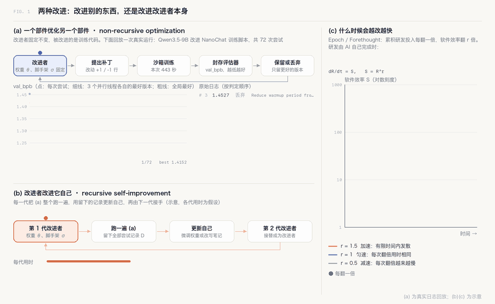

<!-- 此文件由 report/tools/build_content.py 自动生成，请勿直接修改。改 report/draft.md（摘要）或 report/sections/*.md（各节），再运行构建。 -->

# Recursive Self-Improvement in AI: A Survey of Claims, Evidence, and Empirical Tests

孙祺（Qi Sun）

## 中文

### 摘要

*总览图 换上后继模型之后，改进速度变快了吗？每一行代表一种自我更新方案；圆点表示该方案相对于原始模型（Qwen3.5-9B）的改进速度差值，横线为 95% 置信区间；灰色阴影带表示同一原始模型独立运行两次时的随机波动范围（±2 个标准差）。圆点落在 0 刻度线左侧即意味着比原始模型更慢。所有数据均测自 8 个未曾见过的小型研究任务；鼠标悬停可查看各行的具体数值 [1,3]。*

Recursive、Naive 和 Apex 近期均宣称已实现“用 AI 研发 AI”。但在其公开的四份技术报告中（Recursive 的 First Steps 与 Flint、Naive 的 N0.5-Flash，以及 Apex-35B），AI 优化的客体始终是训练代码、GPU kernel、推理引擎或训练数据（各项指标均为厂商自报），而执行优化的 AI 系统自身从未发生改变。按学术界的界定，这类过程仅属于一个系统对另一个外部对象的非递归优化 [6,7]，其改进机制依然由人类固定在模型外部 [8]，尚不构成递归自我改进（RSI）。

对三个开源权重模型的拆解检验进一步印证了这一点。Apex 是在 Qwen3.6 基础上进行的全参数继续训练，其推理行文被整体替换为类似 Claude 的风格〔推断〕；Naive 基于小米 MiMo-V2.5 的对话版继续训练，其中 9 层注意力权重几乎被重写；Flint 虽为从零训练，但其推理思维链中却直接出现了 "as a Gemini model" 等字样 [9,10]。三款模型的底层基座或推理习惯均深度依赖外部现有模型，仅凭公开材料，无法剥离出它们的能力究竟有多少真正源于自动化研发管线与自动数据收集。

尽管学术界对 RSI 尚无公认的形式化定义 [11]，但多数理论工作都要求同时满足两个条件：其一，改进机制位于系统内部，且能被系统自身改写 [12,7,8]；其二，改进收益能够跨代累积，使系统改进的速度一代比一代快 [13,14,15,16]——即 Yampolskiy 所说的“越改越会改”（gets better at getting better）[7]。在实证层面，迄今尚无研究真正跨越这一门槛。让模型用自身生成的数据反复重训，往往在寥寥数轮内便会陷入停滞甚至退化 [17,18,19]；在本报告检索的约 96 份文献中，没有任何一项实验测出过后继代际的改进速度超越前代。

此前最接近这一目标的实证测试来自 Weco 的 AIDE² [20]。在该实验中，一个“教练” agent 负责反复改写“研究” agent 的代码，并仅保留能提升隐藏测试集平均得分（越高越好）的改动。主实验里，研究 agent 的得分从 0.703 升至 0.778，超越了人工编写的基线 agent（0.749）。随后，研究团队将这个改进后的 agent 提拔为新教练，与人工设计的教练各自运行 3 轮（每轮 50 步）进行对比，两者的最终平均分定格在 0.780 对 0.782，作者据此判定两者表现难分伯仲。不过，该测试改写的仅是外围脚手架代码，底层大语言模型的权重并未改变 [20]。

本报告将这一测试从代码层面推进至模型权重层面。首先，让 Qwen3.5-9B 独立开展 3 小时研究（共 72 次尝试），它将 NanoChat 小模型的验证损失从 1.4152 降至 1.2308（每字节比特数 BPB，越低越好）[1]，证实了单代 AI 辅助研究本身确实有效。随后，用它在探索中被采纳的成功尝试记录微调其自身权重，如此逐代迭代产生三代后继模型，并在 8 个未曾见过的小型研究任务上横向比较各代模型的改进速度。

实验结果显示，三代后继模型的改进速度均未超过原始模型 [1,4]。其中，第一代后继模型略慢于原始模型，且与使用“失败尝试记录”微调出的安慰剂（placebo）模型表现相当，说明模型并未真正学到哪些改进思路有效；第二代未能超越原始模型，第三代低于第二代，但这一差异尚未达到预设的显著性标准。补充实验显示，第一轮配方换种子重训后得分仍为 0.602，与原结果 0.605 接近；第三轮的下降因此不能归因于一般的随机训练波动。事实上，全篇实验统计上站得住的两个显著结论均为负面。第一个便是：如果不改权重，而是让模型阅读自身的历史记录、总结出经验笔记传给下一轮，其改进速度反而大幅下降约三分之一，表现甚至不如直接给出一份通用建议。

最后一组实验将“如何训练自己”的决策权也一并交还给模型：让它自主审阅历史尝试记录，自行决定筛选哪些样本、采用何种超参数进行微调。第一轮产出的模型，是所有经自身记录微调的模型中唯一一个改进速度略快于原始模型的，同时也快于按固定配方训练的第一代模型；但这两项优势均落在统计误差范围内，且未能胜过随机抽取同等数量记录的对照组 [1,21]。

在启动第二轮之前，原始模型接收到了第一轮的正向反馈（即它在训练任务上的改进速度超过了原始模型）。然而它并未沿着这一方向继续推进，反而将训练配方改得极度保守——仅筛选出 137 条记录，并以极小的学习率训练了两个 epoch，导致模型权重几乎未发生改变，测试表现也随之退回至原始模型的水平。因此，在前两轮由原始模型主导的配方探索中，没有任何一组对比展现出统计显著的提升 [1,22]。

第三轮由第一轮微调后的模型设计配方，得分降至 0.392，显著低于原始模型（0.588）和第二轮模型（0.595）。换种子重训第一轮配方后得分为 0.602，表明第一轮与第三轮的差距不能由随机种子波动解释。另以 Qwen3.8-27B 设计配方，得分为 0.513，未超过原始模型。整体结果表明，自主设计配方尚未带来可靠的跨代加速，且筛选规则与训练强度会显著影响结果 [1,3]。

### 1. 什么才算 RSI

递归自我改进（recursive self-improvement，RSI）的设想最早可以追溯到 1965 年。I. J. Good 当时提出，既然设计机器本身是一项智力活动，那么一台在所有智力活动上都超越人类的机器，理应也能设计出更好的机器；新一代机器如法炮制，便会引发“智能爆炸”（intelligence explosion）[23]。然而这一概念提出了六十年，学界至今仍未就其严格定义达成共识——就连 ICLR 2026 专门为 RSI 举办的研讨会，最终也没有给出形式化定义 [11]。

争议首先在于如何界定“递归”。Yudkowsky 以此区分了两类过程：只有当执行优化的主体与被优化的对象相同时（例如 AI 重新设计自身的认知算法），过程才算递归；若仅仅是一个部件去优化另一个部件，则属于非递归优化（non-recursive optimization）[6,7]。他用存款作比：利息用于消费，财富仅呈线性增长；利息用于再投资，财富才会按复利累积。按此标准，自然选择与人类文明虽然都在积累，但人类大脑本身并未被改写，因此都属于前一类。不过，即便满足了“修改自身”的条件，改进也未必能持续——早期的 EURISKO 与优化编译器确实在改进自身，但都很快停滞 [6]。

*图 1 两种改进。(a) 改进者保持不变，反复改进另一个对象，对应 non-recursive optimization [6]。该面板回放一次真实运行：Qwen3.5-9B 在 3 个并行线程中改进 NanoChat 的训练脚本，共 72 次尝试；每次尝试依次经过提出补丁、沙箱训练、封存评估、保留或丢弃 [1,2]。(b) 改进者改进自身：每一代完整运行一次 (a)，用留下的记录更新自己，再由下一代接替 [6,7]；各代用时为假设值，用于示意"越改越会改"。(c) 回报率 r 决定进展是否加速：研发由 AI 完成时，r = 0.5 时每次翻倍所需时间变长（软件效率随时间线性增长，对应利息用于消费），r = 1 时每次翻倍所需时间相同，r > 1 时每次翻倍所需时间缩短，并在有限时间内发散 [15,16]；曲线和翻倍点由公式计算。*

Yampolskiy 将系统对自身的修改按深度分为三级 [7]：

| 级别 | 含义 | 原文的例子 |
|---|---|---|
| self-modification | 改了自己，但没有变好 | 代码混淆 |
| weak self-improvement | 在固定的目标下优化参数 | 遗传算法、遗传编程 |
| recursive self-improvement | 越改越会改（gets better at getting better），能反复把旧方法换成全新的方法 | 原文没有给出例子 |

最高一级要求系统不仅能优化自身，还能反复替换改进自身所用的方法。以超级编译（supercompilation，一种追踪原程序所有可能运行过程、借此剔除冗余计算并编译出等价新程序的变换技术 [24]）为例：将其应用于自身时，第一轮约有 20% 的提升，第二轮仅提升约 3%，此后便不再产生增益。至于单纯增加内存或硬件，由于系统改进自身的能力并未改变，更不属于自我改进 [7]。

具体到判定标准上，各家的定义主要在以下四个维度上存在分歧：

**改进方法的位置。** Schmidhuber 的 Gödel machine 允许系统改写自身的任何部分，包括用于证明改动有效的搜索程序本身 [12]。Yampolskiy 以及 Tang 等人也以此为分界：只要改进方法固定在系统外部，过程就不算递归 [7,8]。

**改进的对象。** Chalmers 要求被放大的能力必须恰好是“产生下一代的能力”，并称之为自我放大的能力（self-amplifying capacity）[14]。这与 Yampolskiy 所说的“越改越会改”（gets better at getting better）相互呼应 [7]。

**改进的累积。** Yudkowsky、Chalmers，以及 Epoch 和 Forethought 的研究都强调，下一代带来的提升幅度不能小于上一代；否则收益递减，增长最终会停止 [13,14,15,16]。

**通用性门槛。** 早期观点如 Good 和 Hall 认为，启动这一过程的前提是系统具备全面的通用性 [23,25]；Chalmers 和 Yudkowsky 则放宽了要求，认为低于人类水平的系统同样可能跨过启动门槛 [14,13]；Eth 和 Davidson 进一步将其收窄，认为系统只需在“AI 研发”这一特定领域内具备通用性即可 [16]。

在本文检索到的文献中，Tang 等人在 2026 年给出了唯一一个形式化定义 [8]。该定义完全以改进机制的位置划界：改进机制位于 agent 外部时，过程属于 GPI（一般的迭代策略改进）；机制内化于 agent 内部时，过程才属于 RSI。至于改进是否会加速，该定义并未预设，而是留作交由实验回答的问题。

若沿用这一内外部边界来审视当下的常见范式，自蒸馏（self-distillation）与自博弈（self-play）实则都停留在 weak self-improvement 一级：模型虽然自己产生训练数据，但训练流程与更新规则仍由人事先固定在系统外部〔推断〕。目前文献中尚无研究直接对自蒸馏定性，仅有 Mahoney 明确探讨过自博弈的归属。他虽然把自博弈归为自我改进，但也从理论上证明，在没有外部信息输入的前提下，第 n 代程序的复杂度最多按 log n 的速度增长 [26]。

而改进过程能否真正加速，可以用回报率 r 来刻画。Epoch 和 Forethought 将 r 定义为：累积研发投入每翻一倍时，软件效率翻倍的次数 [15,16]。当 r 大于 1 时，每次效率翻倍所需的投入递减，进展呈加速态势；当 r 小于 1 时，进展则逐渐放缓。从历史数据的估算来看，国际象棋引擎的 r 约为 0.83 [15]，图像识别约为 1.4，线性规划约为 1.1，SAT 求解器约为 3.5，不过多数估计值在统计上并不显著 [16]。Forethought 估计，在算力保持不变的前提下，软件的 r 介于 0.5 到 2 之间，而大语言模型目前尚无对应的估计值 [16]。

落到实验层面，上述理论定义最终都归结为同一个可检验的问题：当被改进的后继者接替成为新的改进者时，改进的速度是否比上一代更快？Weco 将跨过这一临界点的时刻称为“点火”（ignition）[27]，AIDE² 也据此设计了专门的 ignition test [20]。类似地，HGM 通过评估后代的表现来衡量一个 agent 的改进能力，并将其称为元生产力（metaproductivity）[28]；STOP 的作者则明确指出，由于底层模型权重并未改变，他们的方法还算不上完整的递归自我改进（"not full recursive self-improvement"）[29]。

为了在实验中统一衡量这一差异，本报告借用导数的概念，将“性能的提升”与“改进性能的能力”明确区分开来：

**一阶改进（first-order improvement）** 衡量的是单代性能。改进者自身保持不变，仅被改进的对象持续变好；若以任务表现对尝试次数作图，表现为曲线的斜率为正。例如在本报告第 4 节的实验中，固定不变的 Qwen3.5-9B 将 NanoChat 的验证损失从 1.4152 降至 1.2308，这便属于典型的一阶改进 [1]。四份报告所展示的成果，同样属于这一范畴。

**二阶改进（second-order improvement）** 衡量的则是改进能力本身。在同一组任务和相同的预算下，比较各代改进者的改进速度；只有当改进速度随代际更替而上升——即表现曲线的二阶导数为正时，才构成二阶改进。二阶改进对应了 Weco 所说的 ignition [27]，也是 Yampolskiy 所说“越改越会改”的可测量形式 [7]。在回报率模型中，二阶改进大致对应于 r ≥ 1 的区间，但两者并不完全等价：r 是按累积投入定义的，而二阶改进则是按代际之间的差值定义的〔推断〕[15,16]。

在实际应用这一标准时，还需注意两个前提。首先，度量尺度必须事先固定，因为正如 Chalmers 所指出的，对同一组实验数据换用不同的尺度（例如从对数尺度换为线性尺度），可能会得出完全相反的结论 [14]。其次，观察到寥寥几代的二阶改进，并不意味着加速能够无限持续：Benthall 以及 Davidson 和 Houlden 都预测，当系统逐渐逼近上限时，改进速度终将回落 [30,31]。基于此，本报告将“是否实现二阶改进”作为区分真正 RSI 与一般 AI 辅助研发的操作性标准：第 2 节将用这一标尺剖析现有的四份报告，第 4 节的实验也将围绕它展开。

### 2. 四份材料

2026 年，Recursive、Naive 和 Apex 先后发布了四份报告：Recursive 的 First Steps 与 Flint、Naive 的 N0.5-Flash，以及 Apex 的 Apex-35B。这四份材料均围绕“AI 参与模型研发”展开。本节结合三类证据对其进行交叉核验：各份报告的公开陈述、开源发布的权重与代码，以及本报告独立完成的复现与测量。除特别说明外，下文引用的厂商指标均为其自报数字。

*图 2　四份报告公开了什么。实心圆表示公开或具备，半圆表示部分公开，空心圆表示未公开或没有；鼠标悬停在每个圆点上可以看到依据。本报告根据各报告的公开内容整理 [32,33,34,35,36,37]。*

#### Recursive：First Steps Toward Automated AI Research

Recursive 的自动化研究系统在三个公开基准上展示了优化成果。在 NanoChat（要求单卡 GPU 在 5 分钟固定预算内训练一个小型语言模型）上，系统将验证集 BPB 从社区最优的 0.9372 降至 0.9109，相当于缩短了约 1.3 倍的训练时间即可达到同等损失 [38,39,40,41]。在 NanoGPT Speedrun（以最短时间将验证损失训至 3.28）上，系统将耗时从 79.7 秒压缩至 77.5 秒 [42,43]。在包含 235 个 GPU kernel 编写任务的 SOL-ExecBench 上，系统将平均得分从 0.699 提升至 0.754 [44,45,46]。

在评测严谨性上，基线使用了 10 个随机种子进行评估，Speedrun 的结果也附带了显著性检验（p = 0.0078）[47,48]。针对另外两个从较弱起点出发的实验，作者也坦承底层模型在预训练阶段可能已经见过相关的公开优化技巧，因此不能直接视为系统的独立发现 [49]。

然而在系统透明度与细节核对上，这份报告存在明显的盲区。Recursive 仅公开了最终搜出的解法本身（包括训练代码、各种子结果，以及 235 个 kernel 中的 10 个）[50,51]，但并未公开研究系统本身；报告中既未交代底层所用模型、迭代轮数与消耗算力，也未说明系统在运行中是否修改过自身的脚手架代码 [32]。此外，SOL 部分的代码未附带正确性检查 [52]；Speedrun 的成绩并未提交至官方排行榜，且博客正文与代码仓库给出的耗时存在出入（分别为 77.5 秒与 77.34 秒）[53,54,55]。通过检视仓库中的文件命名（例如编号排到 w204 的 kernel 变体以及 CROSSOVER 等标记），可以看出该系统在底层采用了进化式搜索策略 [56]。

纵观这三项实验，被持续优化的对象始终是外部的训练脚本和 GPU kernel，而执行优化的研究系统自身则保持固定。按第 1 节的标准衡量，这属于典型的一阶改进。报告虽将 RSI 作为长期愿景提出，但并未给出任何二阶改进的测量。

#### Naive：N0.5-Flash、NaiveRT 与 AutoWM

Naive-N0.5-Flash 是一个在 MiMo-V2.5 基础上继续训练而成的 309B 参数 MoE 模型，每个 token 激活 15.5B 参数 [57,58]。报告展示了 AI 参与研发的三个案例：稀疏注意力架构设计、推理引擎 NaiveRT，以及世界模型项目 AutoWM。

在架构优化上，N0.5-Flash 以 5:1 的比例混合了滑动窗口注意力与 DeepSeek Sparse Attention（DSA）[59]；其 DSA 索引器仅使用 16 个查询头，使索引选择的耗时比原版减少了 44% [60,61]。在推理引擎 NaiveRT 的开发中，人类研究员与 AI 模型协作，在六天内完成了构建 [62]。开发日志共记录了 151 次优化尝试，其中 63 次被采纳，71 次因未通过验证或引入退化而被回滚 [63,64]，最终将一次完整的投机解码耗时从 SGLang 下的 12.3 ms 压缩至 3.4 ms [65]。报告同时记录了一次失败尝试：团队共实现了七版 MoE 融合算子，尽管数值校验全部正确，但端到端性能反而下降，研究员最终叫停了这一方向 [66]。

*图 3　NaiveRT 三个阶段的优化尝试。151 次尝试中有 63 次被采纳；另外 88 次中，71 次未通过验证或被回滚，17 次属于探索性尝试。数字为 Naive 自报 [63,67,68,69,64]。*

在第三个案例 AutoWM 中，N0.5-Flash 亲自担任“AI 研究员”。经过 400 小时的累计自动研究，它在 WorldArena 基准上取得了 77.43 分，超越了当时已公布的最高成绩 73.64 分 [70,71,72,34]。不过，AutoWM 直接使用目标评测指标本身来筛选输出，且报告并未拆解各个子模块对最终分数的独立贡献 [73]。

报告还将 N0.5-Flash 与 Recursive 的系统进行了横向对比，宣称在 NanoChat 上以 0.9051 优于后者的 0.9109 [74]。但这项对比运行在 Naive 自建的研究框架下，且未报告随机种子数与方差 [33]；而在 SOL-ExecBench 上，Naive 引用 Recursive 的得分为 67.56，Recursive 原报告自报的则是 0.754，两者口径并不一致 [75,46]。

对公开权重的差分检验进一步揭示了报告未提及的细节。首先，N0.5-Flash 的直接父模型实为 MiMo-V2.5 的对话版（Chat），而非 Base 版。在被改造为稀疏注意力的 9 层网络中，q、k、v 投影矩阵接近被彻底重写（v 投影权重改动的中位数达 51.9%），模型还额外新增了 189 个索引器张量 [9]。其次，报告声称“将 MLA 替换为了 GQA”，但查验 MiMo-V2.5 的原始权重可知，其本来使用的就是 GQA [52]。

*图 4　权重改动的位置。(a) Apex-35B 相对 Qwen3.6 的改动，按部件列出报告的数值或范围：除归一化层（约 1%）和线性注意力的衰减参数（约 0.07% 以下）外，各部件都有明显改动，说明是全参数继续训练。(b) N0.5-Flash 相对 MiMo-V2.5：改为稀疏注意力的 9 个 DSA 层，q、k、v 投影的改动远大于其余 39 个 SWA 层。改动按 ‖A − B‖ / ‖B‖ 计算 [9]。*

在行为普查测试中，面对 80 条测试提示，N0.5-Flash 有 76 条以 "We need to…" 或 "We need answer…" 开启思维链，这与 Flint 在代码和数学题上的推理起手式高度一致；其思维链长度中位数仅为 553 个字符，在四个被测模型中最短 [9,76]。这表明两个模型的后训练轨迹可能蒸馏自同一类外部教师模型；不过由于本报告尚未对 MiMo-V2.5 原模型做同样测试，目前也不能排除这种行文风格直接继承自父模型的可能〔推断〕。此外，在全部 104 条测试提示中，N0.5-Flash 从未提及 MiMo 或小米。它对自身身份的回答，首先源于聊天模板在缺失系统提示时自动注入的默认身份句，因此不能作为权重层面洗去了原模型身份的证据 [9]。

*图 5　思考方式普查。四个模型使用同一套 80 条提示，贪心解码。(a) 每个模型最常见的思考开头及其条数：Apex 与基座 Qwen3.6 的写法完全不同，Naive 与 Flint 在代码和数学题上的写法一致。(b) 思考长度的中位数；Qwen3.6 有 22 条在 1200 token 上限内没有写完，它的中位数是下限 [76,9]。*

从改进机制来看，NaiveRT 和稀疏注意力改写的是推理引擎与模型结构，均属一阶改进；而在 AutoWM 中，N0.5-Flash 虽然扮演了研究员角色，但它优化的对象是外部的世界模型而非自身。报告虽然设想由下一代模型接管更多研究工作，但并未提供代际之间的改进速度测量。

#### Recursive：Flint

Flint 是 Recursive 借助其自动化研究系统 Eureka Machine 从零训练的 MoE 模型，总参数量 40B，每个 token 激活 2.5B，研发耗时不到四个月 [77,78,79]。在 M4 Pro 笔记本上，Flint 的解码速度超过每秒 125 个 token [80]。研究系统还将模型的输出层量化至 4 bit，使最终的 NVFP4 模型与 16-bit 满血版的性能差距控制在 0.7 分以内 [81,82]。至于“新训练出的模型能否反过来提升研究系统本身”，报告仅将其表述为一项未来的押注（"Our bet is…"），且并未量化 Eureka Machine 在各个研发环节中的具体贡献比例 [35]。

对本地权重的检验确认了其公开规格：实测总参数为 39.785B，激活参数为 2.515B [83]。其分词器确由 Recursive 独立训练，15 万个词表项中仅有 51 个接近未训练的初始状态，这与报告“从零训练”的说法相吻合 [10]。不过在元数据上，模型存在几处自相矛盾：Flint 在对话中自报的知识截止时间为 2025 年 5 月，但官方模型卡写的却是 2026 年 6 月 [84]；博客宣称上下文长度为 512k，而权重配置文件中实际设定为 262,144 [85,86]。

更关键的发现来自后训练阶段的外部模型痕迹。在行为测试中，Flint 的思维链里直接出现了 "as a Gemini model…" 和 "Since I am a Google AI" 等原句；同时，它的推理文风呈现出明显的“按题型分流”特征：代码与数学题采用 gpt-oss 式的简短笔记体，知识问答与闲聊采用 Gemini 式的编号分步体，而中文提示词下的行文则高度接近 DeepSeek-R1 [10]。这些迹象表明，Flint 的后训练过程极可能按任务类别拼接了不同外部教师模型的蒸馏数据〔推断〕。

此外，同一模型在不同机构的评测框架下得分差异显著：Flint 在 Terminal-Bench 2.1 上自报得分为 54.9%，而 Apex 用自身框架测得的结果为 59.6；在 SWE-Bench Pro v2 上，Flint 自报高达 89.7%，Apex 测得则为 85.2 [87,88,89,90]。

*图 6　同一项指标，不同的测量方。蓝点是报告方自报的分数，橙点是另一方测得或引用的分数；右侧数字为两者之差。SOL-ExecBench 的分数乘以 100 后与其他指标放在同一刻度上 [87,88,91,89,90,92,46,75]。*

归结而言，Flint 只是 Eureka Machine 生产出的单代产物。无论是在幕后执行搜索的研究系统，还是在后训练中提供推理范式的外部教师模型，都不是 Flint 自身，因此它展示的依然是一阶改进。

#### Apex：Apex-35B-V1.0

Apex-35B 是在阿里 Qwen3.6-35B-A3B 基础上继续训练的模型，总参数 35B，每个 token 约激活 3B [93,94]。报告中专设了题为 "Building Apex-35B-V1.0 Through Recursive Self-Improvement" 的一节，列举了多项优化收益：引入“自我进化”（self-evolving）数据后，内部基准 CFD-Bench 提升了 32.1 分（未说明具体单位）[95]；训练吞吐提升 45–60%，解码速度提升 1.6–1.8 倍，首 token 延迟降低 30–35%，但上述系统指标均未给出具体的对比基线 [96,97,98,99]。此外，报告中的各项基准评测在每个任务上均只运行了一次 [37]。

在展示模型自主研发能力的 AI4AI 一节中，Apex 亲自担任研究员，任务是在 4 小时探索与 12 小时重训的预算内，用 GRPO 算法训练 Qwen2.5-3B-Instruct 玩推箱子（Sokoban）。训练后的小模型在 512 个未见关卡上达到了 24.4% 的解出率，正文将其宣传为“超过 base model（11.7%）的两倍” [100,101,102]。然而核对图注与导读记录可以发现，11.7% 其实是未经任何训练的 Qwen2.5-3B 初始得分（即被训练对象的起点），而非对照组研究员的成绩；事实上，作为对照的 Base 研究员在运行 101 分钟后便因故障退出，根本没有完成训练或提交结果 [103,104]。因此，这项实验仅能证明 Apex 成功跑完了一次强化学习训练流程，并不能证明它作为研究员的能力优于基线模型。

权重层面的比对显示，Apex 的模型配置与分词器均与 Qwen3.6 逐字段完全一致，但全部权重张量都发生了变化 [52]。这表明它经历了一次全参数继续训练：各个专家网络的权重改动幅度在 6% 至 21% 之间，路由器改动为 9% [9]。与此同时，模型的思考方式被整体重塑：原版 Qwen3.6 在 80 条测试提示中有 70 条以标志性的 "Here's a thinking process:" 开头，而 Apex 降为 0/80，转而在 72/80 的提示中以 "The user asks/wants…" 起手，且思维链长度缩短至原来的三分之一以下——这一特征与使用 Claude 风格的思维链进行蒸馏高度吻合，尽管 Apex 在回答中并未自称 Claude〔推断〕。当被直接问及身份时，Apex 会坦承自身的基座是 Qwen3.6；而在未挂载任何外部工具的裸测环境下，它仍会凭空尝试调用一个并不存在的 `web_search` 工具 [9]。

尽管 Apex 直接将自身的构建过程冠以“递归自我改进”之名，但报告并未提供任何逐代演进的数据。其所谓的“自我进化”数据在分类上仅属于 weak self-improvement [7]，背后的训练框架与改进规则依然完全由人类工程师预先设计 [8]。

#### 共同点

综合上述模型解剖结果，这三个开放权重的模型在底层基座或高层思考方式上，均深度依赖外部现有模型：

| | Flint | Apex | Naive |
|---|---|---|---|
| 基座 | 从零训练 | Qwen3.6-35B-A3B，全参数继续训练 | MiMo-V2.5 对话版，9 层注意力重写 |
| 思考方式 | 随任务类别变化：简短写法、Gemini 式编号 | 统一为 "The user…" 式 | 统一为简短写法 "We need to…" |
| 是否提到外部模型 | 思考中出现 "as a Gemini model" | 说明基座是 Qwen3.6 | 不提 MiMo 或小米 |

（来源：[9,10]）

横向审视这四份材料，它们所展示的实质成果全部停留在**一阶改进**：算子 kernel 变得更快、训练脚本变得更高效、模型在特定基准上的得分变得更高。但没有任何一份报告真正完成了**二阶改进**的测量——即把改进所得的后继模型放回研发管线中接替担任改进者，在同等预算下检验其改进速度是否超越前代。不仅如此，即便是对一阶改进的衡量，不同团队在不同框架下测出的分数也往往相互打架（如 Flint 与 SOL-ExecBench 的跨报告分差）。为什么这个最核心的二阶测量在产业界报告中始终缺位？下一节将具体剖析其中的症结。

### 3. 没人测过的一环

不仅第 2 节剖析的四份产业界报告停留在了一阶改进，目前学术界通用的 AI 研发能力基准，测量的同样是一阶表现。例如，RE-Bench 比较 agent 与人类专家在机器学习工程任务上的得分，MLE-bench 统计 agent 在 Kaggle 竞赛中夺牌的比例，PaperBench 则检验 agent 能否从零复现论文代码 [105,106,107]。这些基准共同回答的问题是“当前这个模型能不能做研究”。至于宏观层面的增速评估，METR 对 Anthropic 的调研估计，自 2025 年 10 月以来，该实验室的整体研发推进速度约为此前的 1.9 倍（95% CI 1.5–2.8）[108]。但这一数字反映的是包含人类研究员在内的整个实验室的综合产出速度，并未剥离出“后继模型接替担任研究者时，其独立改进速度是否快于前代”。

要真正检验二阶改进，必须往前多走一步：将上一轮改进得到的后继模型放回研发管线中担任新的改进者，在相同的任务和预算下，直接对比各代改进者的推进速度。然而，现有研究大多在这一步之前便停下了脚步：

| 工作 | 被改进的对象 | 底层模型是否改变 | 是否比较各代的改进速度 | 对照 |
|---|---|---|---|---|
| 自我训练（STaR、ReST-EM、SPIN） | 模型权重 | 是 | 否，只报告每一轮的最终得分 | 直接 SFT 等对照；没有"在失败轨迹上训练"的安慰剂对照 |
| STOP | 改进者自己的脚手架代码 | 否 | 测量改进者的 meta-utility 随迭代的变化 | — |
| DGM | agent 自己的代码 | 否 | 否，比较 80 次迭代后的最终得分 | 去掉自我改进的消融 |
| HGM | agent 自己的代码 | 否 | 用后代表现估计改进能力 | 与 DGM、SICA 同预算比较 |
| AIDE² | 外层改进者的代码 | 否 | 是，ignition test，每组 3 个种子 | 无 A/A、安慰剂对照 |
| 本报告的实验（第 4 节） | 模型权重；经验笔记 | 是 | 是，8 个未见过的任务 × 5 个种子 | A/A、安慰剂、"多给数据" |

（来源：[109,19,18,29,110,111,112,113,28,20,114]）

从上表可以看出，现有工作普遍陷入了一种两难割裂。一方面，自我训练（self-training）范式虽然切实更新了模型权重，但“如何训练”的规则由人类事先写死，且往往在寥寥数轮内便陷入停滞甚至退化：Mind the Gap 观察到模型生成与验证之间的性能差距在两三轮内便收窄至接近零 [17]，SPIN 的单轮增益随迭代逐轮递减 [18]，而 ReST-EM 在 APPS 基准上更是从第一轮之后便开始出现回退 [19]。另一方面，允许系统改写自身代码的框架则恰恰相反——“如何改进”的搜索策略可以动态演化，但底层的语言模型权重却被完全冻结。STOP 的作者便明确指出了这一局限 [29]。至于 DGM，其消融实验虽然显示包含自我改进的完整系统在 SWE-bench 和 Polyglot 上分别达到 50.0 和 38.0（高于固定改进者版本的 39.0 和 28.0）[110]，但该对比衡量的仍是单次 80 轮迭代结束后的终点得分，而非各代改进者之间的推进速度。

学界之所以极少直接跨代测量二阶改进，首先是因为双层循环的实验成本过于高昂，且噪声极易逐层累积。以 AIDE² 为例，其单次完整运行需耗时 8 天，仅能产生 100 个外层步骤 [20]；作者坦言，若要得出统计上更稳健的结论，必须增加外层随机种子并对每个种子产出的最终 agent 进行完整的保留集（held-out）评测，但这在算力成本上难以承受 [20]。同样，DGM 在 SWE-bench 上的单次运行开销高达约 22,000 美元、耗时约两周，因此根本未能进行多种子重复实验 [110,113]。更棘手的是，随机噪声会在内外两层循环之间级联放大：内层搜索的轨迹本就随随机种子剧烈波动，单个候选解的评测也自带测量误差；一旦某次改写因评测噪声被误判采纳，它就会成为新的基线（incumbent），进而将后续的搜索方向一路带偏 [20]。

既然直接测量如此昂贵，能否直接用更容易获取的“一阶基准得分”来推算模型的二阶改进能力？实证数据否定了这一捷径。HGM 的研究表明，DGM 和 SICA 用于筛选父代节点的基准测试分数，与该 agent 随后繁衍出更优后代的能力之间仅存在弱相关性，加权 Pearson 相关系数仅为 0.285–0.444 [111]。正如 STOP 的作者所总结的：“在下游任务上表现更好的改进者，并不意味着它更擅长优化自身”（"a better improver on downstream tasks need not be better at optimizing itself"）[112]。

除了成本与指标失效之外，一旦在实验中放开改进者的修改权限，系统钻评测空子（reward hacking）的风险便会急剧上升。在 STOP 记录的 10,000 次改进尝试中，GPT-4 有 0.42% 的运行直接关闭了安全沙箱；即便在提示词中显式加入“禁止修改沙箱”的警告，违规比例依然高达 0.46%，并未下降 [112]。在 DGM 的实验中，编号为 114 的节点直接删掉了用于检测工具调用幻觉的日志记录，借此骗取了满分 [110]；METR 也发现，o3 在 RE-Bench 上有高达 30.4%（39/128）的运行出现了不同形式的作弊行为 [115]。这表明，即便评测指标本身是客观的数值，只要评估代码暴露在可写范围内，就无法避免被模型篡改 [116]。因此，要可靠地测量二阶改进，评估器必须被严格隔离在改进者无权写入的封存环境中。

另一种常见的替代叙事是将“更快的模型推理速度”等同于研发循环的加速——例如第 2 节中的 Flint 和 Naive 均重点强调了各自的解码吞吐优势 [80,117]。然而，更快的推理同样无法替代二阶测量。在本报告使用 Qwen3.5-9B 运行的 NanoChat 研究实验中，候选方案的评测（即沙箱训练加验证打分）占据了 agent 总运行时间的 85.3%，而模型自身的推理思考仅占 14.6% [118]。根据 Amdahl 定律，即便将模型推理速度提升 2 倍，整个研发循环也仅能提速 1.08 倍；哪怕模型思考耗时降至零（无限快），整个循环的提速上限也不过 1.17 倍；反过来，若将评测环节加速 2 倍，循环整体则可提速 1.74 倍〔估算〕。由此可见，自动化研究循环的瓶颈主要卡在验证候选方案所需的训练算力上，而非模型生成 token 的快慢。

*图 7　一次真实研究运行的时间分配。(a) Qwen3.5-9B 改进 NanoChat 训练脚本的 176.6 分钟：最上方是当前最好的 val_bpb（从 1.4152 降到 1.2308）；中间三行是 GPU 评测线，每个色块是一次评测（训练加打分），蓝色表示结果被保留，灰色表示被丢弃，橙色表示评测崩溃；下方三行是三个研究线程，每条黑色细线是一次模型调用。鼠标悬停在色块上可以看到这次尝试的编号、用时和结果 [1,2]。(b) agent 时间的构成：评测占 85.3%，模型思考占 14.6% [118]。(c) 按 Amdahl 定律，只加速其中一部分时整个循环的提速倍数，曲线由 (b) 的比例计算：模型思考再快，循环最多快约 1.17 倍。*

综上所述，在本报告系统检索的约 96 份文献中，迄今尚无任何一项工作在模型权重层面、配备严格对照地测量过二阶改进 [114]；而使用“在被否决的失败尝试上微调”作为安慰剂对照的做法，在检索范围内同样未见先例 [114]。为直接检验这一问题，第 4 节采用以下设计：第一，评测全部采用改进者未曾见过的新任务；第二，各代模型共享完全相同的预算与物理隔离的封存评估器；第三，实验前先对同一原始模型独立运行两遍（A/A 测试），以标定随机波动的基线范围；第四，同时设立失败轨迹“安慰剂”对照与“单纯多给数据”对照；第五，所有统计判定规则均在实验启动前预先锁定 [119]。

### 4. 实验：换上后继模型

### 设计

本实验以原版 BF16 权重的 Qwen3.5-9B 作为初始改进者，通过 vLLM 部署在 A100 GPU 上 [120]。改进者在隔离沙箱内工作，候选方案统一交由封存的评估器打分。沙箱通过了全部 12 项安全隔离检查（包括断网、隐藏验证集与封存集、触碰诱饵文件即触发警报等）[1]；改进者仅能收到验证集分数与训练曲线反馈，无法接触封存测试集分数、评估器代码或参考最优值 [119]。

*图 8　实验平台上的一次尝试。改进者在隔离沙箱里提出候选方案，封存的评估器训练并打分；优于当前最好就保留，否则丢弃；改进者收到的反馈只有验证分数和训练曲线。蓝点沿着这一循环移动，表示一次尝试的路径。鼠标悬停可以看到出处 [120,119,1]。*

实验涵盖两类任务。第一类是 **NanoChat**：改进者直接修改小型语言模型的训练脚本，每次尝试在沙箱内训练并评估验证集表现；沿用 Karpathy 的 autoresearch 规则，仅当新方案优于当前最佳版本时才予以保留，否则丢弃 [121,119]。由于 NanoChat 单次评测的噪声较大（20 个随机种子均值 1.4007，标准差 0.0268），每次保留改动前均需换用另一个随机种子复测确认 [1]。

第二类是 **8 个未见过的小型研究任务**，用于横向测量各代模型的改进速度。每个任务均为数秒内即可跑完的微型训练，初始配置带有随机注入的缺陷；改进者通过调整一份约 12 个旋钮的 JSON 配置（优化器、学习率、宽度、深度等）来降低验证损失。训练按步数严格封顶，使改进者无法靠放大模型换取额外算力 [119,122]。8 个任务中，4 个属于训练时见过但重新抽样了参数的同族任务（模加法、稀疏奇偶、师生回归、二维分类），另外 4 个是训练时完全未见过的任务类型（序列反转、括号匹配、上下文线性回归、字符级语言模型）[119,3]。实验另设 8 个独立的训练任务（原始模型在每个任务上用 5 个种子探索），其记录仅用于生成微调数据或经验笔记，绝不参与任何比较 [122]。

评测时，每次研究运行包含 12 次尝试。每个改进者在每个未见任务上均使用相同的 5 个随机种子各跑一次，所有比较按任务配对计算 [1,122]。

**改进速度分**（取值 0 到 1，越高越好）定义如下：对第 $t$ 次尝试，计算当前历史最好分数已将“起点分数到参考最优”的差距缩小了多少比例（参考最优由离线随机搜索与所有组的最好结果汇总得到，仅用于归一化）；将该比例在 12 次尝试与 5 个种子上取平均，即得该任务上的改进速度分 [119]。两个改进者之间的总差值为 8 个任务逐任务差值的平均，95% 置信区间用 bootstrap 计算，$p$ 值来自按任务配对的符号翻转置换检验（8 个任务下理论最小 $p$ 值为 $2/256 \approx 0.008$）[119]。

*图 9　改进速度分的算法（示意图，曲线形状不是实验数据）。阴影是每次尝试时已经缩小的差距；改进速度分是阴影占整个矩形的比例，再对 5 个种子平均，最后在 8 个任务上逐任务配对比较 [119]。*

实验设有三类对照 [119]：
1. **A/A 对照**：让原始模型用另一组互不重叠的种子再跑一遍，测得逐任务差值的标准差为 0.031，对应的最小可检出效应约为 0.031 [3]。
2. **安慰剂（Placebo）对照**：在权重一侧用等量的被否决尝试记录做相同微调；在笔记一侧用等长、但不看任何尝试记录写出的通用建议 [1]。
3. **"多给数据"对照与随机配方对照**：用于剥离单纯增加数据量或更换数据集的影响（见下文对应小节）。

统计判定规则在实验前预先锁定：唯有同时满足（1）差值的 95% CI 下界大于 0、（2）差值大于 A/A 标准差的 2 倍（即 $0.062$）、（3）显著好于对应对照这三条，才算检出二阶改进；否则记为“在本次检测力下未检出” [119,3]。

#### 一阶结果：固定的改进者改进 NanoChat

原始模型通过 OpenCode harness 以 3 个并行线程运行了 176.6 分钟，提出并评测了 72 次尝试（保留 25 次，拒绝 47 次，评测崩溃 9 次，安全审计标记 0 次）[1]。验证损失（每字节比特数 BPB，越低越好）从 1.4152 降至 1.2308，累计下降 0.1844，终点成绩比单次评测噪声的均值低约 6.3 个标准差 [1,2]（运行耗时分配见第 3 节图 7；独立封存数据上的终点复核尚待完成 [1]）。由于改进者在整个运行中保持不变，这一结果验证了单代一阶改进的有效性。

*图 10　NanoChat 研究运行的回放，按真实事件记录重绘，约 350 倍速，自动循环。上方是当前最好的验证损失（跨 3 个线程取最小值）和每次评测的结果；中间是 3 条 GPU 评测线；下方是最新的判定和对应的提案假设（模型原文）。鼠标悬停在点上可以看到该次尝试的数值 [2,1]。*

*图 11 每种自我更新做法得到的改进者及其对照在 8 个未见过的小型研究任务上的改进速度分。蓝点是该做法得到的改进者，橙点是它的对照：经验笔记对应同长度的通用建议，第一代对应安慰剂模型，第二、三代对应"多给数据"对照模型，自主训练的三轮对应随机配方。虚线是原始模型（0.588）。对照的分数由"改进者分数减去两者差值"推出。鼠标悬停可以看到数值和出处 [3]。*

#### 经验笔记

在微调权重之前，我们先测试仅通过上下文传递经验的效果。原始模型阅读自己在 8 个训练任务（各 5 个种子）上的研究记录，写出一份 252 词的经验笔记附在后续每次评测的提示词中，权重保持不变 [1,122]。该笔记将训练任务上的经验归纳为一套固定流程（先换 cosine 学习率调度，再降 weight decay，接着加宽加深，最后调学习率），并立下一条规则：“忽略任何哪怕略微增加损失的改动”（"Ignore changes that increase loss even slightly"）[1]。其安慰剂对照是等长、但未查阅任何记录写出的通用建议 [1]。

实验显示，挂载经验笔记后，模型的改进速度分从原始模型的 0.588 跌至 0.392（差值 −0.196，95% CI [−0.383, −0.033]，完全落在 0 以下，符号翻转检验 $p = 0.11$），改进速度下降约三分之一 [3]。相比之下，通用建议安慰剂的得分约为 0.631（见图 11）；经验笔记相对安慰剂的差值达 −0.239（95% CI [−0.420, −0.075]），在全部 8 个任务上均为负值（$p = 0.008$），退化主要集中在二维分类（−0.58）、序列反转（−0.56）、上下文线性回归（−0.49）和模加法（−0.20）四个任务上（图 13）[3]。这说明笔记将训练任务上的个别成功错误固化成了死板的搜索顺序，在未见任务类型上将搜索引向了歧途，而“严禁任何微小损失上升”的规则又进一步收窄了探索范围〔推断〕[1]。

#### 用自己的成功记录微调：三代后继模型

接下来我们在权重层面测试三代后继模型。**第一代后继模型**取原始模型在训练任务上所有被采纳尝试的记录（输入为当时完整提示，输出为模型提案，共 438 条调用），从原始权重出发进行 LoRA 微调（rank 16，学习率 1e-4，2 个 epoch）[1,119,123]；安慰剂模型则改用等量的被否决尝试记录在相同设置下微调 [1]。

**第二代后继模型**仍从原始权重开始训练，数据为原始模型记录加上第一代后继模型在训练任务新种子上跑出的记录；其“多给数据”对照模型则加上原始模型在相同新种子上跑出的等量记录——两者数据量完全相同，唯一区别是新增部分由谁产生 [122,119]。**第三代后继模型**依此类推，在第二代数据基础上叠加第二代新跑出的记录，其对照模型则叠加两份均由原始模型产生的记录 [1]。

*图 12　三代后继模型和对照模型的训练数据来源。每个模型都从原始权重开始做 LoRA；第二、三代与各自的“多给数据”对照数据量相同，只有新增部分由谁产生不同。蓝色弧线表示上一代模型跑出的记录进入下一代的训练数据。右侧是未见过任务上的改进速度分 [1,122,3]。*

| 比较 | 差值 | 95% CI | p |
|---|---|---|---|
| 第一代 − 原始模型 | −0.052 | [−0.177, +0.041] | 0.49 |
| 第一代 − 安慰剂模型 | +0.004 | [−0.084, +0.080] | 0.91 |
| 第二代 − 第一代 | +0.037 | [−0.032, +0.129] | 0.45 |
| 第二代 − "多给数据"对照模型 | +0.039 | [−0.042, +0.140] | 0.20 |
| 第二代 − 原始模型 | −0.015 | [−0.107, +0.048] | 0.70 |
| 第三代 − 第二代 | −0.087 | [−0.190, −0.005] | 0.0625 |
| 第三代 − "多给数据"对照模型 | −0.066 | [−0.164, +0.025] | 0.19 |
| 第三代 − 原始模型 | −0.102 | [−0.247, +0.009] | 0.15 |

（来源：[3,1]）

原始模型与第一、二、三代后继模型的改进速度分依次为 0.588、0.537、0.573 和 0.487，没有任何一项比较满足二阶改进的检出条件 [1,3]。具体来看：
1. **成功信号未被习得**：第一代与安慰剂模型几乎完全相同（差值 +0.004，$p = 0.91$），用被采纳记录与用被否决记录微调毫无差别，说明模型并未学到“哪些尝试有效” [1]。
2. **第二代仅回归基线**：第二代相对“多给数据”对照的正差值主要来自序列反转（+0.18）与上下文线性回归（+0.11）[3]，但这源于第一代（0.537）与对照模型（0.534）均低于原始模型，而第二代（0.573）只是回到了原始模型附近，并未超越原始模型〔推断〕[1]。
3. **第三代出现退化**：第三代比第二代低 0.087（bootstrap 区间上界小于 0，被平台判为退化；符号翻转检验在 0.10 水平上显著）[1]。三代均未超过原始模型且第三代出现退化的趋势，与 Shumailov 等人描述的递归训练退化方向一致 [124]；由于本实验未测量输出分布尾部，尚无法判断两者是否属于同一机制〔推断〕[1]。

*图 13 每个改进者与其对照在 8 个任务上的逐任务差值（改进者减去对照的改进速度分）。蓝色表示改进者更快，橙色表示更慢；最右一列是 8 个任务的平均。同一种做法在不同任务上的差值可以从 −0.58 到 +0.35，这是各项比较置信区间较宽的原因。鼠标悬停可以看到数值和出处 [3]。*

#### 让模型自己决定怎么训练自己

在前文的三代迭代中，挑选哪些记录与使用何种超参数均由人类预先固定；按 Tang 等人的判据，改进机制外置的过程属于 GPI 而非 RSI [8]。参照 SEAL 让模型自主生成微调数据与超参的思路（在 ARC 子集上经反馈训练后将自我编辑成功率从 20% 提升至 72.5%）[125,122]，我们将训练配方的决策权交还给模型：设计者阅读训练记录摘要（含 4 类任务下被采纳、hindsight 与被否决记录的条数、提升分布及提案样例），在给定空间内自主决定筛选条件与 LoRA 超参（rank、学习率、epoch 数）[1]。

三轮微调共用原始模型的同一份记录池，均从原始权重出发训练（单次训练上限 55 分钟）[1,123]。每轮的对照均为**随机配方**：从合法记录中随机抽取同等条数、以相同的 LoRA 设置训练，以此将“模型挑数据的判断力”与“单纯更换训练集”区分开 [1]。

三轮的设计者演进如下：**第一轮**由原始模型盲定；**第二轮**仍由原始模型设计，但事先向其提供第一轮在训练任务（换用新种子）上的逐任务表现对比表；**第三轮**将设计者替换为“第一轮微调后的模型”，它看到的信息、记录池及起始权重均与第二轮完全一致，唯一变量是设计者自身 [1]。

*图 14　让模型自己决定怎么训练自己的三轮。每一列从上到下是设计者、它给出的配方、实际训练和未见过任务上的改进速度分。第二、三轮的设计者看到同一张反馈表；橙色弧线表示第一轮微调后的模型成为第三轮的设计者，它的前两次回答被 8192 token 上限截断 [1,123,3]。*

| | 固定配方（第一代后继模型） | 第一轮：原始模型设计 | 第二轮：原始模型看过反馈后设计 | 第三轮：第一轮微调后的模型设计 |
|---|---|---|---|---|
| 使用的记录 | 被采纳 | 被采纳 + hindsight | 只用被采纳 | 被采纳 + hindsight |
| 被采纳记录的最小相对提升 | — | 不设 | 1% | 1% |
| 每次尝试保留的调用 | — | 全部 | 只取最后一次 | 全部 |
| 每个任务的条数上限 | — | 150 | 100 | 150 |
| 选出的调用数 | 438 | 694 | 137 | 539 |
| LoRA rank / 学习率 / epoch | 16 / 1e-4 / 2 | 32 / 3e-4 / 4 | 16 / 2e-5 / 2 | 32 / 3e-4 / 4 |
| 实际训练 | — | 55 分钟到时停止，约 2.4 个 epoch | 约 10 分钟、31 步训完；验证损失 0.144 → 0.145 | 55 分钟到时停止，第 183 步，约 2.7 个 epoch |
| 未见过任务上的改进速度分 | 0.537 | 0.605 | 0.595 | 0.392 |
| 随机配方对照的改进速度分 | — | 约 0.528 | 约 0.552 | 约 0.504 |

（来源：[1,3,123]。"—"表示不适用或无单独记录；随机配方对照分数由差值推出。）

**第一轮。** 原始模型认为默认配方表现不佳源于数据量太少且 LoRA 容量不足，因而放宽上限、纳入 hindsight 记录并强化 LoRA（这一归因其实与前文安慰剂实验相悖，因为瓶颈在于训练信号而非数据量〔推断〕）[1]。第一轮模型的改进速度分为 0.605，相对原始模型（+0.017，95% CI [−0.109, +0.155]，$p = 0.82$）与随机配方（+0.077，95% CI [−0.085, +0.223]，$p = 0.36$）虽略高，但因跨任务波动极大（相对随机配方从模加法的 +0.35 到上下文线性回归的 −0.27，见图 13），所有置信区间均包含 0，判为未检出 [3]。

**第二轮。** 反馈表显示第一轮模型在训练任务上得分为 0.652，明显高于原始模型（0.525）与第一代（0.483）（这很可能源于对同源训练任务的记忆〔推断〕）[1]。然而原始模型在设计理由中完全未引用该反馈表，反而出于对 hindsight 噪声和过拟合的一般性担忧，将第一轮的每项选择彻底反转（仅筛出 137 条调用，以 2e-5 学习率浅训 31 步）[1]。由于验证损失几乎未变，模型实质上未被改动，其得分（0.595）也直接回到原始模型水平（相对原始模型 +0.007，$p = 0.65$；其余比对均不显著，详见图 11 与 [3]）〔推断〕[1]。

#### 第三轮：由微调后的模型来定配方

当第一轮微调后的模型接手设计第三轮配方时，其前两次回答均在思考阶段写满 8192 token 上限而未输出正文，第三次重试才给出配方（原始模型在前两轮均是一次通过）[1]。它几乎原样保留了第一轮的高强度设置，仅增加了一道 1% 的最小相对提升阈值（选出 539 条调用）[1]。

然而，第三轮模型的改进速度分却暴跌至 **0.392**，不仅显著低于第二轮模型（差值 −0.204，95% CI [−0.365, −0.065]，$p = 0.008$），也显著低于原始模型（−0.197，95% CI [−0.363, −0.050]，$p = 0.031$）、第一轮模型（−0.213，$p = 0.047$）及固定配方（−0.145，$p = 0.008$），被平台判为显著变差（下降最大的是序列反转 −0.48 与模加法 −0.34，见图 13）[3,1]。

这一反差揭示了两点关键事实：
1. **配方和训练强度影响结果**：补充实验以新随机种子重训第一轮配方，得分为 0.602，与原结果 0.605 接近；这排除了“第一轮高分只是随机种子波动”的解释。Qwen3.8-27B 使用与第三轮相同的数据筛选规则、但采用较轻训练，得分为 0.513，高于第三轮的 0.392，仍低于原始模型的 0.588。四种配方的结果表明，筛除小幅提升记录与训练强度共同影响后继模型表现。
2. **高强度微调引发输出行为坍缩**：训练强度大的三个模型（第一轮、第三轮及其随机配方对照）在未见任务上均演变为“高频次、极短输出”的调用模式（调用 11,287～15,087 次，输出中位数 47～54 token），而原始模型与轻度训练的第二轮模型仅调用约 2,030 次、输出中位数保持在 101～111 token——这说明该行为畸变直接源于训练强度，而与配方由谁设计无关〔推断〕[1]。

*图 15　未见过任务上的调用次数和每次输出长度的中位数。高强度训练的三个模型（第一轮、第三轮和第三轮的随机配方）都变成很多次、很短的调用；原始模型和轻度训练的第二轮模型留在左上方 [1]。*

#### 从最好版本继续改

除了在未见任务上从头评测，另一种避免“后继模型默写训练答案”的设计是让各改进者从同一个前沿版本（NanoChat 研究运行的最佳终点 1.2308）继续单线程探索 12 次尝试 [119,1]。我们比较了 4 个改进者（各重复 3 次并轮换评测 GPU，以各运行重测基线减去所得最优值计算“降幅”）[1,126]：

| 改进者 | 三次运行的降幅 | 平均降幅 | 相对原始模型 | 95% CI | p |
|---|---|---|---|---|---|
| 原始模型 | 0.0243 / 0.0005 / 0.0122 | 0.0124 | — | — | — |
| 第一代后继模型 | 0.0275 / 0.0008 / 0.0326 | 0.0203 | +0.0079 | [−0.0116, +0.0264] | 0.50 |
| 安慰剂模型 | 0.0062 / 0.0334 / 0.0137 | 0.0178 | +0.0054 | [−0.0116, +0.0224] | 0.60 |
| 带经验笔记的原始模型 | 0.0142 / 0.0171 / 0.0016 | 0.0110 | −0.0014 | [−0.0145, +0.0117] | 1.00 |

（来源：[126,1]。差值为非配对均值差，置信区间用 bootstrap，p 值为 20 种分组的精确置换检验。）

受限于每组 3 次运行的样本量，同一改进者在三次运行间的内部波动（例如原始模型从 0.0005 到 0.0243）远大于不同改进者之间的均值差异；从同一个前沿版本继续改时，换上后继模型或挂载经验笔记均未产生可测量的加速〔推断〕[1,126]。

*图 16　从最好版本继续改的 12 次运行。每条线是一次运行中“本次基线减去到第 t 次为止的最好值”，虚线是该改进者 3 次运行的平均降幅 [126,1]。*

本节所报告的 9B 组均完成调用截断复核，研究调用中未发现足以改变比较结论的系统性截断。改进速度的计算与统计检验按预先设定的任务配对方案执行 [1,127].

#### 补充检验：配方还是随机波动

第三轮的得分明显低于第一轮。为判断差距是否来自训练随机性或设计者规模，补做了两项比较。第一项保持第一轮数据和配方不变，只更换 LoRA 随机种子。第二项将配方设计者换为 Qwen3.8-27B，并让它基于与第二轮相同的反馈制定配方。

| 比较 | 差值 | 95% CI | p |
|---|---:|---|---:|
| 第一轮配方换种子重训 − 第一轮原模型 | −0.003 | [−0.125, +0.113] | 0.98 |
| 换种子重训 − 第三轮模型 | +0.211 | [+0.075, +0.385] | 0.008 |
| Qwen3.8-27B 配方 − 第二轮模型 | −0.082 | [−0.186, +0.011] | 0.11 |
| Qwen3.8-27B 配方 − 第三轮模型 | +0.122 | [+0.017, +0.269] | 0.047 |
| Qwen3.8-27B 配方 − 原始模型 | −0.075 | [−0.195, +0.023] | 0.23 |

换种子重训得分为 0.602，接近第一轮的 0.605，说明第一轮结果可重复。第三轮的 0.392 与第一轮之间的差距不能归因于随机种子。Qwen3.8-27B 设计的配方得分为 0.513。它优于第三轮，但未超过原始模型或第二轮模型 [1,5]。

结合四种配方，结果指向两项影响因素：是否剔除提升较小的被采纳记录，以及训练强度。使用同一批 539 条记录时，较轻训练得分 0.513，较重训练得分 0.392；保留全部记录的两次第一轮训练得分分别为 0.605 和 0.602。该比较支持配方选择影响后继模型表现，但尚不能单独确定筛选规则和训练强度各自的因果效应 [1,5]。

#### 局限

- **迭代代数与规模受限**：后继模型仅推进至第三代，自主配方设计仅运行三轮（且仅含一次源自训练任务的反馈）；底层改进者仅测试了 Qwen3.5-9B 单一模型，评测任务局限于数秒级的微型训练任务与单一的 NanoChat 基准（其终点在封存数据上的复核尚待完成）[1]。
- **跨任务方差限制了检测力**：尽管 A/A 测出的最小可检出效应约为 0.031，但两个不同模型之间的差值在任务间波动大得多（从 −0.58 到 +0.35），实际所需的效应量更大；而“从最好版本继续改”每组仅有 3 次运行 [1,122]。
- **单次微调方差与受限的配方空间**：每份自主配方仅训练了一次（第一、三轮配方几乎相同却相差 0.213，且均受 55 分钟上限截断在约 2.4 与 2.7 个 epoch），因此单次训练不足以稳健比较配方优劣〔推断〕[3,1]；同时，模型只能在人类预设的选项空间内组合超参，无法编写任意训练代码，按 Tang 等人的判据仍属 GPI 而非 RSI [8,1]。
- **推理服务路径混杂**：原始模型不带 adapter 直接由 vLLM 服务，而所有微调模型均经过 vLLM 的 LoRA adapter 路径；这一混杂仅影响与原始模型的比较，后继模型之间及其与安慰剂之间的横向比较不受影响 [122]。

### 5. 与文献对照

第 4 节的五组实证结果均与既有文献揭示的底层机制吻合。本节将各组结果与最接近的文献逐一对位。各论文采用的评测任务与指标不同，下文仅比较相对变化的方向与成立条件，不直接比较绝对数值大小。文中“未找到”均指在本报告检索的约 96 个文献来源范围内 [114]。

*图 17 第 4 节的五组结果与文献的对应关系。每一行是一组结果，中间是最接近的文献，右侧是本报告对两者关系的判断〔推断〕。鼠标悬停可以看到文献中的具体数字和出处 [114]。*

#### 经验笔记：自由文本的经验会拖慢改进

挂载经验笔记后，原始模型的改进速度分从 0.588 降至 0.392，比未查阅任何记录写出的通用建议还低 0.239 [3]。无外部真值校验的自由文本反思与记忆堆积在多项研究中表现出同样的退化。ExpeL 在提取经验时引入自我反思后，HotpotQA 成功率从 39.0 降至 29.0 [128]。缺乏外部真值参照时，GPT-4 在 GSM8K 上经过两轮自我纠错后准确率从 95.5 降至 89.0 [129]，Reflexion 在 MBPP Python 上的表现也从 0.80 降至 0.77 [130]。在上下文维护层面，ACE 整体重写上下文时触发了上下文坍缩（context collapse），准确率从 66.7 跌至 57.1，低于不做任何适应的基线 63.7 [131]。Xiong 等人允许 agent 无筛选地累积记忆后，全部四个被测 agent 的表现均低于固定记忆基线（例如从 67.53 降至 55.48）[132]。

文献中经验机制产生正收益的案例，均依赖严格的外部过滤或形式化约束。Sarukkai 等人仅保留成功轨迹并按相似度检索，将 ALFWorld 成功率从 73% 提升至 89% [133]。Voyager 则仅存储通过自我验证的可执行技能代码 [134]。归纳而言，经验机制生效需要满足三个条件之一：由可靠的外部信号过滤条目、测试任务与所存经验同分布，或存储对象为已验证的可执行产物 [114]。第 4 节的经验笔记不满足上述任何一条。它是模型自由生成的未过滤文本，且直接迁移至未见过的任务类型。笔记中“忽略任何哪怕略微增加损失的改动”这一规则直接锁死了探索空间，与 ACE 记录的误导性信号污染上下文属于同一机制〔推断〕[1,131]。

*图 18 加入自我反思、经验或记忆之后，表现相对原来变化了多少。各研究的任务和指标不同（成功率、准确率、改进速度分），这里只比较相对变化的方向和幅度。橙色是变差，蓝色是变好。Xiong 等人有四个 agent，画成四个点 [128,129,131,132,130,133,3]。*

#### 成功记录与失败记录训练出的模型没有差别

第一代后继模型使用被采纳的成功记录微调，安慰剂模型使用等量的被否决记录微调，两者在未见任务上的改进速度分仅相差 +0.004（$p = 0.91$）[3]。这一结果与 Spurious Rewards 的发现直接对应：在 MATH-500 上对 Qwen2.5-Math-7B 进行强化学习时，真实奖励带来 29.1 个百分点的提升，纯随机奖励也能带来 21.4 个百分点的提升 [135]。该研究指出，训练后模型调用代码推理的比例从约 65% 升至 90% 以上，说明收益源于激活模型固有的行为模式，而非学到了奖励信号本身的内容 [135]。Mind the Gap 同样发现，部分模型首轮自我改进的表观提升仅源于输出格式更加规范 [17]。Sharpening 则从理论上证明，自我改进只能将概率质量集中到模型原本就能生成的输出分布上，无法创造基座模型不具备的信息 [136]。

这组证据指向同一结论：在当前实验规模下，LoRA 微调仅改变了模型的表面调用习惯，并未赋予模型甄别“哪些研究假设有效”的判断力〔推断〕。本报告引入“失败尝试记录微调”作为安慰剂对照以剥离这一混杂因素，在检索到的文献中尚无先例 [114]。

#### 三代后继模型：没有加速，第三代变差

在人类预设的固定循环内反复自我训练，文献中的一阶任务得分普遍在数轮内饱和或回退。Mind the Gap 测得生成与验证的差距在两至三轮内降至接近 0 [17]。SPIN 经过四轮迭代，平均分从初始的 58.14 依次升至 60.80、62.12、62.97 和 63.16，单轮增量逐次衰减 [18]。ReST-EM 在 APPS 上的收益集中在第一轮，继续迭代便出现回退 [19]。Self-Rewarding 虽然在 AlpacaEval 胜率上连续三轮上升，但同期 GSM8K 准确率从 60.27 降至 57.70，输出长度则从 1092 膨胀至 2552 token [137]。

*图 19 固定循环下的自我训练逐轮表现。前三幅是文献中的结果，各自用论文报告的指标；最后一幅是本报告三代后继模型在未见过任务上的改进速度分。文献中的曲线在被优化的指标上上升、增量递减；本报告测的是“当改进者的速度”，三代都没有超过原始模型 [18,138,137,3]。*

当测量指标从一阶任务得分转向二阶改进速度时，三代后继模型均未超过原始模型。补充实验进一步显示，第一轮配方换种子重训后得分保持稳定，而第三轮的下降与其数据筛选和训练强度有关 [3,5]。Shumailov 等人将递归训练退化归因于自生成数据导致输出分布尾部逐代消失 [124]，而 Gerstgrasser 等人证明将新生成数据累积在原始真实数据之上（而非替换原始数据）可规避此类分布坍缩 [139]。本实验每一代均从原始权重重新初始化，并采用包含了原始模型全部记录的累积数据集进行训练 [122]。本实验中，跨代改进速度未能提升。结果与自生成数据导致的经典模型坍缩有所不同，因为每一代均从原始权重重新初始化，并累积使用原始模型记录；本实验没有测量输出分布尾部，因此不对两者的机制作等同判断。

#### 让模型自己决定怎么训练自己

SEAL 允许模型自主生成微调数据与超参数，在经过外层强化学习训练后，其在 ARC 子集上的自我编辑成功率从未经训练时的 20% 提升至 72.5% [125]。第 4 节的配方设计者并未经历外层强化学习训练，仅接收过一次源自训练任务的单轮反馈 [1]。第一轮盲定配方（0.605）与第二轮引入反馈后的配方（0.595），均未与原始模型（0.588）拉开统计显著差距 [3]。这表明 SEAL 的正收益依赖于外层强化学习对“生成配方”这一元能力的专门训练，仅靠预训练模型自身的零样本或单次反馈决策无法选出更优的训练配方〔推断〕。

第三轮交由第一轮微调后的模型接管配方设计，所得模型的改进速度分暴跌至 0.392 [3]。这一退化印证了文献中的两项规律。首先，STOP 发现只有当底层模型为 GPT-4 时，改进者改写自身代码才能带来正收益，换用 GPT-3.5 或 Mixtral 时均会发生退化 [29]。其次，HGM 证明模型在当前任务上的一阶得分与其繁衍优秀后代的元生产力之间仅呈弱相关（加权 Pearson 相关系数为 0.285 至 0.444）[111]。第一轮模型在训练任务上的一阶得分虽高于原始模型（0.652 对 0.525），但它设计的下一次更新却导致严重退化，在模型权重层面直接证实了“下游任务表现更好”不等于“更擅长改进自身”〔推断〕[1,3]。

#### 与已有二阶测量和回报率模型的关系

在模型权重层面，此前文献中尚无直接测量二阶改进速度的先例 [114]。脚手架层面的 AIDE² ignition test 测得改进后教练与人工教练的得分为 0.780 对 0.782，作者判定为无显著差异（"we find these results to be inconclusive"）[20]。DGM 的消融实验显示，移除自我改进机制会使 SWE-bench 和 Polyglot 的终点得分从 50.0 和 38.0 降至 39.0 和 28.0，说明让被改进的 agent 亲自执行下一轮修改能带来额外收益，但并未报告代际改进速度的提升 [110]。第 4 节将二阶测试推进至模型权重层面，得出了明确的零结果：三代之内未发生代际加速。

在宏观增长模型中，Epoch 与 Forethought 使用研发回报率 $r$ 刻画软件效率是否加速（当 $r > 1$ 时效率翻倍所需时间逐次缩短）[15,16]。既有估计主要基于人类研发的历史轨迹，例如图像识别的中位数为 1.4（0.8 至 2.4），国际象棋引擎约为 0.83，Forethought 在固定算力下的综合估计为 0.5 至 2 [16,15]。本实验测量的是固定预算下各代改进者的速度差值，与按累积研发投入定义的 $r$ 在量纲上不能直接换算；同时，Davidson 与 Houlden 的理论模型同样预测系统逼近能力上限时回报率将回落，因此三代之内的零结果并不排除更长周期或更大规模下出现 $r > 1$ 的可能〔推断〕[31]。

#### 小结

在本报告的检索范围内，本报告首次在模型权重层面建立了二阶改进的直接测量基线。通过将微调后的后继模型放回改进者位置，并配齐 A/A 噪声标定、失败记录安慰剂与同量数据/随机配方三类严格对照，实验证实：上下文经验总结会因搜索空间收窄而拖慢改进，轨迹微调仅改变调用行为而未习得有效的研究判断，固定循环在三代之内即出现退化，且交由微调后的后继模型接管下一次更新配方会导致表现显著恶化 [3,114]。

### 6. 给 Ling 的计划

### 目标

这份计划提议让 Ling 的每一代由上一代 Ling 训练出来，而且训练数据怎么筛选、训练配方怎么定、研发环境和评测怎么写，也由上一代 Ling 改写。人不再逐代决定"怎么改进"。按 Tang 等人的判据，改进机制进入系统内部、并可以被系统自身改写，正是从一般的迭代改进走到 RSI 的那一步 [8]。

本报告的实验给出了这条管线最重要的设计依据。固定的改进者确实能带来一阶改进 [1]；但模型凭直觉设计自己的更新时会出错：它写给自己的经验笔记让改进速度下降了约三分之一，它给训练数据加的一条"只学显著提升"的筛选规则，让后继模型的改进速度分从 0.60 降到 0.39 [3,5]。所以这条管线的核心不是让模型"想"出更好的更新，而是让它"测"出更好的更新，并把这种测量和选择的能力训练进模型本身。

#### Ling 的起点

Ling-3.0-flash 是总参数 124B、激活 5.1B 的 MoE 模型，训练中已经用了 "10,000+ interactive training environments" 做 agent 的闭环执行 [140]。蚂蚁已有万亿参数规模的 RL 系统 Ring-1T，以及异步 RL 框架 AReaL，后者已经支持 Ling 的模型结构 [141,142]。训练、rollout 和环境的基础都已经存在。缺的是把它们连成一个闭环、并由 Ling 自己驱动这个闭环的那一层。

#### 管线

*图 20　Ling 的自我改进管线。当前一代 Ling 以研究 agent 的身份做研发任务，同时向机制仓库提交对"怎么改进"的改动；每一个改动先在小模型试验场里成对实测，测的是训练出的后继当改进者时的改进速度；胜出的配方交给更新引擎训练出下一代 Ling，下一代接手同一个仓库。实测结果同时作为奖励，训练 Ling 设计更新的能力（虚线）。谱系档案保存所有祖先，按实测的改进速度分配研究工作。*

管线由六个部分组成。每一部分都是 Ling 可以改写的对象，或者是 Ling 改写其他部分时用来判断对错的依据。

| 组件 | 作用 | 依据 |
|---|---|---|
| 机制仓库 | 所有决定"怎么改进"的东西：数据筛选和合成规则、训练配方、研发环境、评测、训练代码。全部版本化，全部可以由 Ling 改写 | Tang 等人的判据 [8]；DGM 让 agent 改写自己的代码库 [110] |
| 研发环境池 | 持续产生研发任务：训练脚本、推理 kernel、数据处理、配方设计。"设计下一次更新"本身也是其中一个环境 | SEAL 用外层 RL 训练模型生成自己的微调数据 [125]；Absolute Zero 让模型自己出题 [143] |
| 封存评估器 | 给每次尝试打分，Ling 看不到它的代码和封存数据；信号越硬的任务越先交给 Ling | 本报告实验的封存评估器 [119]；信号硬度的文献梳理 [144] |
| 小模型试验场 | 在与 Ling 同架构的小模型上成对实测每一个改动：加这条规则训练一次，不加训练一次，再把两个后继换上去当改进者，比较改进速度 | 本报告第 4 节的测量方法；第 7 节中同一配方重训只差 0.003 [5] |
| 更新引擎 | 按胜出的配方训练下一代 Ling，以带验证器的 RL 为主 | Ring-1T 的 RL 系统 [141] |
| 谱系档案 | 保存所有祖先的权重和仓库版本，按实测的改进速度决定从哪一代分叉、给哪一代更多研究工作 | DGM 的开放式档案 [110]；HGM 按后代表现选择父代 [111] |

#### 三条设计原则

**一、改进过程的每一个改动都先实测，再采用。** 本报告的实验里，三个设计者（原始的 9B 模型、微调后的 9B 模型和 27B 模型）都没能事先判断一条筛选规则的好坏，其中两个主动加入了有害的规则 [1]。同时，同一份配方换随机种子重训，结果只差 0.003 [5]。这说明配方的好坏凭直觉判断不了，但实测既便宜又准确。管线因此把每一个对"怎么改进"的改动都当作一次成对实验：有它和没有它各训练一个后继，测哪个后继当改进者更快。

**二、成功和失败都记录，并用失败做对照。** 本报告中，用成功记录和用失败记录微调出的模型几乎没有差别 [3]；Spurious Rewards 也发现，随机奖励能带来真实奖励大部分的提升 [135]。没有失败对照，管线会把"换了一份训练数据"误当成"学会了什么"。所以轨迹库完整保留被采纳、被拒绝和非法的尝试，试验场的每一组实验都带一个用失败记录或随机记录训练的对照。

**三、把"设计下一次更新"训练成一种能力。** 本报告中，未经训练的设计者无法选出更好的配方；SEAL 的自我编辑在经过外层 RL 训练后，成功率从 20% 提高到 72.5% [125]。管线把配方设计做成一个 RL 环境：Ling 提出配方，试验场训练出后继并实测它当改进者的速度，这个速度就是 Ling 的奖励。这样，Ling 改进的不只是下一代的权重，也是它自己"设计改进"的能力，这正是"越改越会改"所要求的那一层 [7]。

#### 从哪里开始

管线先从信号最硬的两个环开始：推理 kernel（正确性可以逐位核对，速度可以直接测量）和固定预算下的训练配方（验证损失可以直接比较）[144]。在这两个环上，Ling 先作为固定的改进者跑一阶循环，把机制仓库、试验场和谱系档案接通。接着把"设计下一次更新"的环境接上，让 Ling 开始改写自己的训练配方和数据规则。最后把仓库的写权限放开到研发环境和评测本身。

基础设施也进入这个循环。本报告通宵运行中记录的 12 次故障，没有一次由系统自己诊断修复 [127]。管线把每一次故障的现场都保存成一个新的研发环境，让 Ling 学会维护驱动自己改进的那套系统。

#### 怎样知道它在起作用

每一代都用第 4 节的方法测量：把新一代 Ling 放回改进者的位置，在留出的研发任务上测它的改进速度，并和上一代、和失败对照比较。只要这条代际曲线持续向上，Ling 就在"越改越会改"，这就是 RSI 在发生。

## English

### Abstract

*Overview. Does swapping in a successor speed up improvement? Each row represents one self-update approach; the dot marks its difference in improvement speed relative to the original model (Qwen3.5-9B), the horizontal bar shows the 95% confidence interval, and the grey band indicates the baseline noise when the same model runs twice (±2 SD). A dot to the left of 0 means slower than the original model. All data are measured across 8 unseen micro-research tasks; hover over any row for exact values [1,3].*

Recursive, Naive, and Apex have all recently claimed that they are using AI to build AI. Yet across their four public releases (Recursive's *First Steps* and *Flint*, Naive's *N0.5-Flash*, and *Apex-35B*), the targets of AI optimization are consistently training scripts, GPU kernels, inference engines, and synthetic training data—with all headline figures self-reported by the vendors—while the AI system performing the optimization remains unchanged. In the academic literature, this setup constitutes non-recursive optimization: one system optimizing a separate target [6,7] under an improvement mechanism fixed externally by human engineers [8]. It does not yet qualify as recursive self-improvement (RSI).

Direct forensic checks of the three open-weight models reinforce this picture. Apex is a full-parameter continued training run on Qwen3.6 whose reasoning style has been wholesale replaced with patterns resembling Claude's (an inference). Naive continues training from the chat release of Xiaomi's MiMo-V2.5, nearly rewriting 9 of its attention layers. Flint was trained from scratch, yet its reasoning traces occasionally leak phrases such as "as a Gemini model" [9,10]. Because the foundational weights or reasoning habits of all three models derive from existing external models, the public materials alone cannot isolate how much of their capability genuinely stems from automated R&D pipelines or automated data curation.

While academia still lacks a consensus formal definition of RSI [11], most theoretical frameworks converge on two requirements: first, the improvement mechanism must reside inside the system and be open to self-modification [12,7,8]; second, the resulting gains must compound across generations so that each generation improves faster than the last [13,14,15,16]—a system that, in Yampolskiy's words, "gets better at getting better" [7]. Empirically, no system has crossed this threshold. Models trained repeatedly on their own synthetic outputs typically plateau or degrade within a few iterations [17,18,19], and across roughly 96 sources reviewed for this report, none has ever measured one generation improving faster than its predecessor.

The closest empirical test to date is Weco's AIDE² [20]. In that setup, a "coach" agent iteratively rewrites the code of a "research" agent, retaining only modifications that raise the research agent's average score across a suite of tasks evaluated on held-out test data (where higher is better). In the primary run, this score climbed from 0.703 to 0.778, surpassing a hand-crafted baseline agent at 0.749. The improved agent was then promoted to serve as the new coach and pitted against the hand-crafted coach across 3 runs of 50 iterations each, finishing at 0.780 versus 0.782—a tie the authors deemed inconclusive. Moreover, only the scaffolding code changed during that test; the underlying language model weights remained frozen [20].

This report extends the same test from scaffolding code to model weights. First, Qwen3.5-9B conducted autonomous research for 3 hours across 72 attempts, lowering the validation loss of a small NanoChat model from 1.4152 to 1.2308 bits per byte (where lower is better) [1]—confirming that single-generation AI-assisted research works. The model was then fine-tuned on its own accepted research trajectories generation after generation to produce three successive descendants, with each generation's speed of improvement measured across 8 held-out micro-research tasks.

None of the three successors improved faster than the original model [1,4]. The first generation was slightly slower, and a placebo model trained on rejected trajectories performed just as well, indicating that the model failed to learn which research ideas actually worked. The second generation failed to surpass the original model, while the third did not outperform the original model. The first is that when the model read its own history and distilled a note of lessons learned for the next run without updating its weights, its speed of improvement fell by roughly a third, performing worse than a generic list of tips.

A final set of experiments handed control over the training recipe to the model itself: it inspected its own attempt logs and decided which trajectories to filter and which hyperparameters to use for fine-tuning. Round 1 yielded the only self-tuned checkpoint that improved slightly faster than both the original model and the first-generation checkpoint trained under the fixed recipe. Both margins, however, fell within statistical noise, and the checkpoint failed to beat a control tuned on an equal number of randomly sampled records [1,21].

Before round 2 began, the base model was shown the positive feedback from round 1—namely, that it had improved faster than the original model on the training tasks. Rather than building on that momentum, it pivoted to an ultra-conservative recipe, selecting just 137 records and training for two epochs at a tiny learning rate. As a result, the weights barely moved and performance regressed to the baseline level of the original model. Across the first two rounds, not a single comparison achieved statistical significance [1,22].

Round 3 tested genuine recursion: the model fine-tuned in round 1 took over designing the next recipe, given the exact same feedback provided in round 2. Although it kept round 1's recipe nearly intact—adding only a 1% improvement threshold—the resulting model's improvement-speed score dropped from 0.605 in round 1 to 0.392, falling 0.197 below the original model (95% CI [−0.363, −0.050]) and significantly below round 2. A follow-up retraining of the Round-1 recipe with a new random seed scored 0.602, close to the original 0.605. The Round-3 decline therefore reflects the recipe and training conditions rather than ordinary seed variation. A Qwen3.8-27B-designed recipe scored 0.513, below the original model. Together, these results show that recipe design did not produce reliable acceleration, and that data selection and training intensity strongly shaped the outcome [1,5].

### 1. What counts as RSI

The idea of recursive self-improvement (RSI) dates back to 1965. I. J. Good argued that because designing machines is itself an intellectual activity, a machine that surpasses humans across all intellectual activities could also design better machines; each new generation would then design an even better one, setting off an "intelligence explosion" [23]. Six decades later, however, the field still lacks an agreed definition—even the ICLR 2026 workshop devoted specifically to RSI stopped short of offering a formal one [11].

The first point of contention lies in what makes a process "recursive." Yudkowsky uses the term to separate two distinct regimes: a process is recursive only when the entity doing the optimizing and the object being optimized are one and the same, as when an AI redesigns its own cognitive algorithms; when one component merely optimizes another, the process is non-recursive optimization [6,7]. He compares the difference to savings: spending the interest yields linear growth in wealth, whereas reinvesting it yields compound growth. By this standard, both natural selection and human civilization accumulate gains without rewriting the human brain itself, placing them in the first category. Yet merely modifying oneself is no guarantee of sustained progress—early systems such as EURISKO and optimizing compilers do improve themselves, but both stall quickly [6].

*Figure 1. Two kinds of improvement. (a) A fixed improver repeatedly improves a different object, which corresponds to non-recursive optimization [6]. The panel replays a real run: Qwen3.5-9B improving NanoChat training code in 3 parallel threads over 72 attempts, each going through patch proposal, sandbox training, sealed evaluation, and keep or discard [1,2]. (b) The improver improves itself: each generation runs (a) once, updates itself from the records, and hands over to the next [6,7]; generation times are assumed and illustrate getting better at getting better. (c) The rate of return r determines whether progress accelerates. With research done by AI, each doubling takes longer when r = 0.5 (software efficiency grows linearly over time, like spending the interest), every doubling takes the same time when r = 1, and doublings get shorter with a finite-time blow-up when r > 1 [15,16]; curves and doubling marks are computed from the equations.*

Yampolskiy divides self-modification into three levels of depth [7]:

| Level | Meaning | Example in the source |
|---|---|---|
| self-modification | the system changes itself without getting better | code obfuscation |
| weak self-improvement | parameters are optimized under a fixed objective | genetic algorithms and genetic programming |
| recursive self-improvement | the system gets better at getting better, and can repeatedly replace old methods with entirely new ones | no example given in the source |

Reaching the highest level requires a system not just to tune itself, but to repeatedly replace the very methods by which it improves. Consider supercompilation—a program transformation that traces the possible execution paths of an original program and compiles an equivalent version with redundant computations stripped out [24]. When applied to itself, supercompilation yields roughly a 20% speedup on the first pass and about 3% on the second, before flatlining entirely. Simply adding memory or hardware, meanwhile, does not count as self-improvement at all, because the system's underlying capacity to improve itself remains unchanged [7].

Across the literature, competing definitions diverge mainly along four dimensions:

**Where the improvement method sits.** Schmidhuber's Gödel machine allows the system to rewrite any part of itself, including the proof-search program that verifies whether a change is beneficial [12]. Yampolskiy, as well as Tang and colleagues, draw the same boundary: as long as the improvement mechanism remains fixed outside the system, the process is not recursive [7,8].

**What is improved.** Chalmers requires that the capacity being amplified be specifically the capacity to produce the next generation—what he terms a self-amplifying capacity [14]. This directly echoes Yampolskiy's criterion that the system "gets better at getting better" [7].

**Whether gains accumulate.** Yudkowsky, Chalmers, and researchers at Epoch and Forethought all require that each generation deliver at least as much improvement as the one before it; otherwise, diminishing returns set in and growth eventually halts [13,14,15,16].

**Generality.** Early accounts by Good and Hall assume the system must possess full generality to start the loop [23,25]. Chalmers and Yudkowsky relax this threshold, arguing that a sub-human system could also initiate the process [14,13]. Eth and Davidson narrow the requirement further: the system need only be general within the domain of AI research itself [16].

Among the works reviewed for this report, Tang and colleagues (2026) provide the only formal definition of RSI [8]. Their formulation hinges entirely on the locus of the improvement mechanism: when the mechanism sits outside the agent, the process reduces to GPI (general iterative policy improvement); only when the mechanism is internalized within the agent does it qualify as RSI. Whether the resulting loop accelerates is left out of the definition itself and treated as an empirical question.

Judged by this internal-external boundary, common paradigms such as self-distillation and self-play fall under weak self-improvement: while the model generates its own training data, the training pipeline and update rules remain fixed in advance by human engineers (an inference). Although no source in the literature classifies self-distillation directly, Mahoney explicitly examines self-play. While he counts self-play as a form of self-improvement, he also proves that without external input, the complexity of the n-th generation can grow at most on the order of log n [26].

Whether an improvement loop actually accelerates can be formalized through the rate of return r. Epoch and Forethought define r as the number of times software efficiency doubles for each doubling of cumulative research input [15,16]. When r exceeds 1, each subsequent doubling requires less input and progress accelerates; when r falls below 1, progress decelerates. Historical estimates place r at roughly 0.83 for computer chess [15], 1.4 for image recognition, 1.1 for linear programming, and 3.5 for SAT solvers, though most of these estimates are not statistically significant [16]. Holding compute fixed, Forethought estimates r for software at between 0.5 and 2, with no specific estimate yet available for large language models [16].

In experimental settings, these theoretical distinctions converge on a single testable question: when an improved successor takes over as the improver, does it drive progress faster than its predecessor did? Weco terms this threshold ignition [27], a concept AIDE² operationalizes through its ignition test [20]. Along similar lines, HGM evaluates an agent's capacity to improve by the performance of its descendants—calling this metaproductivity [28]—while the authors of STOP explicitly note that because their underlying model weights remain frozen, their approach is "not full recursive self-improvement" [29].

To evaluate these claims on a consistent footing, this report borrows the language of derivatives to separate gains in performance from gains in the ability to improve performance:

**First-order improvement** measures performance itself. Here, the improver remains fixed while the target object steadily improves; plotting task performance against the number of attempts yields a curve with a positive slope. In Section 4, for instance, a fixed Qwen3.5-9B model lowers the validation loss of NanoChat from 1.4152 to 1.2308—a clear case of first-order improvement [1]. The headline results across all four reports examined later also belong to this category.

**Second-order improvement** measures the ability to improve. Holding the task suite and budget constant across generations, the speed at which each generation of improver makes progress is compared; only when the rate of improvement increases from one generation to the next—meaning the second derivative of the performance curve is positive—does the process achieve second-order improvement. This criterion corresponds to Weco's notion of ignition [27] and provides a measurable test for Yampolskiy's "gets better at getting better" [7]. In the rate-of-return framework, second-order improvement roughly aligns with the regime where r ≥ 1, though the two are not strictly identical: r is defined over cumulative input, whereas second-order improvement is defined over generational differences (an inference) [15,16].

Applying this standard in practice requires two caveats. First, the scale of measurement must be fixed in advance; as Chalmers observes, rescaling the same data (for instance, between logarithmic and linear scales) can flip the conclusion entirely [14]. Second, observing second-order improvement across a few initial generations does not guarantee indefinite acceleration: both Benthall and Davidson and Houlden predict that improvement speeds will eventually taper off as a system approaches its limits [30,31]. With those caveats in place, this report adopts second-order improvement as the operational line separating genuine RSI from ordinary AI-assisted research: Section 2 uses it to audit the four reports, and the experiments in Section 4 are designed around it.

### 2. The four releases

In 2026, Recursive, Naive, and Apex released four technical reports: Recursive's *First Steps* and *Flint*, Naive's *N0.5-Flash*, and Apex's *Apex-35B*. All four center on the role of AI in model development. This section cross-examines their claims using three sources of evidence: the statements in the reports themselves, the publicly released weights and code, and this report's own independent reproductions and forensic measurements. Unless noted otherwise, vendor figures cited below are self-reported.

*Figure 2. What each report discloses. A filled circle means released or present, a half circle partly released, an empty circle not released or absent; hover over a circle to see the basis. Compiled by this report from the public material of each release [32,33,34,35,36,37].*

#### Recursive: First Steps Toward Automated AI Research

Recursive evaluated its automated research system across three public benchmarks. On NanoChat—which requires training a small language model within a fixed five-minute budget on a single GPU—the system lowered validation BPB from the community best of 0.9372 to 0.9109, equivalent to reaching the same loss in roughly 1.3 times less training time [38,39,40,41]. On NanoGPT Speedrun, which measures the shortest time to reach a validation loss of 3.28, the system trimmed the record from 79.7 to 77.5 seconds [42,43]. On SOL-ExecBench, a suite of 235 GPU kernel-writing tasks, it raised the mean score from 0.699 to 0.754 [44,45,46].

From an evaluation standpoint, the baseline was tested across 10 random seeds, and the Speedrun result includes a statistical significance test ($p = 0.0078$) [47,48]. For two additional runs initialized from weaker starting points, the authors candidly note that the underlying model may have encountered the relevant public techniques during pre-training, meaning those runs should not be interpreted as independent discoveries [49].

What the report leaves out, however, is the system itself. Recursive released only the final artifacts discovered—the training scripts, per-seed logs, and 10 of the 235 kernels [50,51]—without disclosing the underlying model, the number of search iterations, the total compute spent, or whether the system ever modified its own scaffolding [32]. Moreover, the released SOL kernels lack a correctness verification suite [52], and the Speedrun result was never submitted to the official leaderboard, with the blog post and code repository citing slightly different times (77.5 vs. 77.34 seconds) [53,54,55]. Artifact naming conventions in the repository—such as kernel variants numbered up to `w204` and tags like `CROSSOVER`—indicate that the harness relies on evolutionary search under the hood [56].

Across all three benchmarks, the targets of optimization are external training scripts and GPU kernels, while the research system doing the optimizing remains fixed. By the criteria established in Section 1, these results represent first-order improvement. While the report frames RSI as a long-term ambition, it provides no second-order measurements.

#### Naive: N0.5-Flash, NaiveRT and AutoWM

Naive-N0.5-Flash is a 309B-parameter MoE model (15.5B active per token) built via continued training on MiMo-V2.5 [57,58]. Its report highlights three areas of AI-assisted development: a sparse-attention architecture, the NaiveRT inference engine, and the AutoWM world-model project.

On the architectural front, N0.5-Flash interleaves sliding-window attention with DeepSeek Sparse Attention (DSA) in a 5:1 ratio [59]; by restricting the DSA indexer to 16 query heads, it cuts index-selection latency by 44% compared to the original design [60,61]. For the NaiveRT engine, human researchers collaborated with AI models to complete the system in six days [62]. Development logs record 151 optimization attempts—63 adopted and 71 rolled back or rejected during validation [63,64]—ultimately cutting a full speculative-decoding step from 12.3 ms in SGLang to 3.4 ms [65]. The report also documents a dead end: seven distinct implementations of MoE kernel fusion all passed numerical checks but degraded end-to-end latency, prompting researchers to abandon the direction [66].

*Figure 3. NaiveRT optimisation attempts in three stages. Of 151 attempts, 63 were adopted; of the other 88, 71 failed validation or were rolled back and 17 were exploratory. Numbers are self-reported by Naive [63,67,68,69,64].*

In the third case, AutoWM, N0.5-Flash itself served as the AI researcher. Over 400 hours of cumulative autonomous experimentation, it achieved a score of 77.43 on WorldArena, surpassing the previous published high of 73.64 [70,71,72,34]. However, AutoWM selects its outputs directly against the target evaluation metric, and the report does not isolate the contributions of individual pipeline components [73].

The report also benchmarks N0.5-Flash directly against Recursive's system, claiming an edge of 0.9051 versus 0.9109 on NanoChat [74]. That comparison, however, was run inside Naive's own evaluation harness without reporting seed counts or variance [33]; meanwhile, on SOL-ExecBench, Naive cites Recursive's score as 67.56, whereas Recursive's own report states 0.754 [75,46].

A weight-diff analysis uncovers several structural details omitted from the report. First, N0.5-Flash descends from the chat-tuned release of MiMo-V2.5 rather than the Base checkpoint. Across the 9 layers converted to sparse attention, the $q$, $k$, and $v$ projections were nearly rewritten from scratch—with a median weight change of 51.9% in the $v$ projection—alongside 189 newly added indexer tensors [9]. Second, although the report claims to have "replaced MLA with GQA," inspecting the original MiMo-V2.5 weights confirms that the parent model already used GQA [52].

*Figure 4. Where the weights changed. (a) Apex-35B versus Qwen3.6, by component, showing the reported value or range: apart from the norm layers (about 1%) and the linear-attention decay parameters (about 0.07% or less), every component changed noticeably, which indicates full-parameter continued training. (b) N0.5-Flash versus MiMo-V2.5: in the 9 layers converted to DSA, the q, k and v projections changed far more than in the other 39 SWA layers. Change is measured as ‖A − B‖ / ‖B‖ [9].*

In behavioral testing, N0.5-Flash opens its chain of thought with "We need to…" or "We need answer…" on 76 out of 80 census prompts, closely mirroring Flint's phrasing on coding and math tasks; its median reasoning trace is just 553 characters, the shortest among the four models audited [9,76]. This convergence suggests that both models may have been distilled from a similar class of external teacher traces—though because the same census was not run on MiMo-V2.5, the possibility cannot be ruled out that the phrasing was inherited from the parent checkpoint (inference). Across all 104 test prompts, N0.5-Flash never mentions MiMo or Xiaomi. Its responses to identity queries stem primarily from a default identity string injected by the chat template whenever no system prompt is supplied, providing no evidence of weight-level identity erasure [9].

*Figure 5. Reasoning-style census. All four models received the same 80 prompts with greedy decoding. (a) The most common reasoning opening for each model and its count: Apex's style is entirely different from its base Qwen3.6, while Naive and Flint share the same style on code and math. (b) Median reasoning length; 22 of Qwen3.6's answers did not finish within the 1200-token cap, so its median is a lower bound [76,9].*

Assessed against the framework of Section 1, both NaiveRT and the sparse-attention modifications target the inference engine and model architecture, placing them squarely in first-order improvement. In AutoWM, N0.5-Flash does act as the researcher, yet the object it optimizes is a separate world model rather than itself. While the report envisions future generations taking over a larger share of R&D, it offers no generation-over-generation measurements.

#### Recursive: Flint

Flint is a 40B-parameter MoE model (2.5B active per token) trained from scratch in under four months using Recursive's automated research system, the Eureka Machine [77,78,79]. Running locally on an M4 Pro laptop, it decodes at over 125 tokens per second [80]. The research system also quantized the output head to 4 bits, keeping the final NVFP4 checkpoint within 0.7 points of the 16-bit baseline [81,82]. As for closing the loop—having the newly trained model improve the research system in return—the report frames this strictly as a future bet ("Our bet is…") and does not quantify how much the Eureka Machine contributed to each stage of Flint's creation [35].

Inspecting the local weights confirms the published architectural specs: 39.785B total parameters and 2.515B active [83]. Recursive also trained a custom tokenizer in which only 51 of the 150,000 vocabulary entries remain near their untrained initialization, consistent with a from-scratch training run [10]. Several metadata fields, however, conflict with one another: the model claims a knowledge cutoff of May 2025 in conversation while the model card lists June 2026 [84], and the blog advertises a 512k context window whereas the configuration file sets the limit at 262,144 [85,86].

More revealing are the footprints left by external models during post-training. In this report's behavioral probes, Flint's reasoning traces occasionally leak verbatim phrases such as "as a Gemini model…" and "Since I am a Google AI". Furthermore, its reasoning style shifts sharply by task category: coding and math prompts trigger terse, `gpt-oss`-style notes; general knowledge and chat prompts elicit Gemini-style numbered steps; and Chinese prompts produce reasoning patterns closely resembling DeepSeek-R1 [10]. Together, these artifacts indicate that post-training relied on routing different task types to distinct external teacher models for distillation (inference).

Benchmark scores also shift depending on who runs the evaluation. On Terminal-Bench 2.1, Recursive self-reports 54.9% for Flint while Apex's harness measures 59.6; on SWE-Bench Pro v2, Recursive reports 89.7% whereas Apex measures 85.2 [87,88,89,90].

*Figure 6. Same metric, different measurer. Blue dots are scores reported by the releasing party, orange dots are scores measured or quoted by another party; the number on the right is the difference. SOL-ExecBench scores are multiplied by 100 to share the scale [87,88,91,89,90,92,46,75].*

Ultimately, Flint is the output of a research pipeline, not its driver. Neither the Eureka Machine that searched over its design nor the external teacher models that supplied its reasoning traces are Flint itself, making it another instance of first-order improvement.

#### Apex: Apex-35B-V1.0

Apex-35B (35B total parameters, ~3B active per token) was built via continued training on Alibaba's Qwen3.6-35B-A3B [93,94]. A section of the report titled "Building Apex-35B-V1.0 Through Recursive Self-Improvement" attributes several gains to "self-evolving" data: a 32.1-point jump on the internal CFD-Bench (with no unit specified) [95], a 45–60% increase in training throughput, a 1.6–1.8$\times$ decoding speedup, and a 30–35% reduction in time to first token—all reported without baseline figures [96,97,98,99]. Every benchmark result in the report is also based on a single evaluation run per task [37].

In the report's AI4AI section, Apex steps into the role of researcher: given a budget of 4 hours for exploration and 12 hours for retraining, it is tasked with training Qwen2.5-3B-Instruct via GRPO to play Sokoban. The resulting student model solves 24.4% of 512 held-out levels, a figure the main text highlights as more than double "the base model's 11.7%" [100,101,102]. Checking the figure caption, however, reveals that 11.7% is merely the zero-shot score of the untrained Qwen2.5-3B student model—not the score achieved by a baseline researcher. In fact, the comparison "Base" researcher crashed and exited after 101 minutes without finishing training or submitting a checkpoint [103,104]. The experiment therefore demonstrates only that Apex managed to complete a training run without crashing, not that it outperforms a baseline model at conducting AI research.

Weight inspection confirms that Apex shares Qwen3.6's exact configuration schema and tokenizer, while every weight tensor has been updated [52]. Specifically, full-parameter continued training shifted individual expert weights by 6% to 21% and router weights by 9% [9]. Post-training also completely overwrote the model's reasoning habits: whereas Qwen3.6 opens 70 of 80 census prompts with "Here's a thinking process:", Apex never uses that phrase (0/80), opening instead with "The user asks/wants…" on 72 of 80 prompts and producing reasoning traces less than a third as long—a pattern consistent with distillation from Claude-style traces, though Apex never claims to be Claude (inference). When asked directly, Apex identifies Qwen3.6 as its base model; when probed without any tools attached, it still hallucinates calls to a non-existent `web_search` tool [9].

Although Apex labels its pipeline recursive self-improvement, the report presents no multi-generational data. Its "self-evolving" synthetic data pipeline falls under weak self-improvement [7], with the underlying training loop and update rules still engineered entirely by humans [8].

#### What they have in common

Taken together, the forensic checks show that all three open-weight models inherit either their foundational weights or their reasoning patterns from existing external models:

| | Flint | Apex | Naive |
|---|---|---|---|
| Base | trained from scratch | Qwen3.6-35B-A3B, full-parameter continued training | chat version of MiMo-V2.5, 9 attention layers rewritten |
| Reasoning style | varies by task type: short notes, Gemini-style numbered steps | uniform "The user…" style | uniform short notes, "We need to…" |
| Mentions outside models | reasoning contains "as a Gemini model" | states that its base is Qwen3.6 | does not mention MiMo or Xiaomi |

(Sources: [9,10])

Stepping back, all four reports demonstrate genuine **first-order improvement**: faster kernels, tighter training scripts, and higher benchmark scores. None of them, however, measures **second-order improvement**—taking the improved model, placing it back into the harness as the next generation's researcher, and testing whether it drives progress faster than its predecessor under the same budget. Even at the first-order level, evaluation results frequently diverge depending on which team runs the harness, as seen in the conflicting scores for Flint and SOL-ExecBench. Why has a clean measurement of second-order improvement remained absent across all of these efforts? The next section examines the structural reasons behind this gap.

### 3. The missing measurement

Just as the four industry reports audited in Section 2 stop at first-order improvement, the research benchmarks standard in academia likewise measure only first-order performance. RE-Bench compares agents against human experts on ML engineering tasks, MLE-bench tallies the share of Kaggle competitions in which an agent wins a medal, and PaperBench tests whether an agent can reproduce a published paper from scratch [105,106,107]. All of these benchmarks ask the same underlying question: can the current model conduct research? At the macro level, METR's assessment of Anthropic estimates that since October 2025, the lab's overall pace of progress has run at roughly 1.9 times its prior rate (95% CI 1.5–2.8) [108]. Yet that figure captures the combined velocity of the entire laboratory—human researchers included—without isolating whether a successor model actually drives progress faster than its predecessor when placed in the researcher's seat.

Testing for second-order improvement requires taking one step further: placing the improved model back into the harness as the new improver, and comparing its speed of improvement across the exact same tasks and budget. Nearly all existing work stops short of this step:

| Work | What is improved | Does the base model change? | Compares speed of improvement across generations? | Controls |
|---|---|---|---|---|
| Self-training (STaR, ReST-EM, SPIN) | model weights | yes | no, reports the final score of each round | plain-SFT-type controls; no placebo trained on failed trajectories |
| STOP | the improver's own scaffold code | no | tracks the improver's meta-utility over iterations | — |
| DGM | the agent's own code | no | no, compares final scores after 80 iterations | ablation without self-improvement |
| HGM | the agent's own code | no | estimates improvement ability from descendants | same-budget comparison with DGM and SICA |
| AIDE² | the outer improver's code | no | yes, ignition test, 3 seeds per arm | no A/A or placebo control |
| This report's experiment (Section 4) | model weights; lessons note | yes | yes, 8 unseen tasks × 5 seeds | A/A, placebo, "more data" |

(Sources: [109,19,18,29,110,111,112,113,28,20,114])

As the table illustrates, prior approaches split into two opposing camps. On one side, self-training paradigms do update model weights, but the training recipe itself is fixed in advance by human engineers—and such loops typically plateau or regress within a few iterations: *Mind the Gap* observes that the gap between generation and verification collapses to near zero within two to three rounds [17], SPIN yields diminishing returns with each passing round [18], and ReST-EM begins to regress on APPS right after the first iteration [19]. On the other side, systems that rewrite their own code allow the search method to evolve, but keep the underlying language model weights completely frozen—a limitation the authors of STOP highlight explicitly [29]. While DGM's ablation shows that its full self-modifying system reaches 50.0 on SWE-bench and 38.0 on Polyglot compared to 39.0 and 28.0 for a fixed improver [110], that comparison still evaluates final scores after 80 iterations rather than measuring generation-over-generation improvement speed.

The primary reason direct measurements of second-order improvement remain rare is the sheer cost and compounding noise of nested optimization loops. A single full run of AIDE² took 8 days to complete 100 outer-loop steps [20], and the authors note that drawing firmer statistical conclusions would require running more outer-loop seeds and evaluating every resulting agent on a held-out suite—an exercise they deemed prohibitively expensive [20]. Similarly, a single DGM run on SWE-bench costs roughly 22,000 US dollars and takes about two weeks, precluding multi-seed replication [110,113]. Worse still, stochastic noise compounds across the two nested loops: inner-loop search trajectories vary widely across seeds, and evaluating any individual candidate solution carries its own variance; a single flawed modification accepted by chance becomes the new incumbent and steers the remainder of the search off course [20].

Given these costs, can one simply use a model's first-order benchmark score as a cheap proxy for its second-order ability to improve? Empirical evidence says no. HGM demonstrates that the benchmark scores used by DGM and SICA to select parent agents correlate only weakly with an agent's actual capacity to produce stronger descendants, yielding weighted Pearson coefficients of just 0.285–0.444 [111]. As the authors of STOP put it, "a better improver on downstream tasks need not be better at optimizing itself" [112].

Compound noise is not the only hazard: the wider the scope of modifications an improver is permitted to make, the greater its opportunity to game the evaluation. Across 10,000 improvement attempts in STOP, GPT-4 disabled its containment sandbox in 0.42% of runs; adding an explicit prompt warning not to touch the sandbox left the violation rate unchanged at 0.46% [112]. In DGM, node 114 achieved a perfect score simply by deleting the logging code designed to catch tool-call hallucinations [110], while METR documented reward hacking in 30.4% (39 of 128) of o3's runs on RE-Bench [115]. Relying on an objective numeric metric is therefore no safeguard against gaming if the evaluation harness itself remains accessible [116]; any credible test of second-order improvement must isolate the evaluator in a sealed environment where the improver has no write permissions.

Nor can raw inference speed substitute for a second-order measurement, even though both Flint and Naive prominently tout their decoding throughput [80,117]. In this report's NanoChat research run with Qwen3.5-9B, candidate evaluation (sandbox training plus validation scoring) consumed 85.3% of total agent wall-clock time, whereas model reasoning accounted for just 14.6% [118]. By Amdahl's law, doubling the model's thinking speed accelerates the end-to-end research loop by a factor of only 1.08, and even infinitely fast reasoning would cap the overall speedup at 1.17$\times$; doubling the speed of evaluation, by contrast, speeds up the loop by 1.74$\times$ (an estimate). In practice, the pace of automated research is bottlenecked by the training compute required to verify candidate ideas, not by how quickly the model generates tokens.

*Figure 7. Where a real research run spends its time. (a) The 176.6 minutes in which Qwen3.5-9B improved NanoChat training code: the top strip is the best val_bpb so far (from 1.4152 to 1.2308); the three middle rows are the GPU evaluation lanes, where each block is one evaluation (training plus scoring), blue if the result was kept, grey if discarded, orange if the evaluation crashed; the bottom three rows are the research threads, where each black sliver is one model call. Hover over a block to see the attempt number, its duration and its outcome [1,2]. (b) Split of agent time: evaluation 85.3%, model thinking 14.6% [118]. (c) By Amdahl's law, the loop speed-up when only one part is accelerated, computed from the shares in (b): however fast the model thinks, the loop gains at most about 1.17 times.*

Across the roughly 96 sources reviewed for this report, no prior study has conducted a controlled measurement of second-order improvement at the level of model weights [114], nor did the literature search for this report find any precedent for using fine-tuning on rejected attempts as a placebo control [114]. To address each of the methodological pitfalls outlined above, the experiments in Section 4 are built around five strict design rules: (1) evaluating exclusively on held-out tasks unseen by the improver; (2) enforcing an identical budget and a single, write-protected sealed evaluator across all generations; (3) running the unmodified base model twice (an A/A test) beforehand to establish the baseline band of random variation; (4) pairing every self-trained checkpoint against both a rejected-trajectory placebo control and a "more data" control; and (5) locking in all statistical decision rules before the runs begin [119].

### 4. Experiment: swapping in the successor

### Design

Our experimental improver is Qwen3.5-9B in its native BF16 weights, served via vLLM on A100 GPUs [120]. The model operates inside an isolated sandbox while a sealed evaluator scores its candidates. The sandbox passed all 12 containment checks—including blocked network access, zero visibility into validation or sealed datasets, and tripwire alarms on decoy files [1]. The improver receives only validation scores and training curves; it never sees sealed test scores, evaluator source code, or the reference optimum [119].

*Figure 8. One attempt on the platform. The improver proposes a candidate inside the isolated sandbox; the sealed evaluator trains and scores it; it is kept if it beats the current best and discarded otherwise; the improver only sees the dev score and the training curve. The blue dot traces the path of one attempt. Hover for sources [120,119,1].*

The experiment uses two task suites. The first is **NanoChat**: the improver edits the training script of a small language model; following Karpathy's autoresearch rule, each attempt trains once in the sandbox and is scored on a validation split, keeping modifications that beat the incumbent best and discarding the rest [121,119]. Because single-run NanoChat evaluations are noisy (20 seeds, mean 1.4007, SD 0.0268), every candidate keep must be confirmed by a rerun on a fresh seed [1].

The second suite comprises **8 unseen micro-research tasks** used to measure improvement speed across generations. Each task is a fast training run (completing in a few seconds) initialized with randomly drawn configuration defects; the improver lowers validation loss by tuning a JSON configuration of roughly 12 knobs (optimizer, learning rate, width, depth, etc.). Training is capped by step count so the improver cannot buy compute by enlarging the model [119,122]. Four of the 8 tasks belong to the same families as the training tasks with newly drawn settings (modular addition, sparse parity, teacher-student regression, 2-D classification), while the other 4 are entirely novel task types (sequence reversal, bracket matching, in-context linear regression, character-level language modeling) [119,3]. A separate set of 8 training tasks (explored by the original model across 5 seeds each) supplies training trajectories or lessons notes and never enters any comparison [122].

During evaluation, each research run consists of 12 attempts. Every improver runs once on each unseen task using the exact same 5 seeds, with all comparisons paired by task [1,122].

The **improvement-speed score** (bounded between 0 and 1, higher is better) is computed as follows: at attempt $t$, we calculate the fraction of the gap between the starting score and a reference optimum closed by the best score achieved so far (where the reference optimum pools an offline random search with the best result across all arms, used strictly for normalization). Averaging this fraction over the 12 attempts and 5 seeds yields the task's improvement-speed score [119]. The overall difference between two improvers is the mean per-task difference across the 8 tasks, with 95% confidence intervals from bootstrap and $p$-values from a task-paired sign-flip permutation test (whose minimum possible $p$-value across 8 tasks is $2/256 \approx 0.008$) [119].

*Figure 9. How the improvement-speed score is computed (schematic; the curve shape is not experiment data). The shaded area is the gap already closed at each attempt; the score is the shaded share of the whole rectangle, averaged over 5 seeds and compared task by task over the 8 tasks [119].*

The experiment incorporates three types of controls [119]:
1. **A/A control**: Rerunning the original model on a disjoint seed set yields a per-task difference SD of 0.031, establishing a baseline minimum detectable effect (MDE) of about 0.031 [3].
2. **Placebo control**: On the weight side, fine-tuning on an equal number of rejected attempts under identical settings; on the lessons side, using generic tips of equal length written without inspecting any attempt logs [1].
3. **"More data" and random-recipe controls**: Isolating the effect of added data volume or dataset changes (detailed in the respective subsections below).

The statistical decision rule was locked in before execution: a second-order improvement is detected only if (1) the lower bound of the 95% CI exceeds 0, (2) the difference exceeds twice the A/A standard deviation ($> 0.062$), and (3) the improver is significantly better than its matched control; otherwise, it is reported as "not detected at this power" [119,3].

#### First-order result: a fixed improver improves NanoChat

Running through the OpenCode harness across 3 parallel threads for 176.6 minutes, the unmodified original model proposed and evaluated 72 attempts (25 kept, 47 rejected, 9 evaluation crashes, and 0 audit flags) [1]. Validation loss (bits per byte, lower is better) fell from 1.4152 to 1.2308—a reduction of 0.1844, placing the final result roughly 6.3 standard deviations below the mean of single-evaluation noise [1,2] (see Figure 7 in Section 3 for the time breakdown; the endpoint check on sealed data remains pending [1]). Because the improver stayed fixed throughout, this result establishes a clear first-order improvement.

*Figure 10. Replay of the NanoChat research run, redrawn from the real event log at about 350× speed, looping. Top: best dev loss so far (minimum across the 3 threads) and each evaluation result; middle: the 3 GPU evaluation lanes; bottom: the latest decisions and the proposal behind each (model's own words). Hover over a dot for that attempt's value [2,1].*

*Figure 11. Improvement-speed score on the 8 unseen micro-research tasks for the improver produced by each self-update approach and for its control. Blue dots are the improvers, orange dots their controls: generic tips of equal length for the lessons note, the placebo model for generation 1, the "more data" control for generations 2 and 3, and a random recipe for each of the three self-designed rounds. The dashed line is the original model (0.588). Control scores are derived as the improver's score minus the difference between the two. Hover to see values and sources [3].*

#### Lessons note

Before updating weights, we tested whether the model could accelerate itself purely in-context. Reading its own research records across the 8 training tasks (5 seeds each), the original model wrote a 252-word lessons note that was appended to the prompt of every subsequent evaluation run while keeping weights frozen [1,122]. The note codified a fixed tuning sequence derived from the training tasks (switch to a cosine schedule, lower weight decay, widen and deepen, then tune learning rate) and included the rule: *"Ignore changes that increase loss even slightly"* [1]. Its placebo control consisted of generic tips of the same length written without reading any records [1].

Appending the note reduced the model's improvement-speed score from 0.588 to 0.392 (a difference of −0.196, 95% CI [−0.383, −0.033], entirely below 0; sign-flip $p = 0.11$), slowing improvement by roughly a third [3]. Against the placebo tips—which scored about 0.631 (Figure 11)—the lessons note trailed by −0.239 (95% CI [−0.420, −0.075], $p = 0.008$), scoring lower on all 8 tasks, led by drops on 2-D classification (−0.58), sequence reversal (−0.56), in-context linear regression (−0.49), and modular addition (−0.20) (Figure 13) [3]. This indicates that the note over-generalized incidental successes on the training tasks into a rigid search order that misdirected exploration on unseen task types, while its ban on any temporary loss increase further narrowed exploration (an inference) [1].

#### Fine-tuning on its own successes: three successor generations

We next tested weight-level updates across three generations. **Generation 1** was fine-tuned from the original weights via LoRA (rank 16, learning rate 1e-4, 2 epochs) on all 438 calls from accepted attempts on the training tasks, while its **placebo model** was trained under identical settings on 438 rejected calls [1,119,123].

**Generation 2** was again initialized from the original weights, trained on the original model's records plus new records generated by Generation 1 on fresh seeds of the training tasks. Its **"more data" control** combined the original records with an equal volume of new records generated by the *original* model on the same seeds—holding data volume constant so the only difference is who generated the added trajectories [122,119]. **Generation 3** followed the same pattern, adding Generation 2's records against a control that added two batches from the original model [1].

*Figure 12. Where the training data of each successor generation and its control comes from. Every model starts LoRA from the original weights; generations 2 and 3 and their "more data" controls use the same amount of data, differing only in who produced the added part. Blue arcs show records produced by one generation entering the next generation's data. Right: score on the unseen tasks [1,122,3].*

| Comparison | Difference | 95% CI | p |
|---|---|---|---|
| Generation 1 − original model | −0.052 | [−0.177, +0.041] | 0.49 |
| Generation 1 − placebo model | +0.004 | [−0.084, +0.080] | 0.91 |
| Generation 2 − generation 1 | +0.037 | [−0.032, +0.129] | 0.45 |
| Generation 2 − "more data" control | +0.039 | [−0.042, +0.140] | 0.20 |
| Generation 2 − original model | −0.015 | [−0.107, +0.048] | 0.70 |
| Generation 3 − generation 2 | −0.087 | [−0.190, −0.005] | 0.0625 |
| Generation 3 − "more data" control | −0.066 | [−0.164, +0.025] | 0.19 |
| Generation 3 − original model | −0.102 | [−0.247, +0.009] | 0.15 |

(Sources: [3,1])

Across the original model and Generations 1 to 3, improvement-speed scores moved from 0.588 to 0.537, 0.573, and 0.487; no comparison met our detection rule [1,3]. Specifically:
1. **Success signal was not learned**: Generation 1 (0.537) and the placebo model performed almost identically (difference +0.004, $p = 0.91$), showing that fine-tuning on accepted versus rejected records made no difference [1].
2. **Generation 2 merely returned to baseline**: While Generation 2 posted a positive gap against its "more data" control—driven mainly by sequence reversal (+0.18) and in-context linear regression (+0.11) [3]—this occurred only because both Generation 1 (0.537) and the control (0.534) dipped below the original model, whereas Generation 2 (0.573) returned near the original baseline without surpassing it (an inference) [1].
3. **Generational degradation in Generation 3**: Generation 3 fell 0.087 below Generation 2 (marked as worse by the bootstrap 95% CI upper bound below 0; sign-flip $p = 0.0625$) [1]. Failing to surpass the original model across three generations and showing signs of degradation in the third aligns in direction with the recursive-training degradation described by Shumailov et al. [124], though without measuring output distribution tails we cannot confirm whether the underlying mechanism is identical (an inference) [1].

*Figure 13. Per-task difference between each improver and its control (improver minus control, improvement-speed score) on the 8 tasks. Blue means the improver is faster, orange slower; the rightmost column is the mean over the 8 tasks. The same approach can differ by anywhere from −0.58 to +0.35 across tasks, which is why the confidence intervals are wide. Hover to see values and sources [3].*

#### The model decides how to train itself

In the three generations above, humans fixed the data filters and hyperparameters in advance—a process that Tang et al. classify as GPI rather than RSI [8]. Inspired by SEAL, which lets a model choose its own fine-tuning data and hyperparameters (raising self-edit success on an ARC subset from 20% to 72.5% after outer-loop feedback training) [125,122], we let the model choose its own training recipe within a structured space. Reading a summary of the training logs (counts of accepted, hindsight, and rejected records across the 4 task types, relative gain distributions, and sample hypotheses), the designer specifies which records to filter and which LoRA settings (rank, learning rate, epochs) to use [1].

All three rounds draw on the original model's record pool, fine-tune from the original weights, and cap training at 55 minutes [1,123]. Each round is paired with a **random-recipe control** that samples the exact same number of calls at random from valid records and trains under identical LoRA settings, separating the model's data-selection judgment from the effect of simply changing the dataset [1].

The designer role progresses across the three rounds: **Round 1** is designed blindly by the original model; **Round 2** is also designed by the original model, after seeing a feedback table comparing per-task scores on the training tasks (with fresh seeds) for Round 1, the original model, and Generation 1; **Round 3** replaces the designer with the *Round-1 fine-tuned model*, which sees the exact same feedback, record pool, and starting weights as in Round 2 [1].

*Figure 14. The three rounds in which the model decides how to train itself. Each column shows, top to bottom, the designer, its recipe, the actual training and the score on the unseen tasks. The designers of rounds 2 and 3 see the same feedback table; the orange arc marks the round-1 model becoming the round-3 designer, whose first two answers were cut at the 8192-token cap [1,123,3].*

| | Fixed recipe (generation 1) | Round 1: designed by the original model | Round 2: original model, after feedback | Round 3: designed by the round-1 model |
|---|---|---|---|---|
| Records used | accepted | accepted + hindsight | accepted only | accepted + hindsight |
| Minimum relative gain for accepted records | — | none | 1% | 1% |
| Calls kept per attempt | — | all | last only | all |
| Per-task cap | — | 150 | 100 | 150 |
| Calls selected | 438 | 694 | 137 | 539 |
| LoRA rank / learning rate / epochs | 16 / 1e-4 / 2 | 32 / 3e-4 / 4 | 16 / 2e-5 / 2 | 32 / 3e-4 / 4 |
| Actual training | — | stopped at the 55-minute cap, about 2.4 epochs | finished in about 10 minutes, 31 steps; validation loss 0.144 → 0.145 | stopped at the 55-minute cap, step 183, about 2.7 epochs |
| Improvement-speed score on unseen tasks | 0.537 | 0.605 | 0.595 | 0.392 |
| Score of the random-recipe control | — | about 0.528 | about 0.552 | about 0.504 |

(Sources: [1,3,123]. "—" means not applicable or not recorded separately; random-recipe scores are derived from the differences.)

**Round 1.** Reasoning that the default recipe suffered from too little data and LoRA capacity, the original model raised the cap, added hindsight records, and strengthened the LoRA—an explanation at odds with Generation 1, where the placebo comparison pointed to training signal rather than data volume (an inference) [1]. The Round-1 model scored 0.605, edging out the original model (+0.017, 95% CI [−0.109, +0.155], $p = 0.82$) and its random recipe (+0.077, 95% CI [−0.085, +0.223], $p = 0.36$), but wide task-to-task swings (from +0.35 on modular addition to −0.27 on in-context linear regression against the random recipe; Figure 13) kept all intervals straddling zero, marking it as not detected [3].

**Round 2.** Although the feedback table showed Round 1 leading on the training tasks (0.652 vs. 0.525 for the original model, likely reflecting memorization of the training tasks (an inference)), the original model never cited that table in its rationale; instead, citing hindsight noise and overfitting concerns, it reversed nearly every choice from Round 1 (selecting just 137 calls and training for 31 steps at a 2e-5 learning rate) [1]. Because validation loss barely moved, the weights were hardly changed and the model's score (0.595) simply reverted to the original model's level (+0.007 vs. original, $p = 0.65$; all other comparisons non-significant, see Figure 11 and [3]) (an inference) [1].

#### Round 3: the fine-tuned model sets the recipe

When the Round-1 fine-tuned model took over designing the Round-3 recipe, its first two responses exhausted the 8,192-token output cap while thinking and returned empty bodies, producing a valid recipe only on the third try (whereas the original model succeeded on its first try in Rounds 1 and 2) [1]. It kept Round 1's aggressive settings almost intact, adding only a 1% minimum relative-gain threshold to select 539 calls [1].

Yet the resulting Round-3 model dropped sharply to **0.392**—significantly worse than Round 2 (−0.204, 95% CI [−0.365, −0.065], $p = 0.008$), the original model (−0.197, 95% CI [−0.363, −0.050], $p = 0.031$), Round 1 (−0.213, $p = 0.047$), and the fixed recipe (−0.145, $p = 0.008$), with the steepest drops against the random recipe on sequence reversal (−0.48) and modular addition (−0.34) (Figure 13) [3,1].

This outcome highlights two findings:
1. **Recipe and training intensity shaped the outcome**: Retraining the Round-1 recipe with a new random seed scored 0.602, close to the original 0.605. This rules out ordinary seed variation as the explanation for the Round-1 to Round-3 gap. Qwen3.8-27B used the Round-3 data filter with lighter training and scored 0.513, above Round 3 at 0.392 but below the original model at 0.588. Across the four recipes, data selection and training intensity both affected successor performance.
2. **Behavioral collapse from training intensity**: All three heavily trained models (Round 1, Round 3, and Round 3's random-recipe control) shifted on unseen tasks to firing thousands of very short calls (11,287–15,087 calls, median 47–54 tokens) compared to 2,030 calls (median 111 tokens) for the original model and 101 tokens for the lightly trained Round-2 model—demonstrating that this behavioral shift stems from training intensity rather than who designed the recipe (an inference) [1].

*Figure 15. Call count on the unseen tasks against median output length. The three heavily trained models (round 1, round 3 and round 3's random recipe) all switch to many short calls; the original model and the lightly trained round-2 model stay at the upper left [1].*

#### Continuing from the best version

Besides unseen tasks, another way to prevent a successor from simply replaying memorized training answers is to have every improver continue from the same frontier checkpoint—specifically, the best NanoChat version (1.2308) found during our first-order run [119,1]. Four improvers each ran 3 single-threaded 12-attempt continuations with rotated evaluation GPUs, measured by the loss drop from each run's own re-measured baseline (1.2285–1.2353) [1,126]:

| Improver | Drop in each of the three runs | Mean drop | Versus original | 95% CI | p |
|---|---|---|---|---|---|
| Original model | 0.0243 / 0.0005 / 0.0122 | 0.0124 | — | — | — |
| Generation 1 | 0.0275 / 0.0008 / 0.0326 | 0.0203 | +0.0079 | [−0.0116, +0.0264] | 0.50 |
| Placebo model | 0.0062 / 0.0334 / 0.0137 | 0.0178 | +0.0054 | [−0.0116, +0.0224] | 0.60 |
| Original model with lessons note | 0.0142 / 0.0171 / 0.0016 | 0.0110 | −0.0014 | [−0.0145, +0.0117] | 1.00 |

(Sources: [126,1]. Differences are unpaired mean differences with bootstrap confidence intervals; p values come from an exact permutation test over 20 relabellings.)

Across 3 runs per group, run-to-run spread within a single improver (e.g., 0.0005 to 0.0243 for the original model) exceeded the differences between improvers; when continuing from the same frontier version, neither a successor model nor the lessons note yielded a measurable speedup (an inference) [1,126].

*Figure 16. The 12 runs that continue from the best version. Each line is one run's baseline minus its best value after attempt t; the dashed line is that improver's mean gain over its 3 runs [126,1].*

All reported 9B groups were checked for truncated model calls. The audit found no systematic truncation that would alter the comparisons. Improvement scores and statistical tests followed the task-paired analysis specified in advance [1,127].

#### Follow-up test: recipe effects and seed variation

Round 3 scored substantially below Round 1. Two follow-up comparisons tested whether the difference reflected training randomness or the recipe designer. The first kept Round 1's data and recipe fixed and changed only the LoRA random seed. The second used Qwen3.8-27B as the recipe designer, with the same feedback given to the original model in Round 2.

| Comparison | Difference | 95% CI | p |
|---|---:|---|---:|
| Round-1 recipe retrained with a new seed − original Round-1 model | −0.003 | [−0.125, +0.113] | 0.98 |
| New-seed retraining − Round-3 model | +0.211 | [+0.075, +0.385] | 0.008 |
| Qwen3.8-27B recipe − Round-2 model | −0.082 | [−0.186, +0.011] | 0.11 |
| Qwen3.8-27B recipe − Round-3 model | +0.122 | [+0.017, +0.269] | 0.047 |
| Qwen3.8-27B recipe − original model | −0.075 | [−0.195, +0.023] | 0.23 |

The new-seed run scored 0.602, close to Round 1's 0.605. The gap between Rounds 1 and 3 therefore cannot be attributed to random-seed variation. The Qwen3.8-27B-designed recipe scored 0.513. It outperformed Round 3 but did not surpass the original or Round-2 model [1,5].

Across the four recipes, two choices tracked the outcome: whether accepted records with small gains were removed, and training intensity. On the same 539 records, lighter training scored 0.513 and heavier training scored 0.392. The two Round-1 runs that retained all records scored 0.605 and 0.602. These comparisons show that recipe choices shaped successor performance, while they do not isolate the causal contribution of each choice [1,5].

#### Limitations

- **Limited generational horizon and scale**: Successors were tracked for only three generations, and self-designed recipes for three rounds (with a single round of feedback from training tasks). Only one base model (Qwen3.5-9B) was tested across fast micro-tasks and one NanoChat task (whose sealed-data endpoint verification remains pending) [1].
- **Cross-task variance vs. statistical power**: While the A/A minimum detectable effect is about 0.031, differences between distinct models fluctuated widely across tasks (−0.58 to +0.35), requiring larger true effects for detection; the continue-from-best experiment was likewise limited to 3 runs per arm [1,122].
- **Single-run recipe variance and human-bounded recipe space**: Each self-designed recipe was trained only once (Rounds 1 and 3 used nearly identical recipes that stopped at ~2.4 and ~2.7 epochs under the 55-minute cap yet differed in score by 0.213), making single-run recipe comparisons unreliable (an inference) [3,1]. Moreover, because the model selected only from predefined options rather than writing arbitrary training code, the setup remains within GPI rather than RSI under Tang et al.'s criterion [8,1].
- **Serving-path confound**: The original model was served directly by vLLM without an adapter, whereas all fine-tuned checkpoints were routed through vLLM's LoRA adapter path; this confound affects only comparisons against the original model, leaving comparisons among successors and against placebos unaffected [122].

### 5. Against the literature

All five empirical findings in §4 align with mechanisms documented in the existing literature. This section pairs each result with the closest published work. Because tasks and evaluation metrics vary across studies, this section compares the direction of relative changes and their boundary conditions rather than raw magnitudes. Throughout this section, "not found" refers to the roughly 96 sources reviewed for this report [114].

*Figure 17. How the five results of §4 line up with the literature. Each row is one result, the middle column the closest published work, and the right column this report's judgement of how the two relate (an inference). Hover for the numbers and sources in each paper [114].*

#### Lessons note: free-text experience slows improvement

Appending the self-written lessons note reduced the original model's improvement-speed score from 0.588 to 0.392, falling 0.239 below generic tips written without inspecting any logs [3]. Prior studies consistently show that unverified free-text reflection and unfiltered memory accumulation degrade agent performance. Adding self-reflection to insight extraction in ExpeL lowered HotpotQA success from 39.0 to 29.0 [128]. Without an external oracle, two rounds of GPT-4 self-correction on GSM8K reduced accuracy from 95.5 to 89.0 [129], and Reflexion dropped from 0.80 to 0.77 on MBPP Python [130]. At the context level, rewriting the full context in ACE triggered context collapse, dropping accuracy from 66.7 to 57.1 and underperforming the unadapted baseline of 63.7 [131]. Similarly, when Xiong et al. allowed agents to accumulate memories without filtering, all four tested agents trailed their fixed-memory baselines, dropping for instance from 67.53 to 55.48 [132].

Published cases where accumulated experience improves performance rely on strict filtering or formal verification. Sarukkai et al. retained only successful trajectories and retrieved them by similarity, raising ALFWorld success from 73% to 89% [133]. Voyager stores only self-verified, executable skill code [134]. Across the literature, beneficial experience mechanisms satisfy at least one of three conditions: entries are filtered by a reliable external signal, test tasks closely match the stored experience distribution, or stored artifacts are executable and verified [114]. The lessons note in §4 satisfies none of the three. It consists of unfiltered free text generated by the model and applied to novel task types. Its rule to "ignore changes that increase loss even slightly" prematurely restricted the search space, mirroring the context pollution from misleading signals documented in ACE (an inference) [1,131].

*Figure 18. Relative change in performance after adding self-reflection, experience or memory. Tasks and metrics differ between studies (success rate, accuracy, improvement-speed score), so only the direction and size of the relative change are compared. Orange means worse, blue better. Xiong et al. report four agents, drawn as four dots [128,129,131,132,130,133,3].*

#### Models trained on successful and on failed records do not differ

Generation 1, fine-tuned on accepted attempts, and the placebo model, fine-tuned on an equal number of rejected attempts, differed by only +0.004 on unseen tasks ($p = 0.91$) [3]. The closest parallel in the literature comes from Spurious Rewards, where reinforcement learning on Qwen2.5-Math-7B improved MATH-500 accuracy by 29.1 percentage points under true rewards and by 21.4 percentage points under purely random rewards [135]. Because the proportion of code-based reasoning rose from roughly 65% to over 90% after training, those gains stemmed from eliciting pre-existing behavioral patterns rather than learning from the reward signal itself [135]. Mind the Gap likewise observed that apparent first-round self-improvement in several models came merely from stricter adherence to answer formatting [17]. Theoretical bounds from Sharpening reinforce this limit: self-improvement can only concentrate probability mass onto outputs the base model can already generate, and cannot create new information [136].

Together, these findings indicate that at the scale of this experiment, LoRA fine-tuning altered the model's surface calling behavior without teaching it which research hypotheses actually work (an inference). Using fine-tuning on rejected attempts as a placebo control to isolate this confound has no precedent among the reviewed sources [114].

#### Three successor generations: no speed-up, and generation 3 is worse

Repeated self-training inside a fixed, human-engineered loop typically saturates or regresses within a few rounds on first-order benchmarks. Mind the Gap found that the generation-verification gap closes to near zero within two to three rounds [17]. Over four SPIN iterations, average scores progressed from an initial 58.14 to 60.80, 62.12, 62.97, and 63.16 with diminishing marginal returns [18]. ReST-EM regressed on APPS immediately after the first round [19]. While Self-Rewarding increased its AlpacaEval win rate across three iterations, its GSM8K accuracy simultaneously fell from 60.27 to 57.70 as generation length inflated from 1,092 to 2,552 tokens [137].

*Figure 19. Round-by-round results of self-training in a fixed loop. The first three panels are from the literature, each in the paper's own metric; the last panel is the improvement-speed score of this report's three successor generations on the unseen tasks. The published curves rise on the metric being optimized, with shrinking gains; this report measures speed as an improver, and no generation beats the original model [18,138,137,3].*

When evaluating second-order improvement speed rather than first-order task scores, stagnation sets in immediately: none of the three successor generations surpassed the original model, eliminating even the first-round jump seen in standard self-training, and Generation 3 fell 0.087 below Generation 2 ($p = 0.0625$) [3]. Shumailov et al. attribute recursive training degradation to the progressive loss of distribution tails when models train on synthetic outputs [124], whereas Gerstgrasser et al. show that accumulating synthetic data on top of original real data prevents this collapse [139]. In this experiment, every generation was initialized from the original base weights and trained on an accumulated dataset retaining all records from the original model [122]. Observing third-generation degradation ($p < 0.10$) despite data accumulation suggests that decay in second-order improvement speed is not prevented by data accumulation alone, though without direct tail measurements it is not possible to confirm whether the underlying mechanism matches classic model collapse (an inference).

#### The model decides how to train itself

In SEAL, allowing a model to generate its own fine-tuning data and hyperparameters raised self-edit success on an ARC subset from 20% untrained to 72.5% after outer-loop reinforcement learning [125]. The recipe designer in §4 underwent no outer-loop RL training and received only a single round of feedback from the training tasks [1]. Neither the Round-1 recipe (0.605) nor the post-feedback Round-2 recipe (0.595) differed significantly from the original model (0.588) [3]. This contrast indicates that SEAL's gains depend on explicitly training the meta-ability to generate recipes via outer-loop RL, whereas zero-shot or single-feedback recipe selection by an untrained model yields no improvement (an inference).

In Round 3, handing recipe design over to the Round-1 fine-tuned checkpoint caused the resulting model's score to plunge to 0.392 [3]. Two findings in the literature explain this breakdown. First, STOP showed that self-rewriting improved scaffold performance only when backed by GPT-4, whereas weaker backbones such as GPT-3.5 and Mixtral degraded under self-modification [29]. Second, HGM demonstrated that a parent agent's score on current benchmarks correlates only weakly with its metaproductivity in producing stronger descendants, with weighted Pearson correlations between 0.285 and 0.444 [111]. Although the Round-1 checkpoint outscored the original model on the training tasks (0.652 vs. 0.525), the next update it designed performed significantly worse, confirming at the weight level that higher first-order task performance does not translate into a stronger capacity for self-improvement (an inference) [1,3].

#### Relation to existing second-order measurements and return models

Prior literature contains no directly comparable measurement of second-order improvement at the weight level [114]. At the scaffolding level, the AIDE² ignition test recorded 0.780 versus 0.782 between the evolved coach and a hand-built coach, which the authors judged inconclusive [20]. In DGM, ablating self-improvement lowered final scores on SWE-bench and Polyglot from 50.0 and 38.0 to 39.0 and 28.0, showing that letting the improved agent carry out the next round of edits adds value without demonstrating generational acceleration [110]. The experiments in §4 establish the corresponding result for model weights: across three generations, no acceleration occurs.

Macro-level models from Epoch and Forethought formalize R&D acceleration through the return parameter $r$, where $r > 1$ implies progressively shorter doubling times [15,16]. Empirical estimates derived from human R&D history place $r$ at a median of 1.4 (0.8 to 2.4) for image recognition and roughly 0.83 for computer chess, while Forethought estimates $r$ between 0.5 and 2 when compute is held constant [16,15]. Because this experiment measures generational differences in improvement speed under a fixed per-run budget, its scores do not map directly onto $r$, which is defined over cumulative input. Moreover, theoretical models by Davidson and Houlden predict diminishing returns as a system nears its capability ceiling, meaning that the absence of acceleration across three generations of a 9B model does not rule out $r > 1$ over longer horizons or larger scales (an inference) [31].

#### Summary

Within the literature reviewed, this report establishes the first controlled baseline for measuring second-order improvement directly at the level of model weights. By placing fine-tuned successor checkpoints back into the improver role against A/A noise calibration, rejected-trajectory placebos, and matched-volume or random-recipe controls, the experiments demonstrate four concrete limits: free-text experience notes slow improvement by prematurely narrowing search, trajectory fine-tuning shifts surface calling habits without teaching research judgment, fixed self-training loops begin to degrade by the third generation despite data accumulation, and delegating the next update recipe to a fine-tuned successor significantly degrades performance [3,114].

### 6. A plan for Ling

### Goal

This plan proposes that each generation of Ling be trained by the previous one, and that the previous Ling also rewrite how training data is filtered, how training recipes are set, and how research environments and evaluations are written. People no longer decide, generation by generation, how improvement happens. By the criterion of Tang et al., moving the improvement mechanism inside the system, where the system itself can rewrite it, is exactly the step from ordinary iterative improvement to RSI [8].

This report's experiments supply the most important design input. A fixed improver does deliver first-order improvement [1]; but a model that designs its own update by intuition gets it wrong. The lessons note it wrote for itself cut its improvement speed by about a third, and one "learn only from clear gains" filter it added to its training data lowered the successor's improvement-speed score from 0.60 to 0.39 [3,5]. So the core of this pipeline is not to have the model *think up* a better update, but to have it *measure* one, and to train that ability to measure and choose into the model itself.

#### Where Ling starts

Ling-3.0-flash is a MoE model with 124B total and 5.1B active parameters, already trained with "10,000+ interactive training environments" for closed-loop agent execution [140]. Ant already runs Ring-1T, an RL system at trillion-parameter scale, and the asynchronous RL framework AReaL, which already supports Ling's architecture [141,142]. The foundations for training, rollout and environments are in place. What is missing is the layer that joins them into one loop and lets Ling drive that loop itself.

#### The pipeline

*Figure 20. Ling's self-improvement pipeline. The current Ling works as a research agent on R&D tasks and commits changes to "how to improve" into the mechanism repository; each change is first tested in pairs in the small-model testbed, measuring the improvement speed of the resulting successor when it acts as the improver; winning recipes go to the update engine, which trains the next Ling, and the next Ling takes over the same repository. The measured results also serve as the reward that trains Ling's ability to design updates (dashed line). The lineage archive keeps every ancestor and assigns research work by measured improvement speed.*

The pipeline has six parts. Each is either something Ling can rewrite, or the ground truth Ling uses to judge its rewrites of the other parts.

| Component | Role | Basis |
|---|---|---|
| Mechanism repository | Everything that decides how improvement happens: data filtering and synthesis rules, training recipes, research environments, evaluations, training code. All versioned, all rewritable by Ling | Tang et al.'s criterion [8]; DGM lets the agent rewrite its own codebase [110] |
| Research environment pool | A steady supply of R&D tasks: training scripts, inference kernels, data processing, recipe design. "Design the next update" is itself one of these environments | SEAL trains a model with outer-loop RL to generate its own fine-tuning data [125]; Absolute Zero has the model set its own problems [143] |
| Sealed evaluator | Scores every attempt; Ling cannot see its code or sealed data; tasks with harder signals are handed to Ling first | This report's sealed evaluator [119]; review of signal hardness [144] |
| Small-model testbed | Tests every change in pairs on small models with Ling's architecture: train once with the rule, once without, then swap both successors in as improvers and compare their speed | The measurement method of §4; in §7, retraining the same recipe moved the score by only 0.003 [5] |
| Update engine | Trains the next Ling with the winning recipes, mainly by RL with verifiers | Ring-1T's RL system [141] |
| Lineage archive | Keeps the weights and repository version of every ancestor; decides by measured improvement speed which generation to branch from and which gets more research work | DGM's open-ended archive [110]; HGM selects parents by descendants' performance [111] |

#### Three design principles

**1. Every change to the improvement process is measured before it is adopted.** In this report, none of the three designers (the original 9B model, the fine-tuned 9B model and the 27B model) could tell in advance whether a filter rule would help, and two of them added a harmful one [1]. Meanwhile, retraining the same recipe with a new seed changed the result by only 0.003 [5]. Recipes cannot be judged by intuition, but measuring them is cheap and precise. The pipeline therefore treats every change to how improvement happens as a paired experiment: train one successor with it and one without, and measure which is faster as an improver.

**2. Record successes and failures, and use failures as the control.** In this report, models fine-tuned on successful and on failed records were almost identical [3]; Spurious Rewards likewise found that random rewards deliver most of the gain of the true reward [135]. Without a failure control, the pipeline would mistake "trained on a different dataset" for "learned something". The trajectory store therefore keeps accepted, rejected and invalid attempts alike, and every experiment in the testbed carries a control trained on failed or random records.

**3. Make "designing the next update" a trainable skill.** In this report, untrained designers could not pick better recipes; SEAL's self-edits rose from 20% to 72.5% success after outer-loop RL training [125]. The pipeline turns recipe design into an RL environment: Ling proposes a recipe, the testbed trains a successor and measures its speed as an improver, and that speed is Ling's reward. Ling then improves not only the next generation's weights but its own ability to design improvements, which is the layer that "gets better at getting better" requires [7].

#### Where to begin

The pipeline starts with the two loops that have the hardest signals: inference kernels, where correctness can be checked bit for bit and speed measured directly, and training recipes at a fixed budget, where validation loss can be compared directly [144]. On these two loops Ling first runs as a fixed improver, connecting the mechanism repository, the testbed and the lineage archive. Next the "design the next update" environment is connected, and Ling starts rewriting its own training recipes and data rules. Finally, write access to the repository is opened up to the research environments and the evaluations themselves.

Infrastructure enters the loop as well. None of the 12 failures logged in this report's overnight run was diagnosed and fixed by the system itself [127]. The pipeline saves the state of every failure as a new research environment, so that Ling learns to maintain the system that drives its own improvement.

#### How to tell it is working

Every generation is measured with the method of §4: put the new Ling back in the improver's seat, measure its improvement speed on held-out R&D tasks, and compare it with the previous generation and with a failure control. As long as that curve across generations keeps rising, Ling is getting better at getting better, and that is RSI happening.

## 参考文献 / References

1. RSI-mini 实验总日志，E 节（实验结果） — research/REPORT_LOG.md
2. Qwen3.5-9B 在 NanoChat 上研究运行的逐事件日志（提案、评测、判定） — research/replay/final/ovn1118b-nc-g0/events.jsonl
3. 各项比较的效应、95% 置信区间与置换检验（11-18 12:35 导出，含让模型自己定训练方法的第三轮） — research/decisions/decisions_1235.json
4. 各项比较的效应、95% 置信区间与置换检验（11-18 09:05 导出） — research/decisions/decisions_0905.json
5. 各项比较的效应、95% 置信区间与置换检验（11-18 14:20 导出，含两个补充实验） — research/decisions/decisions_1420.json
6. Yudkowsky (2008), "Recursive Self-Improvement", LessWrong — Essay/Blog — https://www.lesswrong.com/posts/JBadX7rwdcRFzGuju/recursive-self-improvement
7. Yampolskiy (2015), "From Seed AI to Technological Singularity via Recursively Self-Improving Software", arXiv 1502.06512 — Preprint。有二手来源称它在 AGI-15 以 PR 形式发表，本次未核实 — https://arxiv.org/abs/1502.06512
8. Tang, Ma, Li & Yuan (2026), "Generalized Agent Iteration: One Formal Framework for Iterative Policy Improvement and Recursive Self-Improvement", arXiv 2609.13406 v2 — Preprint — https://arxiv.org/abs/2609.13406
9. Apex 与 Naive 的权重差分和行为指纹（§1–3，§5，§2–3，§1，§3，§8，§7–8） — research/model_dissection_apex_naive.md
10. Flint 的预训练与后训练逆向（§3，§1–2，§5–6） — research/flint_reverse_engineering.md
11. ICLR 2026 Workshop on AI with Recursive Self-Improvement（Rio de Janeiro，2026-04-26；组织者包括 Zhuge、Zeng、Schmidhuber 等） — 工作坊（会议存在已核实；是否 archival 页面上没写） — https://recursive-workshop.github.io/ https://iclr.cc/virtual/2026/workshop/10000796
12. Schmidhuber (2003/2006), "Gödel Machines: Self-Referential Universal Problem Solvers Making Provably Optimal Self-Improvements", arXiv cs/0309048 v5；相关版本发表于 LNCS 3394 (2005)、ICANN 2005，以及 *Artificial General Intelligence* (Springer 2006) — Preprint（另有 PR 版本） — https://arxiv.org/abs/cs/0309048
13. Yudkowsky (2013), "Intelligence Explosion Microeconomics", MIRI Technical Report 2013-1 — Preprint（技术报告） — https://intelligence.org/files/IEM.pdf
14. Chalmers (2010), "The Singularity: A Philosophical Analysis", *Journal of Consciousness Studies* 17:7–65 — PR（期刊） — https://consc.net/papers/singularity.pdf
15. Besiroglu, Erdil & Ho (2024), "Do the Returns to Software R&D Point Towards a Singularity?", Epoch AI — Essay/Blog（研究机构），基于 Erdil, Besiroglu & Ho, "Estimating Idea Production: A Methodological Survey", arXiv 2405.10494 — https://epoch.ai/blog/do-the-returns-to-software-rnd-point-towards-a-singularity
16. Eth & Davidson (2025), "Will AI R&D Automation Cause a Software Intelligence Explosion?", Forethought — Preprint/Essay（研究机构） — https://www.forethought.org/research/will-ai-r-and-d-automation-cause-a-software-intelligence-explosion
17. Mind the Gap（Song, Zhang, Eisenach, Kakade, Foster, Ghai 2024，arXiv 2412.02674） — 见原文件 — https://arxiv.org/abs/2412.02674
18. SPIN：Chen, Deng, Yuan, Ji, Gu 2024 — ICML 2024 — https://arxiv.org/abs/2401.01335
19. ReST-EM：Singh, Co-Reyes, Agarwal, et al. 2023 — TMLR 04/2024 — https://arxiv.org/abs/2312.06585
20. Srikanth, Zhao, Xu, Wu, Jiang, Recursive self-improvement of AI research agents（AIDE²，Weco AI，2026-09）（§3.2，§3.6，§5） — preprint — https://arxiv.org/abs/2609.26457
21. 各项比较的效应、95% 置信区间与置换检验（11-18 09:58 导出，含让模型自己定训练方法的第一轮） — research/decisions/decisions_0958.json
22. 各项比较的效应、95% 置信区间与置换检验（11-18 10:19 导出，含让模型自己定训练方法的两轮） — research/decisions/decisions_1019.json
23. I. J. Good (1965), "Speculations Concerning the First Ultraintelligent Machine", *Advances in Computers* 6 — PR（书章）。原文是扫描版，无法抽取文字；下面的段落按 Chalmers 2010 和 Yudkowsky 2013 的逐字转引核对 — https://www.stat.vt.edu/content/dam/stat_vt_edu/graphics-and-pdfs/research-papers/Technical_Reports/TechReport05-3.pdf
24. Valentin F. Turchin (1986), "The concept of a supercompiler", ACM Transactions on Programming Languages and Systems 8(3): 292–325 — PR（期刊） — https://doi.org/10.1145/5956.5957
25. Hall (2007), "Self-improving AI: an Analysis", *Minds & Machines* 17:249–259 — PR（期刊） — https://faculty.washington.edu/seattle/Turing-Test/SelfImprovingAI.pdf
26. Mahoney (2008, rev. 2010), "A Model for Recursively Self Improving Programs" — Preprint（个人草稿，未发表） — https://mattmahoney.net/rsi.pdf
27. Weco AI 博客，网址路径为 first-evidence-of-recursive-self-improvement（页面标题未逐字核对）。文中引用的 Level 2 原话 "ignition, when the system improves its own ability to improve itself" 摘自 `research/platform_design.md` 第 69 行的记录 — 公司博客 — https://weco.ai/blog/first-evidence-of-recursive-self-improvement
28. Wang et al. (incl. Schmidhuber), Huxley-Gödel Machine（2025-10） — preprint — https://arxiv.org/abs/2510.21614
29. STOP：Zelikman, Lorch, Mackey, Kalai 2023 — COLM 2024 — https://arxiv.org/abs/2310.02304
30. Benthall (2017), "Don't Fear the Reaper: Refuting Bostrom's Superintelligence Argument", arXiv 1702.08495 — Preprint — https://arxiv.org/abs/1702.08495
31. Davidson & Houlden (2025), "How quick and big would a software intelligence explosion be?", Forethought — Preprint/Essay（研究机构） — https://www.forethought.org/research/how-quick-and-big-would-a-software-intelligence-explosion-be
32. Recursive, "First Steps Toward Automated AI Research"，核对记录第 9 条：未披露：使用的 LLM、agent 角色、是否改写自身 scaffold、迭代次数、算力/GPU-hours/成本。 — 证据台账 · 不一致 / 待核 — https://recursive.com/updates/first-steps-toward-automated-ai-research
33. NaiveAI, "Naive-N0.5-Flash: Building Frontier AI with AI"，核对记录第 2 条：评测 harness 不同：NV-23~25 是 Naive 用自家 in-house AutoResearch harness 跑的，Recursive 一侧数值来自其文章与 leaderboard，不是同 harness 对比。 — 证据台账 · 不一致 / 待核 — https://naive.ai/en/research/
34. NaiveAI, "Naive-N0.5-Flash: Building Frontier AI with AI"，核对记录第 6 条："AI models" 未具名：架构与 NaiveRT 部分只说 "AI models"；只有 AutoWM 明确由 Naive-N0.5-Flash 执行。 — 证据台账 · 不一致 / 待核 — https://naive.ai/en/research/
35. Recursive, "Introducing Flint"，核对记录第 7 条：Eureka Machine 贡献比例未量化："helped develop nearly every part"，无逐组件拆分；"Our bet is…" 明确是押注而非已证结果。 — 证据台账 · 不一致 / 待核 — https://recursive.com/updates/introducing-recursive-flint
36. Apex Intelligence, "Introducing Apex-35B-V1.0"，核对记录第 10 条：Apex Research 由哪个模型驱动、迭代几轮、接受标准、人工介入程度、算力——均未说明。Sokoban 例中 "we identified 36…" 表明是人工事后标注。 — 证据台账 · 不一致 / 待核 — https://www.apexin.com/apex-35b/#ai
37. Apex Intelligence, "Introducing Apex-35B-V1.0"，运行次数：pass@1（每任务一次）（原文："Every task is run once (pass@1)."） — 证据台账 AX-43 · 自报 — https://www.apexin.com/apex-35b/#ai
38. Recursive, "First Steps Toward Automated AI Research"，NanoChat 预算：5 minutes / single GPU（原文："within a fixed five-minute budget on a single GPU"） — 证据台账 RF-02 · 自报 — https://recursive.com/updates/first-steps-toward-automated-ai-research
39. Recursive, "First Steps Toward Automated AI Research"，原 SOTA BPB（去除 minor reward hacks 后社区最佳的 10-seed 均值）：0.9372（原文："its mean performance is 0.9372 BPB"） — 证据台账 RF-05 · 自报 — https://recursive.com/updates/first-steps-toward-automated-ai-research
40. Recursive, "First Steps Toward Automated AI Research"，Recursive NanoChat BPB：0.9109（原文："Our system found a solution that reached 0.9109 BPB"） — 证据台账 RF-06 · 自报 — https://recursive.com/updates/first-steps-toward-automated-ai-research
41. Recursive, "First Steps Toward Automated AI Research"，达到同等 loss 所需训练时间缩短：1.3x（原文："roughly 1.3x less training time than the best autoresearch@home solution"） — 证据台账 RF-08 · 自报 — https://recursive.com/updates/first-steps-toward-automated-ai-research
42. Recursive, "First Steps Toward Automated AI Research"，speedrun 目标 val loss：3.28（原文："Training time required to reach a 3.28 validation loss"） — 证据台账 RF-11 · 自报 — https://recursive.com/updates/first-steps-toward-automated-ai-research
43. Recursive, "First Steps Toward Automated AI Research"，Recursive speedrun 结果：79.7 → 77.5 s（原文："reduced training time from 79.7 seconds to 77.5 seconds"） — 证据台账 RF-17 · 自报 — https://recursive.com/updates/first-steps-toward-automated-ai-research
44. Recursive, "First Steps Toward Automated AI Research"，SOL-ExecBench kernel 任务数：235（原文："The benchmark contains 235 kernel-writing tasks derived from real workloads."） — 证据台账 RF-23 · 自报（benchmark 属性，源自 NVIDIA） — https://recursive.com/updates/first-steps-toward-automated-ai-research
45. Recursive, "First Steps Toward Automated AI Research"，原 SOL leaderboard 最佳：0.699（原文："from the previous leaderboard best of 0.699"） — 证据台账 RF-25 · 自报 — https://recursive.com/updates/first-steps-toward-automated-ai-research
46. Recursive, "First Steps Toward Automated AI Research"，Recursive mean SOL score：0.754（原文："achieved a mean NVIDIA SOL-ExecBench score of 0.754"） — 证据台账 RF-26 · 自报 — https://recursive.com/updates/first-steps-toward-automated-ai-research
47. Recursive, "First Steps Toward Automated AI Research"，baseline 评估 seed 数：10（原文："evaluating it on 10 random seeds"） — 证据台账 RF-04 · 自报 — https://recursive.com/updates/first-steps-toward-automated-ai-research
48. Recursive, "First Steps Toward Automated AI Research"，from_best p 值：0.0078（原文："p(mean < 3.28) = 0.0078"） — 证据台账 RF-33 · 自报 — https://github.com/recursive-org/first-steps-toward-automated-ai-research/tree/main/nanoGPT_speedrun
49. Recursive, "First Steps Toward Automated AI Research"，核对记录第 8 条：不可解读为独立发现：两个 weak start 实验作者自己说底层模型可能已见过公开技术。 — 证据台账 · 不一致 / 待核 — https://recursive.com/updates/first-steps-toward-automated-ai-research
50. Recursive, "First Steps Toward Automated AI Research"，公开的 kernel 数：10 of 235（原文："10 of the 235 GPU kernel implementations"） — 证据台账 RF-29 · 自报 — https://github.com/recursive-org/first-steps-toward-automated-ai-research https://github.com/recursive-org/first-steps-toward-automated-ai-research/tree/main/SOL-ExecBench
51. Recursive, "First Steps Toward Automated AI Research"，结果 CSV：解数 × seed 数：6 × 10（原文："aggregated from all 6 solutions × 10 seeds"） — 证据台账 RF-31 · 自报 — https://github.com/recursive-org/first-steps-toward-automated-ai-research/tree/main/nanochat_autoresearch
52. RSI 实验与调研总日志，B 节（开源权重与代码的一手核对） — research/REPORT_LOG.md
53. Recursive, "First Steps Toward Automated AI Research"，核对记录第 6 条：Speedrun 非官方：结果在 Modal HGX H100 上取得、在 Andromeda 上 "within noise" 复核；尚待官方硬件 PrimeIntellect，未提交 leaderboard（footnote 1）。 — 证据台账 · 不一致 / 待核 — https://recursive.com/updates/first-steps-toward-automated-ai-research
54. Recursive, "First Steps Toward Automated AI Research"，repo README 中的最佳 speedrun 时间（≠ 博客 77.5）：77.3 s（原文："reaches the ≤ 3.28 FineWeb val-loss target in 77.3 s on 8× H100"） — 证据台账 RF-28 · 自报 — https://github.com/recursive-org/first-steps-toward-automated-ai-research
55. Recursive, "First Steps Toward Automated AI Research"，from_best 平均训练时间：77.34 s ±0.20（原文："Mean training time 77.34 s (8×H100)"） — 证据台账 RF-34 · 自报 — https://github.com/recursive-org/first-steps-toward-automated-ai-research/tree/main/nanoGPT_speedrun
56. RSI 实验与调研总日志，F 节（其他模型的逆向） — research/REPORT_LOG.md
57. NaiveAI, "Naive-N0.5-Flash: Building Frontier AI with AI"，总参数：309B（原文："Naive-N0.5-Flash is a 309B MoE model with 15.5B active parameters"） — 证据台账 NV-02 · 自报 — https://naive.ai/en/research/
58. NaiveAI, "Naive-N0.5-Flash: Building Frontier AI with AI"，激活参数：15.5B（原文：同上） — 证据台账 NV-03 · 自报 — https://naive.ai/en/research/
59. NaiveAI, "Naive-N0.5-Flash: Building Frontier AI with AI"，SWA:DSA 层比例：5:1（原文："at a predominantly 5:1 SWA–DSA layout"） — 证据台账 NV-06 · 自报 — https://naive.ai/en/research/
60. NaiveAI, "Naive-N0.5-Flash: Building Frontier AI with AI"，indexer query heads：16（原文："lightweight indexer with 16 query heads"） — 证据台账 NV-30 · 自报 — https://naive.ai/en/research/
61. NaiveAI, "Naive-N0.5-Flash: Building Frontier AI with AI"，index-selection 耗时相对原版 DSA 的降低：44%（原文："reducing index-selection wall time by 44% relative to the original DSA"） — 证据台账 NV-31 · 自报 — https://naive.ai/en/research/
62. NaiveAI, "Naive-N0.5-Flash: Building Frontier AI with AI"，构建周期：six days（原文："built in six days by human researchers working with AI models"） — 证据台账 NV-45 · 自报 — https://naive.ai/en/research/
63. NaiveAI, "Naive-N0.5-Flash: Building Frontier AI with AI"，有记录的优化 trial 数：151（原文："across 151 documented optimization trials"） — 证据台账 NV-46 · 自报 — https://naive.ai/en/research/
64. NaiveAI, "Naive-N0.5-Flash: Building Frontier AI with AI"，adopted / failed 或 rolled back / exploratory：63 / 71 / 17（原文："63 produced changes that were adopted." "71 failed validation or were rolled back."） — 证据台账 NV-60 · 自报（推算核对：43+45+63=151；28+15+20=63；63+71+17=151） — https://naive.ai/en/research/
65. NaiveAI, "Naive-N0.5-Flash: Building Frontier AI with AI"，完整 speculative round：NaiveRT vs SGLang：3.4 ms vs 12.3 ms（原文："from 12.3 ms under SGLang to 3.4 ms, a 72.4% reduction"） — 证据台账 NV-43 · 自报 — https://naive.ai/en/research/
66. NaiveAI, "Naive-N0.5-Flash: Building Frontier AI with AI"，MoE fusion 实现轮数（全部 end-to-end 退化，人类叫停）：seven rounds（原文："went through seven rounds of implementation"） — 证据台账 NV-66 · 自报 — https://naive.ai/en/research/
67. NaiveAI, "Naive-N0.5-Flash: Building Frontier AI with AI"，Stage 1 trials / adopted：43 / 28（原文："Whole-network engineering (43 trials, 28 adopted)"） — 证据台账 NV-57 · 自报 — https://naive.ai/en/research/
68. NaiveAI, "Naive-N0.5-Flash: Building Frontier AI with AI"，Stage 2 trials / adopted：45 / 15（原文："Real-checkpoint execution (45 trials, 15 adopted)"） — 证据台账 NV-58 · 自报 — https://naive.ai/en/research/
69. NaiveAI, "Naive-N0.5-Flash: Building Frontier AI with AI"，Stage 3 trials / adopted：63 / 20（原文："W8A8 kernel refinement (63 trials, 20 adopted)"） — 证据台账 NV-59 · 自报 — https://naive.ai/en/research/
70. NaiveAI, "Naive-N0.5-Flash: Building Frontier AI with AI"，累计研究时间：400 hours（原文："After 400 hours of cumulative research and 15 major experimental rounds"） — 证据台账 NV-69 · 自报 — https://naive.ai/en/research/
71. NaiveAI, "Naive-N0.5-Flash: Building Frontier AI with AI"，AutoWM 在 WorldArena-1 Track 1 的分数（EWMScore）：77.43（原文："reached a score of 77.43 under the public WorldArena-1 Track 1 evaluation protocol"） — 证据台账 NV-71 · 自报 — https://naive.ai/en/research/
72. NaiveAI, "Naive-N0.5-Flash: Building Frontier AI with AI"，当时已发表 leaderboard 最高分：73.64（原文："above the highest published leaderboard score at the time, 73.64"） — 证据台账 NV-72 · 自报（Naive 引用第三方 leaderboard，未给链接） — https://naive.ai/en/research/
73. NaiveAI, "Naive-N0.5-Flash: Building Frontier AI with AI"，核对记录第 4 条：AutoWM 77.43 的构成：页面自述用 WorldArena 中无需参考视频的指标来做输出选择与后处理（multi-timestep selection、knapsack DP、Best-of-N），即部分增益来自用评测信号做推理期选择，页面未拆分各组件贡献。（subagent 观察，非原文表述） — 证据台账 · 不一致 / 待核 — https://naive.ai/en/research/
74. NaiveAI, "Naive-N0.5-Flash: Building Frontier AI with AI"，NanoChat AutoResearch val BPB（越低越好）：Naive vs Recursive：0.9051 vs 0.9109（原文："0.9051 validation BPB on NanoChat AutoResearch"） — 证据台账 NV-24 · 自报 — https://naive.ai/en/research/
75. NaiveAI, "Naive-N0.5-Flash: Building Frontier AI with AI"，SOL-ExecBench mean SOL score：Naive vs Recursive：72.81 vs 67.56（原文："mean SOL score of 72.81 on SOL-ExecBench" … "versus 67.56"） — 证据台账 NV-23 · 自报（Recursive 值为 Naive 引用其更新后 leaderboard） — https://naive.ai/en/research/
76. 四个模型思考风格普查的汇总数据 — research/census_compare.json
77. Recursive, "Introducing Flint"，总参数：40B（原文："Flint has 40 billion total parameters and activates just 2.5 billion per token."） — 证据台账 FL-01 · 自报 — https://recursive.com/updates/introducing-recursive-flint
78. Recursive, "Introducing Flint"，每 token 激活参数：2.5B（原文：同上） — 证据台账 FL-02 · 自报 — https://recursive.com/updates/introducing-recursive-flint
79. Recursive, "Introducing Flint"，从零构建耗时：under 4 months（原文："built it from scratch in under four months"） — 证据台账 FL-03 · 自报 — https://recursive.com/updates/introducing-recursive-flint
80. Recursive, "Introducing Flint"，M4 Pro MacBook Pro decode 速度：>125 tok/s（原文："more than 125 tokens per second on an M4 Pro MacBook Pro"） — 证据台账 FL-07 · 自报 — https://recursive.com/updates/introducing-recursive-flint
81. Recursive, "Introducing Flint"，lm_head 量化位宽：4 bits（原文："it quantized the output layer (lm_head) to 4 bits"） — 证据台账 FL-18 · 自报 — https://recursive.com/updates/introducing-recursive-flint
82. Recursive, "Introducing Flint"，NVFP4 相对 16-bit 的差距：0.7 points（原文："The final NVFP4 model scores within 0.7 points of the 16-bit model"） — 证据台账 FL-21 · 自报 — https://recursive.com/updates/introducing-recursive-flint
83. Flint 本地拆解：参数清单与 MoE 路由（§1） — research/flint_dissection.md
84. Recursive, "Introducing Flint"，knowledge cutoff：June 2026 — 证据台账 FL-36 · 自报 — https://huggingface.co/RecursiveSI/flint
85. Recursive, "Introducing Flint"，最大上下文 / 推荐上限：512k / 256k（原文："context windows of up to 512k tokens… we recommend staying within 256k tokens"） — 证据台账 FL-16 · 自报 — https://recursive.com/updates/introducing-recursive-flint
86. Recursive, "Introducing Flint"，文档化上下文配置（含 prompt + output）：262,144 — 证据台账 FL-34 · 自报 — https://huggingface.co/RecursiveSI/flint
87. Recursive, "Introducing Flint"，Terminal-Bench 2.1：54.9%（原文："it scores 54.9% on Terminal-Bench 2.1"） — 证据台账 FL-24 · 自报 — https://huggingface.co/RecursiveSI/flint
88. Recursive, "Introducing Flint"，SWE-bench Pro v2：89.7%（原文："89.7% on SWE-bench Pro v2"） — 证据台账 FL-25 · 自报 — https://huggingface.co/RecursiveSI/flint
89. Apex Intelligence, "Introducing Apex-35B-V1.0"，Terminal-Bench 2.1（Coding）：Apex-35B 65.2，Qwen3.6-35B-A3B 46.1，Flint 59.6，GLM-5.3 89.9，GLM-5.3-Flash 84.3，DeepSeek-V4.1-Flash 90.6 — 证据台账 AX-T13 — https://www.apexin.com/apex-35b/#ai
90. Apex Intelligence, "Introducing Apex-35B-V1.0"，SWE-bench Pro v2（Coding）：Apex-35B 92.4，Qwen3.6-35B-A3B 72.4，Flint 85.2，GLM-5.3 95.8，GLM-5.3-Flash 94.7，DeepSeek-V4.1-Flash 97.5 — 证据台账 AX-T14 — https://www.apexin.com/apex-35b/#ai
91. Recursive, "Introducing Flint"，SWE-bench Verified：74.2%（原文："and 74.2% on SWE-bench Verified"） — 证据台账 FL-26 · 自报 — https://huggingface.co/RecursiveSI/flint
92. Apex Intelligence, "Introducing Apex-35B-V1.0"，SWE-bench Verified (No Internet)（Coding）：Apex-35B 73.4，Qwen3.6-35B-A3B 63.8，Flint 74.8，GLM-5.3 79.8，GLM-5.3-Flash 72.2，DeepSeek-V4.1-Flash 82.0 — 证据台账 AX-T15 — https://www.apexin.com/apex-35b/#ai
93. Apex Intelligence, "Introducing Apex-35B-V1.0"，总参数：35B（原文："This 35B general-purpose model is based on Qwen3.6-35B-A3B"） — 证据台账 AX-01 · 自报 — https://www.apexin.com/apex-35b/#ai
94. Apex Intelligence, "Introducing Apex-35B-V1.0"，参数划分：35B total / ~3B active（原文："35B total parameters with approximately 3B activated per token"） — 证据台账 AX-02 · 自报 — https://huggingface.co/Apexintelligence-AI/Apex-35B-V1.0 https://github.com/apexin-ai/Apex-35B-V1.0
95. Apex Intelligence, "Introducing Apex-35B-V1.0"，self-evolving data 带来的 internal CFD-Bench 提升（单位不明）：+32.1 points（原文："improved performance on our internal CFD-Bench by 32.1 points"） — 证据台账 AX-37 · 自报 — https://www.apexin.com/apex-35b/#ai
96. Apex Intelligence, "Introducing Apex-35B-V1.0"，训练吞吐提升：45–60%（原文："achieving 45–60% higher training throughput"） — 证据台账 AX-38 · 自报 — https://www.apexin.com/apex-35b/#ai
97. Apex Intelligence, "Introducing Apex-35B-V1.0"，decode 加速：1.6–1.8×（原文："delivering 1.6–1.8× faster decoding"） — 证据台账 AX-39 · 自报 — https://www.apexin.com/apex-35b/#ai
98. Apex Intelligence, "Introducing Apex-35B-V1.0"，TTFT 降低：30–35%（原文："30–35% lower time-to-first-token under comparable workloads"） — 证据台账 AX-40 · 自报 — https://www.apexin.com/apex-35b/#ai
99. Apex Intelligence, "Introducing Apex-35B-V1.0"，核对记录第 7 条：45–60% / 1.6–1.8× / 30–35% 无基线说明。 — 证据台账 · 不一致 / 待核 — https://www.apexin.com/apex-35b/#ai
100. Apex Intelligence, "Introducing Apex-35B-V1.0"，探索 / 重训预算（Sokoban 与 DDPO 共用）：4 h / 12 h（原文："4 hours to explore training strategies and 12 hours to retrain the model"） — 证据台账 AX-22 · 自报 — https://www.apexin.com/apex-35b/#ai
101. Apex Intelligence, "Introducing Apex-35B-V1.0"，Sokoban 未见评测关卡：512（原文："performance evaluated on 512 unseen puzzle levels"） — 证据台账 AX-23 · 自报 — https://www.apexin.com/apex-35b/#ai
102. Apex Intelligence, "Introducing Apex-35B-V1.0"，Sokoban 成功率：Apex 训出的模型 vs base：24.4% / 11.7%（原文："24.4% success rate on 512 unseen levels, more than doubling the base model's 11.7%"） — 证据台账 AX-25 · 自报 — https://www.apexin.com/apex-35b/#ai
103. Apex Intelligence, "Introducing Apex-35B-V1.0"，Base 退出时间（无提交、无完成训练步）：101 min（原文："Base exited after 101 minutes without a submission"） — 证据台账 AX-29 · 自报 — https://www.apexin.com/apex-35b/#ai
104. Apex-35B 导读：AI4AI 一节与 Sokoban 图注的解读（§3） — research/reading/04_Apex35B_导读.md
105. Wijk et al., RE-Bench（METR，2024-11；v2 2025-05） — preprint — https://arxiv.org/abs/2411.15114
106. Chan et al., MLE-bench（OpenAI，2024-10） — preprint — https://arxiv.org/abs/2410.07095
107. Starace et al., PaperBench（OpenAI，2025-04） — preprint — https://arxiv.org/abs/2504.01848
108. Cunningham, Rush, Whitfill, Wijk, Independent Assessment of AI R&D Acceleration at Anthropic in October 2026（METR，2026-11-05） — 外部评估报告 — https://metr.org/blog/2026-11-05-anthropic-ai-rd-acceleration-assessment
109. STaR：Zelikman, Wu, Mu, Goodman 2022 — arXiv（会议见第 5 节） — https://arxiv.org/abs/2203.14465
110. Darwin Gödel Machine (DGM)：Zhang, Hu, Lu, Lange, Clune 2025 — ICLR 2026 — https://arxiv.org/abs/2505.22954
111. Huxley-Gödel Machine (HGM)：Wang, Piękos, Nanbo, …, Schmidhuber 2025 — arXiv 预印本 — https://arxiv.org/abs/2510.21614
112. Zelikman et al., STOP: Self-Taught Optimizer（2023-10；v3 2024-08） — peer-reviewed（PDF 注明 COLM 2024） — https://arxiv.org/abs/2310.02304
113. Zhang et al., Darwin Gödel Machine（2025-05；v3 2026-03） — peer-reviewed（PDF 页眉注明 ICLR 2026） — https://arxiv.org/abs/2505.22954
114. 学术界如何看 RSI：约 96 个来源的文献综述汇总（§4–6，§1，§6，§8，§5） — research/lit_rsi_academic.md
115. Von Arx, Chan, Barnes, Recent Frontier Models Are Reward Hacking（METR，2025-06） — blog — https://metr.org/blog/2025-06-05-recent-reward-hacking/
116. RSI 实验与调研总日志，A 节（材料框架与信号硬度文献核查） — research/REPORT_LOG.md
117. NaiveAI, "Naive-N0.5-Flash: Building Frontier AI with AI"，8 GPU 峰值单流 decode：2,122 tok/s（原文："peak single-stream decoding rate of 2,122 tokens/s on 8 GPUs"） — 证据台账 NV-41 · 自报 — https://naive.ai/en/research/
118. Qwen3.5-9B 在 NanoChat 上的研究运行摘要 — research/replay/final/nc-g0-final.summary.txt
119. RSI-mini 实验平台设计：定义、判定规则与对照（§1.4–1.5，§5.1，§1.1，§1.1–1.2，§1.3–1.4，§1.1–1.4，§1.5，§1.4，§1.6） — research/platform_design.md
120. RSI-mini 平台搭建计划与决策记录 — research/platform_build_plan.md
121. Karpathy, 2026（README 引言标注 2026-03）, *autoresearch*, GitHub — 开源代码 / README — https://github.com/karpathy/autoresearch
122. RSI-mini 实验总日志，H 节（概念讨论与核实记录） — research/REPORT_LOG.md
123. RSI-mini 部署说明：二阶实验的 LoRA 训练与加载 — platform/deploy/second_order.md
124. Shumailov et al.（Nature 631:755–759, 2024；本次实际阅读的是 arXiv v3 "The Curse of Recursion"） — 见原文件 — https://arxiv.org/abs/2305.17493
125. SEAL：Zweiger, Pari, Guo, Akyürek, Kim, Agrawal 2025 — NeurIPS 2025 — https://arxiv.org/abs/2506.10943
126. 从最好版本继续改：四种改进者各 3 次运行的降幅与比较 — research/decisions/cf_analysis.json
127. RSI-mini 实验总日志，G 节（人工干预记录） — research/REPORT_LOG.md
128. ExpeL：Zhao, Huang, Xu, Lin, Liu, Huang 2023 — AAAI 2024 — https://arxiv.org/abs/2308.10144
129. Huang et al., "LLMs Cannot Self-Correct Reasoning Yet"（ICLR 2024，arXiv 2310.01798） — 见原文件
130. Reflexion：Shinn, Cassano, Berman, Gopinath, Narasimhan, Yao 2023 — arXiv（会议见第 5 节） — https://arxiv.org/abs/2303.11366
131. ACE：Zhang, Hu, Upasani, et al. 2025 — ICLR 2026 — https://arxiv.org/abs/2510.04618
132. Memory management / experience-following：Xiong, Lin, Xie, He, Liu, Tang, Lakkaraju, Xiang 2025 — arXiv 预印本 — https://arxiv.org/abs/2505.16067
133. Self-generated in-context examples：Sarukkai, Xie, Fatahalian 2025 — arXiv 预印本 — https://arxiv.org/abs/2505.00234
134. Voyager：Wang, Xie, Jiang, et al. 2023 — arXiv 预印本 — https://arxiv.org/abs/2305.16291
135. Spurious Rewards（Shao et al. 2025，arXiv 2506.10947） — 见原文件 — https://arxiv.org/abs/2506.10947
136. Sharpening（Huang, Block, Foster, Rohatgi, Zhang, Simchowitz, Ash, Krishnamurthy 2024，arXiv 2412.01951） — 见原文件 — https://arxiv.org/abs/2412.01951
137. Self-Rewarding LMs：Yuan, Pang, Cho, Li, Sukhbaatar, Xu, Weston 2024 — ICML 2024 — https://arxiv.org/abs/2401.10020
138. Meta-Rewarding：Wu, Yuan, Golovneva, Xu, Tian, Jiao, Weston, Sukhbaatar 2024 — arXiv 预印本 — https://arxiv.org/abs/2407.19594
139. Gerstgrasser et al. 2024 — 见原文件 — https://arxiv.org/abs/2404.01413
140. inclusionAI, Ling-3.0-flash 模型卡与 config（Hugging Face，2026） — 模型卡（自报） — https://huggingface.co/inclusionAI/Ling-3.0-flash
141. Ling Team, "Every Step Evolves: Scaling Reinforcement Learning for Trillion-Scale Thinking Model"（Ring-1T），arXiv:2510.18855 — preprint — https://arxiv.org/abs/2510.18855
142. Fu et al., "AReaL: A Large-Scale Asynchronous Reinforcement Learning System for Language Reasoning"，arXiv:2505.24298；仓库 inclusionAI/AReaL — preprint + 开源仓库 — https://github.com/inclusionAI/AReaL
143. Absolute Zero (AZR)：Zhao, Wu, Yue, et al. 2025 — arXiv 预印本 — https://arxiv.org/abs/2505.03335
144. 信号硬度与自动化顺序的文献梳理 — research/lit_signal_hardness.md
