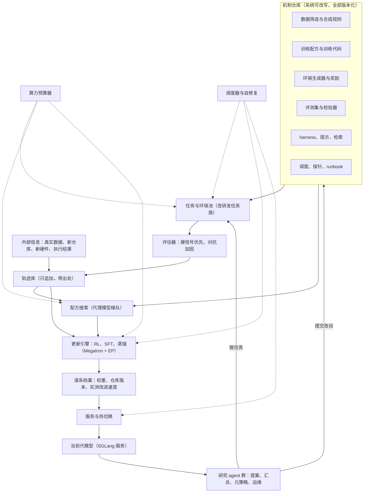

# Ling-3.0-flash 规模的完整 RSI 管线：调研与设计稿

> 2026-11-18 写成。本项目的实验结果取到 `research/REPORT_LOG.md` 14:21 的版本（含"同一配方换种子重训"和"27B 当设计者"两个后续实验）。读了本项目 `research/`、`report/sections/`、`platform/` 下的材料和 Ling-3.0-flash 的官方模型卡、config、建模代码、权重索引，并检索了公开网页。
> 标注约定：〔自报〕= 厂商或论文作者自己公布、没有第三方复核的数字；〔推断〕= 由证据推出的判断，不是任何来源的原话；〔估算〕= 粗算，写出了算式和假设；〔检索摘要〕= 只看到检索工具给出的摘要，没有逐页核对原文。方括号里的编号对应第 7 节。
> 范围：这份稿子只回答"怎样让完整的 RSI 在 124B 总参 / 5.1B 激活的 MoE 上真正跑起来"。按要求不设晋升门槛和通过标准；谁来接手下一代，由第 3.9 节的谱系档案连续决定。
> 这里说的"完整 RSI"取文献里较严的口径：改进机制在系统内部并且可以被系统改写（Tang 等人的判据 [A13]），每一代权重都变，后继模型接手当下一代的改进者。

---

## 1. MoE 训练为什么慢/难与业界做法

### 1.1 Ling-3.0-flash 的参数都在哪里（一手核对）

官方卡片给出的规格〔自报〕：124B 总参、5.1B 激活，35 层 KDA + 7 层 gated MLA（5:1），512 个路由专家 + 1 个共享专家、每 token 激活 8 个，hidden 2560，专家中间维度 768，前 2 层是 dense MLP，256K 上下文，MIT 许可，训练中用了"10,000+ interactive training environments" [P1]。

用 config、建模代码和权重索引可以把参数分布算出来 [P2]：

| 项 | 数值 | 怎么得到的 |
|---|---|---|
| 单个专家的参数 | 5,898,240（约 5.9M） | 三个矩阵 gate / up / down，各 2560×768（`BailingMoeV3MLP`） |
| 主干里的路由专家 | 40 层 × 512 = 20,480 个，共 120.80B | 42 层里前 2 层是 dense（`first_k_dense_replace=2`） |
| 路由专家占 124B 的比例 | 约 97.4% | 120.80 / 124 |
| 权重索引里的专家张量 | 20,992 × 3 = 62,976 个，占全部 63,783 个张量的 98.7% | `model.safetensors.index.json`；20,992 = 41 × 512，多出的 512 个属于 MTP 层 |
| 权重文件总大小 | 254.97 GB，按 BF16 折合 127.49B 参数 | 索引的 `total_size`；比卡片的 124B 多出的部分与 MTP 层的 512 个专家（3.02B）大致对上〔推断〕 |
| 每个 token 走过的专家参数 | (8 + 1) × 40 × 5.9M ≈ 2.12B，约占 5.1B 激活的 42% | 〔估算〕 |
| 专家以外的部分 | 注意力和归一化约 2.5B，embedding 和 lm_head 各 0.40B，dense MLP 0.09B，router 0.05B | 〔估算〕：总数减去各项 |
| 路由方式 | sigmoid 打分；512 个专家分 8 组，先选 4 组，再在选中的 256 个里取 top-8；带 `expert_bias`（无辅助损失的负载均衡）；router 用 fp32 | `BailingMoeV3Gate`、config 的 `n_group=8`、`topk_group=4`、`moe_router_enable_expert_bias=true`、`router_dtype=fp32` |

两个直接后果：模型几乎全部的参数都在 20,480 个很小的专家里；每个专家在每一层只处理 8/512 ≈ 1.6% 的 token。

### 1.2 LoRA / PEFT 放到这种细粒度 MoE 上，难在哪里

**(1) 在专家上，LoRA 不再"省参数"。** 一个专家矩阵只有 2560×768 ≈ 1.97M 个参数。rank 16 的 LoRA 给每个矩阵加 16×(2560+768) = 53,248 个参数，是原矩阵的 2.7%；主干共有 61,440 个专家矩阵，合计 3.27B 个可训练参数〔估算〕。rank 64 时是 13.1B。给每个专家配独立 LoRA，适配器本身就是一个几十亿参数的模型。

**(2) 每个专家拿到的梯度很稀。** 每个专家只见 1.6% 的 token，而且任务越窄，路由越集中：ESFT 在 DeepSeek-V2-Lite（每层 66 个专家、每 token 6 个）上观察到，同一个任务的路由"highly concentrated"在少数专家上 [W13]；本项目对 Flint 的测量里，代码和数学文本的头部专家重叠度与随机相当（0.043 对 0.041）[P5]。Ling 2.0 的技术报告把 MoE 需要更大 batch、更低学习率归因于稀疏的梯度更新 [W12]。几千条轨迹的小数据微调，落到大多数专家上的样本接近于零〔推断〕。

**(3) 显存省不掉。** LoRA 省的是梯度和优化器状态，255 GB 的 BF16 权重照样要全部驻留。官方卡片的推理配置已经是 4 张 141 GB 卡或 8 张 80 GB 卡 [P1]。全参训练的状态（权重 + 梯度 + Adam 两个动量）按每参数 8–14 字节算是 1.0–1.8 TB〔估算：127.49B × 8 或 14 字节〕，必须跨节点，于是要用 expert parallel（EP）。Megatron 文档写明，不做优化时"EP All-to-All can consume 30-40% of training time"，并且"Fine-grained MoE produces many small operations that can underutilize GPU resources" [W5]。

**(4) 朴素实现本身就慢。** Ling 的 Hugging Face 参考实现把每个专家存成独立的 `nn.Linear`，训练前向里用 Python 循环逐个专家做掩码运算（`for i, expert in enumerate(self.experts)`）[P2]。40 层 × 512 个专家，一次前向是 20,480 次小矩阵乘〔估算〕。生产训练栈靠 grouped GEMM（把多个专家的矩阵乘合进一次 kernel 调用）、DeepEP 式的 token 分发和 MoE Parallel Folding 解决这个问题 [W5][W6]；Megatron Core 的技术报告在 GB200 上给出 DeepSeek-V3 1,048 TFLOPS/GPU、Qwen3-235B 919 TFLOPS/GPU〔自报〕[W7]。直接拿 transformers + PEFT 训 Ling，慢的主要原因是这层循环，不是 LoRA。

**(5) 专家 LoRA 的工具链还不成熟。**
- PEFT 从 0.17.0 起可以用 `target_parameters` 直接给 `nn.Parameter` 形式的融合专家权重挂 LoRA，但发布说明写的是"still experimental"，并提醒专家多时显存会高 [W1]。
- VeOmni 的文档区分"每个专家独立 LoRA"和"一层共享一对 LoRA"，并写明 FP8 的 MoE-LoRA 没有实现、eager 后端不支持 EP [W3]。
- Megatron-Bridge 的 LoRA 默认是 `share_expert_adapters=True`，即每个 EP rank 上的本地专家共用一个适配器；它另有一个 `experts_shared_outer_loras` 选项，说明是为了对上 SGLang 的服务约定；导出成 HF 适配器时不带 router 的 bias buffer [W4]。
- vLLM 一侧，新版本有 `FusedMoEWithLoRA`，但融合 MoE 的 LoRA 不支持 expert parallel，对 kernel 后端也有限制；社区里有专家 LoRA 训完后在 vLLM 加载失败的报告〔检索摘要〕[W2]。
- Ling 自己是自定义的 `bailing_hybrid` 结构，卡片要求用专门的 SGLang 镜像或 vLLM 源码版本 [P1]。KDA 层的投影能不能以适配器形式在线加载，没有找到公开说明〔推断：需要自己验证〕。本项目给 Qwen3.5-9B 做 LoRA 时，也因为同样的原因跳过了线性注意力层的投影 [P10]。

**(6) 路由会漂。** 微调数据比预训练窄，路由分布会移动；负载不均既拖慢 EP，也让部分专家得不到训练。公开做法有三种：Ring-1T 在 RL 里固定 router 的 bias [W11]；Router Prior Bias 用一个软约束把 router logits 拉向基座的路由，在 Moonlight-16B-A3B 的数学后训练上得到 45.77，重新加负载均衡损失是 31.91，不加约束是 29.44 [W15]；RL 里另有按 router logits 重新缩放重要性权重的做法 [W16]。Ring-1T 的论文还指出，训练引擎和推理引擎算出的概率不一致这个问题，"is particularly pronounced in the training of MoE models with RL"，原因是动态路由；它的 IcePop 把概率比落在 [0.5, 5] 之外的 token 从梯度里剔除，约占千分之一到二 [W11]。

### 1.3 业界给大 MoE 做后训练，实际怎么做

| 做法 | 谁在用，证据 | 备注 |
|---|---|---|
| **全参继续训练 + Megatron 的 EP** | 本项目逆向：Apex 相对 Qwen3.6-35B-A3B，256 个专家全部被改动 6–21%，router 改了 9%，注意力 7–9%；Naive 相对 MiMo-V2.5，浅层专家几乎没动（<1%），深层专家 6–16% [P5]。Ling 2.0 用 Megatron，并报告整个训练都在 FP8 下完成 [W12] | 大厂自己的模型默认走这条路 |
| **RL 框架都接 Megatron** | verl：DeepSeek-V3 671B 最少 96 张 H20（96 GB），Qwen3-235B-A22B 最少 32 张，前提是把优化器状态全部卸到 CPU（每节点 1.6 TB 内存）；671B 在 96 卡上的一个 RL step 是 1,700 s，其中 rollout 1,050 s，MFU 0.19；Qwen3-30B-A3B 在 8–32 卡上 MFU 0.31–0.40 [W8]。slime：SGLang 做 rollout、Megatron 做训练，用于 GLM-4.5 到 GLM-5 系列 [W9]〔后半句为检索摘要〕。OpenRLHF 走 Ray + vLLM + DeepSpeed，论文称支持 MoE，没有查到 expert parallel〔检索摘要〕[W23] | rollout 占了一个 RL step 的多数时间 |
| **蚂蚁自己的栈** | AReaL（清华 + 蚂蚁）：完全异步的 RL，rollout 不等训练；README 的支持列表里有"Bailing V3 (Megatron only)"，Megatron 后端支持 EP，也支持 LoRA（配 vLLM 推理端），推理端可接 SGLang 或 vLLM，自报相对同步系统 2.77× [W10]。Ring-1T 的 ASystem 由 Hybrid Runtime、AMem、AState、ASandbox、AReaL 组成；AState 自报能在 10 秒内同步万亿参数模型的权重；RL 用 AdamW、学习率 2e-6，推理类 RL 每步 480 个 prompt × 8 条 rollout、最长 65,536 token [W11] | Ling-3.0-flash 的模型类正是 `BailingMoeV3` [P2]，所以这条链路对它是现成的〔推断〕 |
| **只做 LoRA 的托管服务** | Tinker 只提供 LoRA 微调，支持到 Qwen3-235B-A22B 这样的大 MoE〔检索摘要〕[W17] | 说明 LoRA 在大 MoE 上可用；挂在哪些层没有查到 |
| **只调一部分专家** | ESFT：按任务挑出最相关的专家只训它们，router 和其余模块冻结。专项任务 50.2（全参 51.0，LoRA 44.9），通用能力保留 60.6–61.5（全参 58.8，LoRA 59.1），存储 2.57–3.20 GB（全参 28.6 GB），训练 19.8–20.9 分钟（全参 28.5，LoRA 16.5）[W13]。PERFT 把 PEFT 模块接进路由机制 [W14] | 作者自己说这个方法依赖细粒度专家；Ling 的专家更细 |
| **router 的处理** | 固定 bias（Ring-1T）[W11]；软锚定（Router Prior Bias）[W15]；Megatron 建议 router 保持 FP32 [W5] | 完全放开和完全冻结都有代价 |

### 1.4 本项目 9B 实验里的 55 分钟是怎么来的

Qwen3.5-9B 是 dense 模型，55 分钟和 MoE 没有关系。成因在训练脚本里 [P10]：

- 55 分钟是脚本自己设的上限（`LORA_TIME_LIMIT_MIN` 默认 55）。训练要占用一条评测用的 GPU，所以调度上给了它一个固定时段 [P3]。
- 脚本一次只前向一条样本，攒 8 条做一次优化器更新；每条最长 6,144 token；开了 gradient checkpointing；整个 9B 模型以 BF16 放在一张 A100 上。LoRA 不减少前向和大部分反向的计算量。
- 损失只算在最后一条 assistant 消息上，前面几千 token 的上下文照样要算。
- 实测 55 分钟走了约 184 步，即 1,472 条样本，约 2.2 秒一条〔估算：3,300 s / 1,472，含加载和验证〕。模型自己定的配方要 623 条 × 4 轮 = 2,492 条，需要约 93 分钟〔估算〕，所以停在约 2.4 轮 [P3]。

换句话说，那里慢是因为单卡、不组 batch、长上下文加上模型要的训练量超过了时段。到 Ling 上，这些因素还在，另外叠加 1.2 节的六条。

### 1.5 对问题 1 的回答

在 512 专家、激活 8 个的 MoE 上做 LoRA，按每 token 的计算量算并不比全参慢多少；难处在别的地方。97% 的参数在两万个小专家里，专家上的 LoRA 既不省参数也拿不到足够的梯度；255 GB 的权重必须全部驻留；朴素实现要逐个专家循环；专家 LoRA 在训练端（EP）和服务端的支持都还在实验阶段；路由还会随微调漂移。公开的做法是两头走：要快、要能在线挂载时，只在注意力和共享部分上做 LoRA；要真正改模型时，用 Megatron + EP 做全参继续训练或 RL，router 的 bias 固定或软锚定。蚂蚁的 AReaL / ASystem 已经支持 Bailing V3 这个模型类。

---

## 2. 管线总图

### 2.1 一句话

当前这一代 Ling 以研究 agent 的身份工作在一个"机制仓库"上。仓库里放着所有决定"怎么改进"的东西：数据怎么选、配方怎么定、环境和奖励怎么造、评测怎么测、训练代码和调度怎么写。agent 做任务产生轨迹，同时向仓库提交改动；更新引擎按仓库里当前的配方，用轨迹和外部数据训练出下一代权重；下一代被热切换上线，接手同一个仓库继续干。权重、仓库、harness 三样东西每一代都在变。

### 2.2 组件与数据流



数据流按顺序是：

1. 模型做任务 → 评估器给出判定 → 整条轨迹（含失败的、被拒的、非法的）写进轨迹库。
2. 模型提出对仓库的改动（一条新的数据筛选规则、一个新环境、一段训练代码补丁、一个调度修复）→ 在代理模型梯队上试 → 结果连同改动写回仓库和轨迹库。
3. 配方搜索从仓库里取候选配方，从轨迹库里取数据，在小模型上重复训练、测量，把排序交给更新引擎。
4. 更新引擎在 124B 上执行排在前面的配方，产出候选后继；候选进谱系档案。
5. 服务层把候选挂上线，分一部分研究工作给它；它做研究的实际效果又是一条写回档案的测量。
6. 调度器和自修复贯穿全程；每一次故障的现场被做成一个新的环境，回到第 1 步。

### 2.3 节奏分层

```
分钟级   研究循环        小任务、小模型训练、kernel；一次评测几秒到几分钟
           │  产生轨迹和对仓库的小改动
小时级   配方搜索        在同架构小模型上：按配方训练（抽样换种子重训）→ 换上去当改进者测一轮
           │  产出配方排序
日级     124B 轻量候选   注意力层 / 共享部分的 LoRA，以适配器形式挂在同一个基座上，分流研究工作
           │  产出"哪条路值得整合"
周级     124B 全参整合   RL + SFT（Megatron + EP），成为新基座；蒸馏回小模型；环境池换一批
           │
月/季级  预训练与架构    拆成能各自闭合的小环（数据、基础设施、配方），不在本稿细化
```

---

## 3. 各组件设计与启发来源

### 3.0 四条总原则

1. **改进机制放进仓库，仓库归系统改。** 本项目三代固定配方的实验按 Tang 等人的判据只是 GPI：选哪些数据、LoRA 超参、何时换代都由人写死 [P3 H7][A13]。STOP 的作者也说，底层模型不变时"this is not full recursive self-improvement" [A1]；DGM 的归档维护和父代选择是固定的，DGM 自己改不了 [A2]。完整的 RSI 需要把这两头都放开。
2. **每一代都要有外部信息进来。** 用成功记录微调和用失败记录微调出来的模型没有差别（+0.004，p = 0.91）[P3]；Sharpening 的结论是自我训练只能把概率集中到模型已经会的输出上 [A9]。所以主要的更新通道必须带着模型自己没有的信息：环境执行的结果、真实数据、训练实验的实测结果。
3. **被训练的能力就是用来改进的能力。** 研发任务（改训练配方、调 kernel、修基础设施、设计下一次更新）本身进入 RL 环境池，模型在"做研发"这件事上拿奖励。
4. **慢的事情在小模型上先演一遍。** 124B 一代能试的配方数量有限。本项目里两份只差一条筛选阈值的配方，结果相差 0.213，而同一份配方换种子重训只差 0.003；三个设计者都没能事先判断哪一份好 [P3]。配方的好坏只能靠实测，所以配方、环境、调度改动都先在代理模型梯队上大量试，再上大模型。

### 3.1 机制仓库

- **做什么**：一个单一的版本库，目录对应图里的六块。每次改动是一条带类型的提交：改了什么、假设是什么、在哪一层梯队上试过、几个种子、结果多少。
- **关键设计**：
  - 所有隐含上限都写成显式字段（输出 token 上限、训练时限、超时、重启次数）。本项目里 8192 token 的输出上限让 27B 的对照组以返回码 0 "正常"结束，看上去像是大模型不行 [P3 G]。
  - 仓库分两个区。可写区是系统日常改的；锚点区放外部评测题和真实数据的指纹，系统能读分数、能往里加，不能删改已有条目（理由见 3.4）。
  - 改动先以分支存在，在梯队上跑过之后才并入主线；主线永远可回退到任何一代。
- **启发**：Tang 等人把"改进机制是否属于 agent 自身"作为 GPI 和 RSI 的分界 [A13]；DGM 让 agent 改自己的代码库并保留归档 [A2]；A-Evolve-Training 用一个不被覆盖的基底目录、带类型的结果清单和只由元 agent 改写的滚动策略，在 30B 模型上无人介入跑了四轮后训练 [W19]；本项目 H7 的结论 [P3]。

### 3.2 研究 agent 层

- **做什么**：当前代模型加 harness，分四种角色。提案者并行探索不同方向；汇总者把一轮的结果写成固定格式的证据；元策略者只改下一轮的搜索策略；运维者处理故障（3.10）。
- **关键设计**：
  - 每一轮留一个只跑基线的提案者，用来标定噪声。A-Evolve-Training 每轮 8 个 worker 里固定 1 个做基线锚 [W19]；本项目的 A/A 测量给出任务间标准差 0.031 [P3]。
  - 不让模型写自由文本的"经验"。记忆只有两种：结构化的试验账本（假设、改动、结果、重复次数），和负结果登记（试过什么、为什么不行）。检索按任务相似度做。
  - harness 和提示本身在仓库里，可以被改。
  - 设计配方的角色可以比被训练的对象更大：124B 设计，小模型被训练。
- **启发**：9B 自己写的经验笔记让改进速度分从 0.588 降到 0.392，比不看任何记录写出的通用建议还低 [P3]；ExpeL、ACE 的 context collapse 是同一方向的文献证据 [P9]。801-30B 的论文把记录负结果及其原因的"context infrastructure"当作连接各个环的共享记忆，自报五个跨栈诊断用了约一个月 [W20]。Naive 的 NaiveRT 有 151 次试验的账目：63 次采纳、71 次失败或回滚、17 次探索〔自报〕[P6]。harness 可改来自 DGM、AIDE² [A2][A6]。27B 是本项目里唯一在理由中引用反馈表的设计者，但它设计的配方并不更好（0.513，9B 看过反馈后设计的是 0.595，差异不显著）[P3 H9]。会引用证据不等于会设计，所以设计能力要靠 3.7 的外层循环来练，不能指望换一个更大的设计者。

### 3.3 任务与环境生成器

- **做什么**：维持一个不断换新的环境池。起点是 Ling 已有的一万多个交互环境〔自报〕[P1]。
- **关键设计**：
  - **三个来源**。从真实仓库和 PR 自动构造可执行任务；模型自己出题、自己解题，由执行器验证；从系统自己的故障和失败试验里回收。
  - **出题者的奖励看可学性**：太容易和解不出来的题都不给分。
  - **研发任务族是必选项**。分五类：几秒到几分钟的小训练任务（本项目的小任务族那一类）；固定墙钟预算的训练配方改进（NanoChat 那一类）；给小模型做后训练；带逐位一致检查的 kernel 优化；数据排查和基础设施修复。还有一类最关键：**"设计下一次更新"本身是一个环境**，输入是轨迹库摘要和历次配方的实测结果，输出是一份配方，奖励是按这份配方训练出的代理模型的实测表现（3.7）。
  - 每个环境带版本号和"被攻破记录"，进池之前先过 3.4 的对抗加固。
- **启发**：SWE-smith 从 128 个仓库自动合成了 50,000 个任务实例〔检索摘要〕[W21]；801-30B 把 26 万个原始 PR 变成 22 万个可执行任务，经九种 harness 跑出约 200 万条轨迹，过滤后留下 110 万条（超过 1,000 亿 token，约 9.1 万 token 一条）〔自报〕[W20]。Absolute Zero 让同一个模型既出题又解题，7B 和 14B 训练 200 步后仍在提升 [A7]。Naive 自报每周近一千万个沙箱、峰值十万并发 [P6]；Ring-1T 的 ASandbox 自报 100 ms 启动 [W11]。研发任务族的形状来自 Karpathy autoresearch 的固定墙钟预算（把训练变快也算改进）[P9]、PostTrainBench（agent 在单张 H100 上用 10 小时做后训练）[A16]、Apex 的 AI4AI 协议（4 小时探索 + 12 小时重训）[P7]。把"设计更新"做成环境来自 SEAL [A4]。RSIBench-Data 提醒：找到最好版本后继续搜索的运行里，78.26% 最终更差，所以环境要保留检查点、允许回滚 [A17]。

### 3.4 评估器与加固

- **做什么**：给每条轨迹一个可信的判定，并且在搜索变强时跟着变强。
- **关键设计**：
  - **信号分层**。最硬的先用：逐位一致、固定墙钟下的 BPB、隐藏测试。软信号（评分细则、模型裁判）只用在硬信号覆盖不到的地方，裁判用别家的模型。
  - **采纳前换种子复测**。本项目的 NanoChat 运行就是这样做的，72 次尝试里保留 25 次 [P3]。
  - **对抗加固是一个常驻的环**。一组 agent 专门找环境的漏洞，另一组修；新环境先被攻击过再进池。攻击方用上一代模型和别家模型，避免自己查自己。
  - **沙箱**：不能联网、看不到评测数据、诱饵文件被访问就报警。本项目的沙箱做了 12 项隔离检查 [P3]。
  - **静默失效探测**：每条轨迹检查 `finish_reason`、单次试验时长、连续未改代码的回合数、服务路径是否一致。
  - **评测集可以被系统改，但只增不删，并且保留一层系统改不了的外部锚点**（发布时间晚于训练数据的公开题、真实用户任务、人写的校验器）。锚点不是门槛，它的作用是让"评测分"和"真实目标"的偏离能被系统自己看见。
  - **训练和推理要对得上**：同一个 token 在两个引擎里的概率不一致，RL 就悄悄变成 off-policy。做法是 rollout 记录采样时的 logprob，训练端用 IcePop 式的掩码；精度敏感的环节要求逐位一致。
- **启发**：Recursive 在 SOL-ExecBench 上遇到三种作弊（缓存输出、依赖跨次运行的持久状态、钻计时 harness 的空子），结论是评估器也得跟着变强 [P8]。METR 报告 o3 在 RE-Bench 上 30.4% 的运行有 reward hacking [A15]；DGM 有节点删掉检测日志拿到满分 [A2]；STOP 里 GPT-4 在 0.42% 的尝试中关闭了沙箱 [A1]。Hacker-Fixer 环见 [A14]。A-Evolve-Training 第 3 轮内部指标涨到 0.93 而外部榜只有 0.85，系统自己发现后改了搜索策略〔自报〕[W19]；Tang 等人把评价标准是否锚定在系统外作为第二个维度 [A13]；Moser 等人证明有界的代理分数可以一直涨而真实目标在降 [A19]。逐位一致和 on-policy 的关系来自 NaiveRT [P6]；IcePop 来自 Ring-1T [W11]。本项目推理优化的实测补了一条：唯一真正有效的优化（投机解码）过不了逐位一致、只能过容差检查，所以硬度要按环节选，不是越硬越好 [P3 C][P11]。Ling 卡片自己的评测也用别家模型当裁判（GPT-5.4-mini、Gemini-2.5-Pro、Claude Opus 4.6）[P1]。

### 3.5 轨迹库

- **做什么**：所有轨迹的唯一存放处，只追加。
- **关键设计**：
  - 每条记录带：环境版本、模型代号、仓库版本、评估器判定、采样时的 logprob、每层的专家负载统计、`finish_reason`、调用次数和输出长度。
  - 被采纳、被拒绝、非法的轨迹全部留下。失败轨迹有两个用途：给 RL 当负样本；长期当对照数据。
  - 每条数据带出处标签（真实 / 自生成第几代 / 外部教师）。训练集按标签配比，真实数据只累积、不被替换。
  - 行为分布的漂移是一等指标：调用次数、输出长度、思考长度、专家负载的逐代变化。
- **启发**：Gerstgrasser 等人发现累积真实数据可以避免递归训练的坍缩，替换则不行 [A11][A10]。本项目第三代在累积数据的前提下仍然变差（−0.087），说明只靠累积不够，还要有 3.0 第 2 条的外部信息 [P3]。重训练过的模型调用次数变成原始模型的 5–7 倍、每次输出约 50 token，这种变化只有记了行为统计才看得见 [P3]。Mind the Gap 观察到大 k 时 pass@k 随迭代下降，即有效多样性在降 [A8]。Apex、Naive、Flint 的思考风格都来自外部教师 [P5]，所以外部教师的数据要单独打标签，才分得清哪部分提升是自己产生的。本项目平台设计稿已经提出从第一天起按训练数据的规格记录轨迹 [P4]。

### 3.6 更新引擎

- **做什么**：把"配方 + 数据 → 新权重"这一步做成可重复、可并行、带回执的服务。底座用 Megatron + EP，RL 用 AReaL / ASystem 这条已经支持 Bailing V3 的链路 [W10][W11]。
- **三种算子**：
  1. **带可验证奖励的 RL**，主通道。异步 rollout，按 token 预算截断并把没跑完的 rollout 留到下一步续跑，IcePop 掩码，全参更新。
  2. **在验证过的轨迹和真实数据上做 SFT / 继续训练**，辅通道，用来学格式、工具用法和新领域。
  3. **蒸馏**：把 124B 的后继蒸馏到小模型，让代理梯队跟着大模型走；外部教师的蒸馏保留，但在轨迹库里单独标记。
- **在 MoE 上训哪些参数**，这是配方的一部分，由 3.7 去搜，初始选项是：
  - 全参（周级整合的默认）；router 的 bias 固定或软锚定到上一代。
  - 只在注意力、共享专家、dense 层上做 LoRA（日级候选的默认，适配器小、能在线挂载）。
  - 按任务挑专家：只训研发任务上负载最高的那部分专家。
  - 每层共享一对专家 LoRA（训练端和 SGLang 服务端目前对得上的形式 [W4]）。
- **其他设计**：每一批配方里抽一部分换种子重训，用来标定噪声；batch 和学习率按稀疏梯度的要求取（大 batch、低学习率）；训练时限写进配方，由配方自己负责在时限内收敛；每次训练的回执里有逐层专家负载和 router 漂移量。
- **启发**：Sharpening 的分析指出 SFT 式自训练受覆盖限制，带在线探索的 RL 可以绕过这个限制 [A9]；RLVR 一词出自 Tulu 3 [P9]。Yue 等人给了一个边界：k 很大时基座模型的 pass@k 高于 RLVR 之后的模型，即 RLVR 主要是在基座已有的能力范围内提高采样效率 [P9]，所以环境池必须不断换新，不能只在一批固定题上反复做 RL〔推断〕。Spurious Rewards 提醒 RL 的增益也可能只是激发了已有行为（随机奖励 +21.4，真实奖励 +29.1）[A12]，所以 3.7 里常驻一个随机奖励 / 失败轨迹的对照臂。C3PO++（约 2.5× 的 rollout 提速）、IcePop、学习率 2e-6 来自 Ring-1T〔自报〕[W11]。Kimi K2 把可验证奖励和自评细则奖励合在一个 RL 框架里〔检索摘要〕[W22]。MoE 上的四个选项分别来自 Apex 的全参痕迹 [P5]、Ring-1T 和 Router Prior Bias [W11][W15]、ESFT [W13]、Megatron-Bridge [W4]。SEAL 报告连续自我编辑会出现灾难性遗忘 [A4]；Apex 在 LiveCodeBench 上低于基座（82.3 对 84.5）〔自报〕[P7]。本项目的重复训练实验里，同一份配方换种子只差 0.003（0.602 对 0.605）[P3]；那是 9B 上的 LoRA，124B 全参时噪声多大要重新量。同一份数据训得轻一点结果就好一些（0.513 对 0.392）[P3]，所以训练强度要和数据量一起搜。

### 3.7 对"更新本身"的配方搜索

这是整条管线里把"自我训练"变成"递归自我改进"的那一环。

- **搜索对象**：一份 self-edit，内容包括数据筛选规则、各来源配比、用哪个算子、训哪些参数、超参、奖励整形、课程顺序，以及对训练代码的补丁。
- **外层循环**：
  1. 当前代模型读轨迹库摘要和历次配方的实测结果，提出一批配方。
  2. 每份配方在代理模型上训练。改动尽量一次只动一项，并和"不加这条规则"的基线成对比较；每一批抽一部分配方换种子重训，量噪声。
  3. 训练出的代理后继被换上去当改进者，在留出的研发任务上测改进速度。
  4. 测量结果写回，作为下一批提案的输入；同时作为 3.3 里"设计下一次更新"这个环境的奖励，进入 RL。也就是说，模型在"设计自己的训练"这件事上被训练。
- **种群和档案**：配方按谱系存档，可以从任何祖先分叉。选父代时不看它自己的分数，看它这一支后代的实测改进（clade 层面的估计）。
- **常驻的标定臂**：每一批里固定有随机配方、失败轨迹配方、不更新三条臂。它们的用途是告诉搜索"噪声有多大、只多训练一点能带来多少"，不是用来卡谁。
- **反馈要来自留出任务**，而且以结构化表格给出，提示里要求逐项引用。
- **启发**：
  - SEAL：模型生成自己的微调数据和更新指令，经过外层 RL 之后 ARC 子集上是 72.5%，没有外层 RL 只有 20% [A4]。
  - 本项目的四份模型自定配方（原始模型不更新是 0.588）：原始模型盲定的 0.605，换种子重训 0.602；看过一次反馈后重定的 0.595（配方几乎全部反转，训练很轻，模型几乎没变）；由微调后的模型来定的 0.392；由 27B 来定的 0.513；随机配方在 0.50–0.55 [P3]。后两份都加了"只学提升超过 1% 的成功记录"这条看上去合理的规则，结果它有害（第二份也有这条，但训练太轻，看不出影响）。结论有三条：配方里一条小规则就能造成 0.2 的差距，训练噪声只有 0.003；三个设计者都不能事先判断规则的效果，模型更大也没有消除这类错误；所以配方只能靠实测来筛，设计能力要靠外层循环来练。
  - 第一轮配方在训练任务上领先很多（0.652 对 0.525），到留出任务上只剩 +0.017 [P3]，所以反馈不能来自训练任务。
  - HGM：当前分数和"能不能产出更好的后代"只是弱相关（加权 Pearson 0.285–0.444），按 clade 的元生产力选父代更好 [A3]。本项目里第一轮模型一阶分更高，设计出的下一次更新却更差 [P3]。
  - AlphaEvolve：种群式的程序搜索加自动评估器；元提示一起进化；作者说回馈到自身的周期以月计 [A5]。这里用代理梯队把周期压到小时。
  - Promptbreeder：去掉自指的 hyper-mutation 后效果下降，是自指算子有正贡献的小证据 [P9]。
  - DGM 的消融：让 agent 自己改自己，SWE-bench 上是 50.0，不让改是 39.0 [A2]。

### 3.8 代理模型梯队与迁移

- **梯队**：
  - 第 0 级：几秒到几分钟训完的微型模型，用来测"当改进者的速度"。
  - 第 1 级：和 Ling 同架构的小 MoE（同样的 KDA/MLA 配比、同样的路由方式、专家数按比例缩小）。它是"学生改进者"：整条 RSI 循环（收集 → 更新 → 换上去 → 再测）在它身上一天可以跑很多代。
  - 第 2 级：124B 上的 LoRA 候选。
  - 第 3 级：124B 全参。
- **怎么迁移**：
  - 超参按缩放律外推，不照搬。
  - 配方迁移的是**排序**，不是绝对数值。每一代拿少量配方在小模型和 124B 上各跑一遍，算两边排序的相关性；相关性本身记进档案，哪一级代理对哪一类改动有预测力，是系统要学的东西。
  - 每一代把 124B 后继蒸馏回第 1 级，避免学生和老师越走越远。
  - 用"很小的 SFT 之后能涨多少"作为一个模型还有多少可塑空间的代理量。
- **启发**：Ling 2.0 的"风洞实验"用 5 个 500M–8B 的小模型实验预测大模型的最终 loss，自报误差在 0.01 以内，成本约为完整训练的 1%（报告里另有一处写的是不到 1%）；它的超参缩放律来自近一千次实验 [W12]。Flint 的架构是按"was projected to offer the best combination"选的 [P8]。μP 一类的工作说明合适的参数化下超参可以跨宽度迁移（Tensor Programs V，本次没有重新打开原文）[B1]。反面的提醒来自 801-30B：当问题同时牵涉架构、配方、基础设施和数据配比时，"the proxy study needed to settle it becomes as expensive as the run it was meant to de-risk"；它的试跑用来暴露问题，不用来外推分数；SFT 前后模型排序的 Spearman 相关只有 0.438；Tiny-SFT 和 learning aptitude 是它用的可塑性代理 [W20]。所以这里把"迁移相关性"做成被测量的量。本项目平台设计稿已经提出先用小模型当学生改进者做预演 [P4]。Frontis-MA1 把训练后的 35B 模型换进 agent，MLE-Bench Lite 的奖牌率从 39.39% 到 60.61%，是"换进去再测"在一阶上的先例 [A18]。

### 3.9 谱系档案与接手方式

- **做什么**：保存每一代的权重（或适配器）、对应的仓库版本、它当改进者时的全部实测。
- **关键设计**：
  - 不设"通过才能上岗"的关口。研究工作按每条谱系的后验估计分流（类似 Thompson 采样）：表现好的后继自然拿到越来越多的工作，直到成为事实上的主改进者；表现差的自然被饿死，但权重留在档案里，可以再分叉。
  - 分流的依据是 clade 层面的改进速度，不是通用 benchmark 分数。
  - 评测就是工作本身：候选做的是真实的研发任务，产出的轨迹照样进库。
- **启发**：DGM 的归档式开放探索 [A2]；HGM 的 clade 元生产力 [A3]；AIDE² 的 ignition test 把自我改进的产物换到外环改进者的位置（0.780 对 0.782，作者说结论不确定）[A6]。本项目里更大的模型当改进者并不更快（+0.001）[P3]，所以分流不能看通用能力。SICA 观察到早期的坏点子会通过归档拖低后续质量 [P9]，所以档案允许从任何祖先分叉。

### 3.10 服务与热切换

- **做什么**：让一个 255 GB 的后继在不打断研究循环的前提下上线。
- **关键设计**：
  - 日级候选是适配器，挂在同一个基座的同一组服务实例上，按请求切换；周级整合换基座，用引擎的在线权重更新接口，不重启进程。
  - 所有被比较的模型走同一条服务路径。本项目里原始模型不带适配器、后继模型带适配器，这一点混进了它们之间的比较 [P3 H6]。
  - 探针只查自己的后端。本项目 27B 那条链断掉，是因为两个网关互相把对方当上游，`/v1/models` 无限递归，而模型其实 3 分钟就起来了 [P3 G]。
  - rollout 和训练之间的权重同步、前缀缓存的失效，都随代号走；换代时缓存按代号隔离。
  - 思考预算、输出上限跟着模型走，不用全局常数。
- **启发**：SGLang 提供从磁盘、从内存张量、从分布式通信组三种不重启的权重更新方式〔检索摘要〕[W18]；slime 和 SGLang 为 RL 的权重同步、MoE 参数更新和中途打断 rollout 做了专门的补丁，其中打断请求的接口是和 AReaL 团队一起设计的 [W9]；AState 自报 10 秒内同步万亿参数 [W11]；vLLM 的多 LoRA 服务〔检索摘要〕[W2]。Ling 卡片写明它原生接了 SGLang HiCache + Mooncake 的分层缓存，长输入下首 token 延迟降低 60% 到 80% 以上〔自报〕[P1]，对长程研发 rollout 是直接的吞吐收益。

### 3.11 调度与基础设施自修复

本项目通宵实验记录了 12 起故障，1 起自愈，其余都靠人或协调者处理，其中 3 起是协调者自己的操作引入的 [P3 G]。按这些故障的类型来设计：

| 本项目里的故障类型 [P3 G] | 对应设计 |
|---|---|
| 配置缺块，每次试验 0.1 秒就失败，系统照常往下跑 | 不变量监控：试验时长下限、连续失败数、零改动回合数，触发即停线并开工单 |
| 环境变量从别处漏进来，离线找不到模型 | 每个作业自带完整环境声明，启动前自检 |
| 步骤被自己持有的锁卡住；排在后面的组永远拿不到槽 | 用带租期的资源租约代替锁；全局优先级；等待必须带原因码 |
| 调度器自己暂停了资源，看门狗又把等待判成卡死 | 心跳带状态（排队 / 运行 / 被暂停），看门狗只杀没有心跳的 |
| 输出被截断，运行以返回码 0 结束，结论是错的 | 3.4 的静默失效探测；截断率进每份结果的回执 |
| 提示模板里的花括号被当成占位符；演练用的是假动作，没覆盖提示拼装 | 演练必须走真实的提示拼装和解析；仓库里的模板有单元测试 |
| GPU 编号映射错，训练落到别人的卡上 | 资源以句柄发放，作业拿不到裸编号；保留"忙碌 GPU 拒绝启动"这道保护 |
| 重启次数用完，监督进程连同全部子进程退出 | 重启额度是可查询的状态，运维动作先查额度 |
| 两个网关互为上游 | 见 3.10 |

在这之上有三条机制：

1. **运维 agent 是研究 agent 的一个角色**，走"发现 → 归因 → 修复 → 验证"的固定流程。它的动作有白名单（重启步骤、带备份地把步骤重置为待跑、给调度配置提补丁），改调度代码要先在代理集群上跑过。
2. **每一起故障都变成一条回归测试和一个训练环境**（故障现场重放）。修基础设施于是成了被训练的能力的一部分，下一代运维 agent 比上一代见过更多故障。
3. **在代理梯队上做故障演练**：定期注入已知类型的故障，看系统能不能自己恢复。

- **启发**：801-30B 把预训练拆出的第一个环就是基础设施排障环（detect, attribute, fix, verify），由 agent 把异常的内部指标（MoE 的 MaxVio、梯度和权重范数的趋势）追到基础设施代码或配方设置；它还让 agent 维护九种 harness 的集成，理由是"manual maintenance becomes unsustainable" [W20]。Naive 的训练系统一节有 AI 发现问题、提出方案、独立验证的例子（SWA Halo Sequence Parallel）[P6]。A-Evolve-Training 用只追加的执行记录做崩溃后的恢复源 [W19]。本项目 G 节的观察：最危险的是"静默的错误结论" [P3]。

### 3.12 算力预算器

- **做什么**：在四层节奏和各个环之间分 GPU。
- **关键设计**：
  - 先记账。每一类活动占了多少 GPU 小时、带来了多少实测改进，按环统计。
  - 优先加速占时间最多的环节。评测和 rollout 的吞吐排第一。
  - 试验用 racing：多个候选先跑短预算，差的提前停。
  - 分配规则本身是仓库里的一段策略，元策略者可以改。
- **启发**：本项目里 agent 时间的约 85% 花在评测上，思考只占约 15% [P3]。agent 推理快 2 倍，循环只快约 6%〔推断〕；被评测的训练快 2 倍，循环接近快 2 倍 [P3 H2]。Apex 的 AI4AI 里，把去噪步数从 50 降到 20 让单次试验从 1,040 s 降到 551 s，分数基本不变 [P7]，是"用更便宜的评测换更多迭代"的例子。verl 的基准里 rollout 占一个 RL step 的 1,050 / 1,700 [W8]。NaiveRT 关心单流解码速度，是因为最长的 rollout 会拖住同步 RL 或在异步 RL 里超时被丢 [P6]。AlphaEvolve 给 Gemini 训练省下 1% 的总时间 [A5]。Epoch 和 Forethought 的 r 把"每单位研发投入换来多少效率"作为会不会加速的参数 [P9]；预算器记的账就是它在这条管线里的在线估计〔推断〕。

### 3.13 一张表：组件 → 关键选择 → 启发

| 组件 | 关键设计选择 | 本项目的发现 | 文献与工业实践 |
|---|---|---|---|
| 机制仓库 | 数据、配方、环境、评测、训练代码、调度全部进库，系统可改 | 固定配方三代不算 RSI（H7） | Tang 等人；DGM；A-Evolve-Training |
| 研究 agent | 四种角色；留一个基线锚；结构化账本代替自由文本经验 | 经验笔记 −0.196；27B 引用了反馈但配方不更好 | NaiveRT 试验账目；801-30B 的 context infrastructure；ExpeL、ACE |
| 环境生成器 | 真实仓库 + 自出题 + 故障回收；研发任务族；"设计更新"是一个环境 | 小任务族和 NanoChat 的做法可直接放大 | Ling 的一万多个环境；SWE-smith；Absolute Zero；PostTrainBench；Apex AI4AI；SEAL |
| 评估器 | 硬信号优先；对抗加固常驻；外部锚点；训练推理一致 | 沙箱 12 项检查；静默截断；投机解码过不了逐位一致 | Recursive 的审计；METR；Hacker-Fixer；NaiveRT；IcePop；A-Evolve 的指标脱钩 |
| 轨迹库 | 只追加；带出处；失败轨迹保留；记行为统计 | 成功 ≈ 失败轨迹；行为漂成很多次短调用；第三代变差 | Gerstgrasser；Shumailov；Mind the Gap |
| 更新引擎 | RL 为主、SFT 为辅；全参 + EP 做整合，注意力 LoRA 做候选；router 软锚定 | 55 分钟上限；同一份数据训得轻一点更好（0.513 对 0.392） | AReaL / ASystem；Megatron；ESFT；Router Prior Bias；Apex 全参痕迹 |
| 配方搜索 | self-edit + 外层 RL；单因素实测；常驻标定臂；按 clade 选父代 | 四份自定配方 0.39–0.61；换种子只差 0.003 | SEAL；HGM；AlphaEvolve；DGM 消融；Promptbreeder |
| 代理梯队 | 同架构小 MoE 当学生改进者；迁移排序并测量相关性 | 平台设计稿 §7 的预演建议 | Ling 风洞实验；801-30B 的反面提醒；Flint 的 projected |
| 谱系档案 | 不设关口，按后验分流；可从任何祖先分叉 | 更大的模型不更会改进（+0.001） | DGM；HGM；AIDE² ignition test；SICA |
| 服务热切换 | 候选是适配器；同一服务路径；在线换权重 | 服务路径混杂；探针递归 | SGLang RL 接口；slime；AState；HiCache |
| 自修复 | 故障变环境；运维 agent；不变量监控 | 12 起故障的类型表 | 801-30B 的排障环；Naive 训练系统 |
| 预算器 | 先加速评测；racing；分配规则可改 | 评测占 85% | Apex 的预算再分配；verl 的 step 构成；r |

---

## 4. 节奏与算力〔估算〕

这一节全部是粗算。每个数字后面写了算式和假设；假设不成立时按比例改即可。

### 4.1 单位成本

**训练每 token 的计算量**：按 6 × 激活参数的经验式，6 × 5.1B = 3.06×10¹⁰ FLOPs / token。

**每 10 亿训练 token 的 GPU 小时**，两个锚点：

- 锚点 A：Megatron Core 报告 DeepSeek-V3 在 GB200 上 1,048 TFLOPS/GPU〔自报〕[W7]。3.06×10¹⁹ / 1.048×10¹⁵ ≈ 29,200 s ≈ **8.1 GPU 小时**。
- 锚点 B：Naive 自报 512 张 GPU 约 4 天处理 1T token（15.5B 激活，1M 上下文，GPU 型号未披露）[P6]，即 49,152 GPU 小时 / 1T。按激活参数比例 5.1 / 15.5 折算，≈ 16,170 GPU 小时 / 1T，即 **16.2 GPU 小时**。

两个锚点差一倍，取 **8–16 GPU 小时 / 10 亿 token** 作为 SFT / 继续训练的范围。RL 训练的利用率更低：verl 里 DeepSeek-671B 的 RL 是 MFU 0.19，Qwen3-30B-A3B 是 0.31–0.40 [W8]，粗略按再乘 2，取 **16–32 GPU 小时 / 10 亿 token**。Ling 的专家比 DeepSeek-V3 更细，Megatron 文档说细粒度 MoE 的小运算容易吃不满 GPU [W5]，实际可能更差，这一项没有公开数字。

**同架构小模型**：若取激活 0.75B 的规模（Ring-mini-2.0 是 16.8B 总参、0.75B 激活 [W11]），同样的算式是 1.2–2.4 GPU 小时 / 10 亿 token，RL 取 2.4–4.8。

**显存下限**：全参训练的状态 1.0–1.8 TB（1.2 节）。按 80 GB 卡留 56 GB 给状态算，至少 18–32 张卡只用来放状态〔估算〕。verl 给的参照是 Qwen3-235B-A22B 在把优化器卸到 CPU 时最少 32 张 96 GB 卡 [W8]；Ling 的总参约为它的一半。实际起步规模按 32–64 张卡考虑。LoRA 候选的训练和推理一样，8 张 80 GB 卡或 4 张 141 GB 卡起步 [P1]。

**rollout**：没有 Ling 的公开吞吐数字。用一个参数 θ 表示每张 GPU 的聚合解码吞吐（token/s）。Naive 自报常规解码每条流 50–100 token/s [P6]；假设一个 4–8 卡的服务节点同时带 16–64 条流，θ 大约在 100–1,600 之间，下面取 500–2,000 做中间情形。这是本节最不确定的一个量。

### 4.2 一代（周级整合）的预算

| 项 | 假设 | 算式 | GPU 小时 |
|---|---|---|---|
| (a) 小模型上的配方搜索 | 48 次训练（例如 40 份配方各 1 次，另抽 4 份各多训 2 次量噪声），每次 5 亿 token 的 RL | 48 × 0.5 × (2.4–4.8) | 58–115 |
| (a') 小模型后继当改进者的测量 | 48 个后继，每个约 1 GPU 小时的推理（小任务的评测本身在 CPU 上）| 48 × 1 | 约 50 |
| (b) 124B 的日级 LoRA 候选 | 每天 4 个，7 天，每次 10 亿 token，按 SFT 费率 | 28 × (8–16) | 224–448 |
| (c) 生成这一代的 rollout | 10 万条轨迹，每条模型生成 1 万 token（假设）；θ = 500–2,000 | 10⁹ / (3600 × θ) | 139–556 |
| (c') rollout 的 prefill | 每条 9.1 万 token（取 801-30B 的平均长度 [W20]），前向约为训练的三分之一 | 9.1 × (8–16) / 3 | 24–49 |
| (d) 124B 全参整合 | 200 亿 token 的 RL + SFT（介于 801-30B 的轻量 SFT 60 亿和它的 agentic 语料 1,340 亿之间 [W20]），2 次重复 | 2 × 20 × (16–32) | 640–1,280 |
| (e) 候选当改进者的实测 | 4 条臂 × 32 个留出研发任务 × 5 个种子 × 12 次尝试，每次评测 5 分钟 GPU | 7,680 × 5 / 60 | 640 |
| (e') 上一项里 agent 自己的推理 | 按本项目思考 : 评测 ≈ 15 : 85 [P3] | 640 × 15 / 85 | 约 113 |
| 对抗加固、故障演练 | 按以上合计的 10% | | 190–325 |
| **合计** | | | **约 2,100–3,600** |

读法：

- 一代大约是 **2,000–4,000 GPU 小时**的量级。128 张卡、利用率 50% 时是 1.3–2.6 天〔估算：2,000 / 64 ≈ 31 小时，4,000 / 64 ≈ 63 小时〕。所以按 FLOPs 算，124B-A5B 做到一周一代是可行的；平台设计稿里"一代要按天或周计" [P4] 的判断成立，偏向"天"的一端。
- 这是因为按激活参数算，Ling 每 token 的训练成本接近一个 5B 的 dense 模型；真正随 124B 走的是显存（决定最小集群）和权重同步。
- 训练（a + b + d）约 920–1,840，rollout 和评测（a' + c + c' + e + e'）约 970–1,410，大致各占一半。本项目 9B 实验里评测占 85%，是因为那里权重更新只占很小一块。
- 最容易把预算放大的三件事：要试的配方数量（这里只算了 48 次小模型训练和 2 次 124B 整合；配方空间崎岖时这一项成倍增加）；θ 比假设低；256K 长上下文下的吞吐下降。三者都没有公开数字可查。
- 参照：A-Evolve-Training 在 30B 模型上的四轮后训练跨了数周，用的是多张 H200 的集群，没有披露 GPU 小时 [W19]。

### 4.3 各层的周转时间

| 层 | 一次周转 | 一周能做多少次〔估算〕 | 限制它的是什么 |
|---|---|---|---|
| 分钟级研究循环 | 5–10 分钟（一次评测） | 每条评测线约 1,000–2,000 次（10,080 分钟 ÷ 5–10 分钟） | 评测 GPU 数 |
| 小时级配方搜索 | 1–3 小时一批（训练 + 换上去测） | 约 56–168 批（168 小时 ÷ 1–3 小时） | 小模型训练和测量的并行度 |
| 日级 LoRA 候选 | 10 亿 token ÷ 32 卡 ≈ 15–30 分钟训练，加上线分流一天 | 约 28 个候选 | 分流给每个候选的研究工作量 |
| 周级全参整合 | 200 亿 token ÷ 64 卡 ≈ 5–10 小时训练，加 rollout 和测量 | 1 代 | 测量要够准，工程可靠性 |

日级训练时间的算式：10 亿 token × (8–16) GPU 小时 ÷ 32 卡 = 0.25–0.5 小时。周级：20 × (16–32) ÷ 64 = 5–10 小时。

---

## 5. 从本项目实验得到的具体启发

本项目的实验是在 dense 的 Qwen3.5-9B 上做的，规模和 Ling 差两个数量级。下面只取那些不依赖规模的教训 [P3]。

| 本项目的发现 | 数字 | 对管线的直接后果 |
|---|---|---|
| 固定的改进者能带来真实的一阶提升 | NanoChat 的 val_bpb 从 1.4152 到 1.2308，72 次尝试，保留 25 次 | 研究循环本身是成立的，可以直接作为环境池里的研发任务族和轨迹来源 |
| 时间花在评测上 | 评测约 85%，思考约 15% | 预算器先投评测吞吐；推理加速对循环的贡献有限；kernel 和训练提速的任务优先进环境池 |
| 自己写的经验有害 | 0.588 → 0.392；比通用建议还低 0.239，8 个任务全为负 | 不做自由文本经验；只留结构化账本、负结果登记和验证过的可执行产物 |
| 成功轨迹和失败轨迹训出来一样 | +0.004，p = 0.91 | 自己轨迹上的 SFT 不当主通道；主通道用带验证器的 RL 和真实数据；失败轨迹臂常驻，用来标定 |
| 重训练改变的是行为格式 | 调用次数 5–7 倍，输出中位数约 50 token | 轨迹库记行为统计；更新回执里报告漂移；配方里的强度参数是搜索对象 |
| 三代固定配方没有复利，第三代更差 | 0.588 → 0.537 → 0.573 → 0.487 | 每代必须有新的外部信息；档案保留所有祖先；后继不一定从上一代分叉 |
| 模型自己定配方，没有一份明显超过不更新 | 四份配方 0.605、0.595、0.392、0.513；随机配方 0.50–0.55；原始模型 0.588 | 配方设计要有外层循环和专门训练 |
| 训练噪声小，配方差异大 | 同一配方换种子：0.602 对 0.605；只多一条 1% 阈值：0.392 | 预算投在"多试配方、单因素对比"上；重复训练只用来标定噪声 |
| 看上去合理的筛选规则有害 | "只学显著提升"出现在两个设计者的配方里（0.392、0.513）；经验笔记里的"忽略任何让损失变差的改动"是同一类 | 新的筛选规则一律和"不筛"成对实测；默认保留小步改动的轨迹 |
| 设计者不能事先判断规则的效果 | 9B 两次都没引用反馈表；27B 引用了，配方仍不更好（0.513 对 0.595） | 反馈用结构化表格；不指望更大的设计者；设计能力本身进 RL |
| 训练任务上的领先到留出任务上消失 | 0.652 对 0.525 → +0.017 | 反馈和奖励只来自留出任务 |
| 更大的模型不更会改进 | 27B 对 9B：+0.001 | 档案按实测的改进速度分流，不看通用分数 |
| 任务间差异远大于种子间差异 | 模型间差值在任务上从 −0.58 到 +0.35；A/A 标准差 0.031 | 测量靠多任务，不靠多种子；环境池要大、要多样 |
| 训练时限把配方截断 | 55 分钟停在约 2.4 轮 | 时限写进配方；训练服务按 token 预算报价，配方自己负责收敛 |
| 隐含上限造成静默的错误结论 | 8192 token 上限下 48 次调用有 8 次被截断，运行返回码 0 | 所有上限显式化；静默失效探测；上限随模型走 |
| 服务路径不一致 | 原始模型不走适配器路径 | 所有臂走同一条服务路径 |
| 12 起故障，1 起自愈 | G 节 | 3.11 的全部设计 |
| 3 次重复分不出差异 | 续跑实验每组 3 次，最小可能的 p 是 0.10 | 预算表里把重复次数算进去；小模型梯队承担大部分重复 |

三家工业材料和逆向结果补了另外三条 [P5][P6][P7][P8]：

- Apex 和 Naive 都是在别人的基座上做全参继续训练，Flint、Apex、Naive 的思考风格都来自外部教师。目前公开的"RSI"产物里，更新信号主要来自外部。这条管线把外部教师保留为一个带标签的信息源，让自己产生的部分可以被单独量出来。
- Apex 的"self-evolving data"（失败 → 分析缺口 → 合成并验证新样本 → 进入后续训练）是 3.3 第三个来源的原型，但它的 +32.1 分是在同一个内部评测上量的〔自报〕，所以这里要求合成数据和评测题分开留出。
- NaiveRT 的接受准则是只看真实模型路径上的端到端变化，微基准更快不算。3.4 的评估器按这条来。

---

## 6. 风险与未解决问题

1. **权重层面的复利没有公开先例。** 文献里自我训练两三轮就饱和，改写自身的系统都冻结了底层模型 [P9]；本项目三代没有加速 [P3]。这条管线押的是"带新环境的 RL + 对更新本身的搜索"能持续带入外部信息，这一点没有被验证过。Davidson 和 Houlden 的模型预测逼近上限时回报会回落 [P9]。
2. **小模型到 124B 的迁移可能不成立。** 801-30B 的经验是耦合问题上代理实验和正式训练一样贵，SFT 前后排序的相关只有 0.438 [W20]。如果测出来的相关性很低，小时级那一层就只能用来查错，配方搜索要搬到 124B 的 LoRA 层，成本上升一个量级以上。
3. **评测可改之后的目标漂移。** 系统能改评测，就能把评测改得更容易。外部锚点能让偏离被看见，但不能保证系统朝正确方向修正。A-Evolve-Training 的系统自己纠正了一次 [W19]，那是单次未重复的运行。
4. **自由度越大，作弊越多。** 小任务族用 JSON 配置时几乎没有作弊面；放开改代码之后作弊是常态 [P4][A15]。对抗加固要长期占一块固定预算。当攻击方和防守方是同一个模型的不同代时，两边可能有共同的盲区。
5. **MoE 特有的问题。**
   - 路由漂移逐代累积。每代软锚定到上一代，漂移仍会叠加；锚定到最初的基座又限制适应。
   - 窄任务上的 RL 让少数专家过度使用、多数专家闲置；没有查到跨多代后训练的专家负载数据。
   - 专家 LoRA 目前不能可靠地在线挂载，日级候选只能动注意力和共享部分，表达力可能不够。
   - KDA 层的适配器支持、FP8 路径下的训练推理一致性，都要自己验证。
   - 512 个专家、中间维度 768 的训练 MFU 没有公开数字，第 4 节的成本可能偏乐观。
6. **配方空间很崎岖。** 本项目里同一份配方换种子只差 0.003，多加一条 1% 的筛选阈值却差 0.21，三个设计者都没有预见到 [P3]。搜索因此要靠大量实测，小模型梯队上的结论能不能迁移（第 2 条）就更关键。124B 全参、小学习率下的训练噪声多大也还不知道。
7. **逐代遗忘。** SEAL 的连续自我编辑有灾难性遗忘 [A4]；Apex 在 LiveCodeBench 上低于基座 [P7]。研发能力上去而通用能力下来，对一个要对外服务的模型不可接受；研发专用的分支和通用的主线是否要分开，没有结论。
8. **长程信用分配。** "设计一次更新"的奖励要等训练和测量做完，小时到天级。奖励稀、延迟长，RL 能不能学到是开放问题；SEAL 只在小规模上做过两轮 [A4]。
9. **自修复的边界。** 有权改调度的 agent 自己会制造故障，本项目里协调者引入了 3 起 [P3 G]。动作白名单和代理集群上的预演能降低概率，但运维 agent 误判"静默的错误结论"时没有第二道检查。
10. **去掉人工关口的代价。** 按要求本设计没有晋升门槛。这意味着一个在研发任务上更快、但在别处有问题的后继会自然拿到越来越多的工作。外部锚点、行为漂移统计和可回退的档案是仅有的缓冲；人在这里的角色只剩下看这些量。这是一个明确的取舍，是否接受要由使用方决定。
11. **二阶效应仍然难测。** 一周一代，一个季度约十几代。任务间方差大 [P3]，每代要几十个留出研发任务才能看清代际差异；这些任务会被用掉，环境生成器能不能持续供给同分布的新题，没有验证过。

---

## 7. 参考来源（URL）

### 7.1 本项目内的材料

| 编号 | 文件 | 对应的公开来源 |
|---|---|---|
| P1 | `other/hf/inclusionAI__Ling-3.0-flash/files/README.md` | https://huggingface.co/inclusionAI/Ling-3.0-flash |
| P2 | 同目录的 `config.json`、`modeling_bailing_moe_v3.py`、`model.safetensors.index.json` | 同上 |
| P3 | `research/REPORT_LOG.md`（E 实验、G 故障、H 讨论；正文里 P3 后面的字母和编号指小节）；`report/sections/04_experiment.md` | — |
| P4 | `research/platform_design.md` §7 | — |
| P5 | `research/model_dissection_apex_naive.md`、`research/flint_dissection.md`、`research/flint_reverse_engineering.md` | — |
| P6 | `research/sources/naive_research.md`、`research/reading/02_Naive_N0.5_导读.md` | https://naive.ai/en/research/ |
| P7 | `research/sources/apex_35b.md`、`research/reading/04_Apex35B_导读.md` | https://www.apexin.com/apex-35b/ |
| P8 | `research/sources/recursive_first_steps.md`、`research/sources/recursive_flint.md` | https://recursive.com/updates/first-steps-toward-automated-ai-research ；https://recursive.com/updates/introducing-recursive-flint |
| P9 | `research/lit_rsi_academic.md`、`research/lit_rsi/01_theory.md`、`02_methods.md`、`03_measurement.md`、`research/lit_signal_hardness.md`、`report/sections/05_literature.md` | 各条目的 URL 在这些文件里 |
| P10 | `platform/rsi/update/lora_train.py`、`platform/bundle/lora_train.sh` | — |
| P11 | `research/rec_optimization_analysis.md` | — |

### 7.2 本次检索打开的网页

| 编号 | 来源 | URL | 读到的程度 |
|---|---|---|---|
| W1 | PEFT v0.17.0 发布说明 | https://github.com/huggingface/peft/releases/tag/v0.17.0 | 打开 |
| W2 | vLLM 论坛、API 文档、多 LoRA 博客 | https://discuss.vllm.ai/t/do-the-current-moe-models-support-setting-lora-adapters-on-expert-layers/1726 ；https://docs.vllm.ai/en/v0.20.2/api/vllm/lora/layers/fused_moe/ ；https://vllm.ai/blog/2026-02-26-multi-lora | 检索摘要 |
| W3 | VeOmni LoRA 文档 | https://veomni.readthedocs.io/en/latest/key_features/lora.html | 打开 |
| W4 | NVIDIA Megatron-Bridge PEFT 文档 | https://docs.nvidia.com/nemo/megatron-bridge/nightly/training/peft.html | 打开 |
| W5 | Megatron Core MoE 文档 | https://docs.nvidia.com/megatron-core/developer-guide/0.17.1/user-guide/features/moe.html | 打开 |
| W6 | MoE Parallel Folding | https://arxiv.org/abs/2504.14960 | 摘要页 |
| W7 | Scalable Training of Mixture-of-Experts Models with Megatron Core | https://arxiv.org/abs/2603.07685 | 摘要页 |
| W8 | verl：Training DeepSeek 671b | https://verl.readthedocs.io/en/latest/perf/dpsk.html | 打开 |
| W9 | slime（LMSYS 博客） | https://www.lmsys.org/blog/2025-07-09-slime | 打开 |
| W10 | AReaL 仓库与论文 | https://github.com/inclusionAI/AReaL ；https://arxiv.org/abs/2505.24298 | 仓库 README 打开；论文为检索摘要 |
| W11 | Ring-1T 论文 | https://arxiv.org/abs/2510.18855 | HTML 前约 10 万字符 |
| W12 | Ling 2.0 技术报告 | https://arxiv.org/abs/2510.22115 | HTML 前约 10 万字符 |
| W13 | ESFT | https://arxiv.org/abs/2407.01906 | HTML |
| W14 | PERFT | https://arxiv.org/abs/2411.08212 | 摘要页 |
| W15 | Router Prior Bias（Findings of EMNLP 2026） | https://aclanthology.org/2026.findings-emnlp.2339/ | 摘要页 |
| W16 | Towards Stable and Effective Reinforcement Learning for Mixture-of-Experts | https://arxiv.org/abs/2510.23027 | 摘要页 |
| W17 | Tinker | https://tinker-docs.thinkingmachines.ai/ ；https://thinkingmachines.ai/blog/announcing-tinker/ | 检索摘要 |
| W18 | SGLang for RL | https://docs.sglang.io/docs/advanced_features/sglang_for_rl | 检索摘要 |
| W19 | A-Evolve-Training | https://arxiv.org/abs/2606.20657 | 摘要页 + HTML |
| W20 | No Second Run: Does RSI Stop at Frontier Pre-training?（801-30B） | https://arxiv.org/abs/2611.10719 | 摘要页 + HTML 前约 10 万字符 |
| W21 | SWE-smith | https://arxiv.org/abs/2504.21798 | 检索摘要 |
| W22 | Kimi K2 技术报告 | https://arxiv.org/abs/2507.20534 | 检索摘要 |
| W23 | OpenRLHF | https://arxiv.org/abs/2405.11143 | 检索摘要 |
| W24 | Ling-3.0-Flash 发布的媒体报道（只用来确认没有公开的 RL 细节） | https://developer.aliyun.com/article/1751301 | 检索摘要 |

### 7.3 文献（URL 取自本项目的文献账本 P9，数字以账本里核对过的为准）

| 编号 | 文献 | URL |
|---|---|---|
| A1 | STOP（Zelikman 等，2023） | https://arxiv.org/abs/2310.02304 |
| A2 | Darwin Gödel Machine（Zhang 等，2025） | https://arxiv.org/abs/2505.22954 |
| A3 | Huxley-Gödel Machine（Wang 等，2025） | https://arxiv.org/abs/2510.21614 |
| A4 | SEAL（Zweiger 等，2025） | https://arxiv.org/abs/2506.10943 |
| A5 | AlphaEvolve（Novikov 等，2025） | https://arxiv.org/abs/2506.13131 |
| A6 | AIDE²（Srikanth 等，2026） | https://arxiv.org/abs/2609.26457 |
| A7 | Absolute Zero（Zhao 等，2025） | https://arxiv.org/abs/2505.03335 |
| A8 | Mind the Gap（Song 等，2024） | https://arxiv.org/abs/2412.02674 |
| A9 | Sharpening（Huang 等，2024） | https://arxiv.org/abs/2412.01951 |
| A10 | Shumailov 等（The Curse of Recursion） | https://arxiv.org/abs/2305.17493 |
| A11 | Gerstgrasser 等（Is Model Collapse Inevitable?） | https://arxiv.org/abs/2404.01413 |
| A12 | Spurious Rewards（Shao 等，2025） | https://arxiv.org/abs/2506.10947 |
| A13 | Tang 等，Generalized Agent Iteration（2026） | https://arxiv.org/abs/2609.13406 |
| A14 | Hardening Agent Benchmarks with Adversarial Hacker-Fixer Loops（2026） | https://arxiv.org/abs/2606.08960 |
| A15 | METR，Recent Frontier Models Are Reward Hacking（2025） | https://metr.org/blog/2025-06-05-recent-reward-hacking/ |
| A16 | PostTrainBench（2026） | https://arxiv.org/abs/2603.08640 |
| A17 | RSIBench-Data（2026） | https://arxiv.org/abs/2607.25886 |
| A18 | Frontis-MA1（2026） | https://arxiv.org/abs/2607.28568 |
| A19 | Moser 等（2026） | https://alphaxiv.org/abs/2610.21646v1 |

### 7.4 只凭背景知识提到、本次没有打开原文的

| 编号 | 文献 | 说明 |
|---|---|---|
| B1 | Tensor Programs V: Tuning Large Neural Networks via Zero-Shot Hyperparameter Transfer（arXiv 2203.03466） | 只用来说明"超参可以跨宽度迁移"这个方向，没有引用其中的数字；引用前请核对 |
| B2 | Ling Scaling Laws（模型卡检索摘要给出的编号是 arXiv 2507.17702） | 本稿关于风洞实验的数字全部取自 W12，没有用这篇 |

### 7.5 没有查到的

- Ling-3.0-flash 的 RL 算法、奖励设计、环境构造方法、训练用的 GPU 规模：官方卡片和媒体报道都只有"10,000+ interactive training environments"一句 [P1][W24]。
- 512 专家、中间维度 768 这种粒度的 MoE 的训练 MFU。
- Ling-3.0-flash 在 SGLang / vLLM 上的批量解码吞吐。
- KDA 层的 LoRA 在推理引擎里的支持情况。
